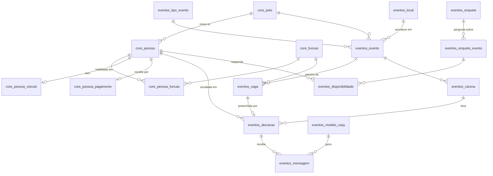

# Modelo de dados inicial — banco `pessoas` (v0.1)

> **Superado em 22/10/2026:** o schema real está em `src/core/db/schema/eventos/` e nas migrations de
> `src/core/db/migrations/` (aplicadas no `iam-pessoas`). Este documento fica como histórico do raciocínio.

> **Atenção (22/10/2026):** com a ADR 0001 v3 (GH e Eventos em repos separados, um Supabase), o schema `core` abaixo
> não será criado: o Eventos usa o `core` do GH-System (`pessoa`, `vinculo`, `polo`, `cargo`, `usuario/perfil`,
> `sensivel.*`). O que só o Eventos precisa da pessoa (veículo, funções habilitadas, geolocalização, camiseta,
> `iam_control_user_id`) vai para tabelas do schema `eventos` ligadas a `core.pessoa` (regra 4 da ADR). O schema
> `eventos` continua valendo e adota `evento/escala/convocacao/presenca` (regra 5). Revisão do modelo na v0.2.

> Segue a [ADR 0001](adr/0001-banco-pessoas-gh-eventos.md). Rascunho para discussão, ainda não é migration.
> Escopo detalhado: `core` + `eventos` da **fase 1** (cadastro, calendário, escala, aprovação, copys).
> As fases seguintes aparecem só como lista de tabelas, no fim.

## Convenções

- Postgres 17, identificadores em minúsculas com `_`, schemas por módulo (`core`, `eventos`, `rh`, `auditoria`).
- PK `uuid` (`gen_random_uuid()`) nas entidades expostas na API ou referenciadas entre sistemas;
  `bigint generated always as identity` nas tabelas internas de alto volume.
- `timestamptz` sempre; `text` em vez de `varchar(n)`, com `check` quando houver limite.
- Domínios fechados com `check (... in (...))` em vez de `enum`, que é mais fácil de evoluir.
- **Toda FK tem índice.**
- `criado_em`, `atualizado_em` em todas as tabelas; `criado_por` (pessoa_id) onde a autoria importa.
- Dado sensível (CPF, chave PIX) **criptografado na aplicação** (`bytea`) + coluna de busca por hash
  (`cpf_hash`), nunca em texto puro.

## Diagrama (fase 1)



## DDL — schema `core` (dono: GH)

```sql
create schema core;

create table core.polo (
  id          smallint generated always as identity primary key,
  sigla       text not null unique check (sigla ~ '^[A-Z]{2,4}$'),   -- AM, LON, POA, VIX, BC, GYN, CUR, BH, FOR
  nome        text not null,
  cidade      text not null,
  uf          char(2) not null,
  ativo       boolean not null default true,
  criado_em   timestamptz not null default now()
);

create table core.pessoa (
  id                    uuid primary key default gen_random_uuid(),
  iam_control_user_id   bigint unique,                 -- conta (login) no IAM Control
  iam_control_aluno_id  bigint,                        -- quando também é aluno
  nome                  text not null,
  apelido               text,                          -- como aparece na escala ("Joãozinho")
  email                 text not null unique,
  telefone_e164         text check (telefone_e164 ~ '^\+[1-9][0-9]{7,14}$'),
  cpf_cifrado           bytea,
  cpf_hash              bytea unique,                  -- busca/deduplicação sem expor o CPF
  sexo                  text check (sexo in ('F','M')),          -- define quarto e pai/mãe no Confronto
  data_nascimento       date,
  polo_id               smallint references core.polo(id),
  cep                   text, logradouro text, numero text, complemento text,
  bairro                text, cidade text, uf char(2),
  lat                   double precision, lng double precision,  -- geocodificado no cadastro (distância e caronas)
  camiseta_modelo       text check (camiseta_modelo in ('camiseta','baby_look')),
  camiseta_tamanho      text check (camiseta_tamanho in ('PP','P','M','G','GG','XG')),
  possui_camiseta       boolean,
  fez_confronto         boolean,
  tem_cnpj              boolean,
  tipo_vinculo          text not null default 'staff'
                        check (tipo_vinculo in ('staff','administrativo','palestrante','terceiro')),
  status                text not null default 'ativo' check (status in ('ativo','inativo','pendente')),
  cadastro_revisado_em  timestamptz,                   -- pede revisão periódica ao próprio staff
  criado_em             timestamptz not null default now(),
  atualizado_em         timestamptz not null default now()
);
create index on core.pessoa (polo_id);
create index on core.pessoa (iam_control_aluno_id) where iam_control_aluno_id is not null;

create table core.funcao (
  id          smallint generated always as identity primary key,
  codigo      text not null unique,      -- staff, staff_lider, lider_evento, palco, dj, social_media,
                                         -- fotografo, camarim, pai_mae, tutor, coordenacao, som, palestrante...
  nome        text not null,
  trainee_de  smallint references core.funcao(id)   -- "trainee líder" aponta para "líder"
);

create table core.pessoa_funcao (
  pessoa_id   uuid references core.pessoa(id) on delete cascade,
  funcao_id   smallint references core.funcao(id),
  nivel       text not null default 'habilitado' check (nivel in ('trainee','habilitado')),
  primary key (pessoa_id, funcao_id)
);
create index on core.pessoa_funcao (funcao_id);

create table core.pessoa_veiculo (
  pessoa_id      uuid primary key references core.pessoa(id) on delete cascade,
  lugares        smallint not null check (lugares between 1 and 8),
  consumo_km_l   numeric(4,1) check (consumo_km_l > 0),   -- usado no custo de deslocamento
  atualizado_em  timestamptz not null default now()
);

create table core.pessoa_pagamento (              -- acesso restrito (financeiro, RH, o próprio)
  pessoa_id      uuid primary key references core.pessoa(id) on delete cascade,
  pix_tipo       text not null check (pix_tipo in ('cpf','cnpj','email','telefone','aleatoria')),
  pix_chave_cifrada bytea not null,
  atualizado_em  timestamptz not null default now()
);
```

## DDL — schema `eventos` (fase 1)

```sql
create schema eventos;

create table eventos.tipo_evento (
  id        smallint generated always as identity primary key,
  sigla     text not null unique,         -- IPR, ASM, CONF, MG, LIB, LEGACY, MC...
  nome      text not null,
  regra     jsonb not null default '{}'   -- quantidades por função, ver exemplo abaixo
);

create table eventos.local (
  id         uuid primary key default gen_random_uuid(),
  nome       text not null,                -- "P7 Eventos", "Hotel Deville Prime"
  logradouro text, numero text, bairro text, cidade text not null, uf char(2) not null, cep text,
  lat        double precision, lng double precision,
  capacidade integer,
  criado_em  timestamptz not null default now()
);

create table eventos.evento (
  id                    uuid primary key default gen_random_uuid(),
  iam_control_turma_id  bigint unique,             -- null para MC/evento que não nasce no IAM Control
  tipo_evento_id        smallint not null references eventos.tipo_evento(id),
  codigo                text not null unique,      -- SIGLA_POLO_EDICAO: ASM_POA_234 (gerado)
  edicao                text,
  polo_id               smallint references core.polo(id),
  local_id              uuid references eventos.local(id),
  inicio                timestamptz not null,
  fim                   timestamptz not null check (fim >= inicio),
  expectativa_publico   integer check (expectativa_publico >= 0),
  pessoas_na_fila       integer check (pessoas_na_fila >= 0),          -- Confronto: base do pai/mãe
  status_escala         text not null default 'sem_escala'
                        check (status_escala in ('sem_escala','rascunho','aprovada','comunicada')),
  aprovado_por          uuid references core.pessoa(id),
  aprovado_em           timestamptz,
  sincronizado_em       timestamptz,
  criado_em             timestamptz not null default now(),
  atualizado_em         timestamptz not null default now(),
  check ((status_escala in ('aprovada','comunicada')) = (aprovado_em is not null))
);
create index on eventos.evento (inicio);
create index on eventos.evento (tipo_evento_id);
create index on eventos.evento (polo_id);
create index on eventos.evento (local_id);
create index on eventos.evento (aprovado_por);

create table eventos.vaga (                       -- gerada pela regra do tipo; editável
  id          bigint generated always as identity primary key,
  evento_id   uuid not null references eventos.evento(id) on delete cascade,
  funcao_id   smallint not null references core.funcao(id),
  ordem       smallint not null,
  origem      text not null default 'regra' check (origem in ('regra','manual')),
  unique (evento_id, funcao_id, ordem)
);
create index on eventos.vaga (funcao_id);

create table eventos.carona (
  id              bigint generated always as identity primary key,
  evento_id       uuid not null references eventos.evento(id) on delete cascade,
  motorista_id    uuid not null references core.pessoa(id),
  tempo_trajeto_min integer,                     -- calculado (Distance Matrix)
  distancia_km    numeric(7,1),
  unique (evento_id, motorista_id)
);
create index on eventos.carona (motorista_id);

create table eventos.alocacao (                   -- uma pessoa numa vaga de um evento
  id                 bigint generated always as identity primary key,
  vaga_id            bigint not null unique references eventos.vaga(id) on delete cascade,
  evento_id          uuid not null references eventos.evento(id) on delete cascade,  -- desnormalizado p/ consulta
  pessoa_id          uuid not null references core.pessoa(id),
  status             text not null default 'sugerida'
                     check (status in ('sugerida','escalada','convidada','confirmada','recusada','cancelada')),
  sugestao_score     numeric(5,2),               -- por que foi sugerida (distância, rodízio, disponibilidade)
  deslocamento       text check (deslocamento in ('carro_proprio','carona','carro_iam','uber','onibus','voo','nao_se_aplica')),
  carona_id          bigint references eventos.carona(id) on delete set null,
  distancia_km       numeric(7,1),
  montagem           boolean not null default false,
  observacao         text,                       -- "meio período", "roupa preta"...
  respondido_em      timestamptz,
  motivo_recusa      text,
  criado_por         uuid references core.pessoa(id),
  criado_em          timestamptz not null default now(),
  atualizado_em      timestamptz not null default now(),
  unique (evento_id, pessoa_id)                  -- uma função por pessoa por evento
);
create index on eventos.alocacao (pessoa_id);
create index on eventos.alocacao (carona_id);
create index on eventos.alocacao (criado_por);

create table eventos.enquete (
  id          bigint generated always as identity primary key,
  titulo      text not null,                     -- "Eventos de janeiro/2027"
  fecha_em    timestamptz not null,
  criado_por  uuid references core.pessoa(id),
  criado_em   timestamptz not null default now()
);
create index on eventos.enquete (criado_por);

create table eventos.enquete_evento (
  enquete_id  bigint references eventos.enquete(id) on delete cascade,
  evento_id   uuid references eventos.evento(id) on delete cascade,
  primary key (enquete_id, evento_id)
);
create index on eventos.enquete_evento (evento_id);

create table eventos.disponibilidade (
  enquete_id  bigint not null,
  evento_id   uuid not null,
  pessoa_id   uuid not null references core.pessoa(id) on delete cascade,
  disponivel  boolean not null,
  respondido_em timestamptz not null default now(),
  primary key (evento_id, pessoa_id),
  foreign key (enquete_id, evento_id) references eventos.enquete_evento(enquete_id, evento_id) on delete cascade
);
create index on eventos.disponibilidade (pessoa_id);
create index on eventos.disponibilidade (enquete_id, evento_id);

create table eventos.modelo_copy (
  id          smallint generated always as identity primary key,
  tipo        text not null check (tipo in ('escalacao','hospedagem','lembrete','alteracao')),
  nome        text not null,
  corpo       text not null,                     -- "📍 CIDADE: {{evento.cidade}} - {{local.nome}} ..."
  ativo       boolean not null default true,
  atualizado_em timestamptz not null default now()
);

create table eventos.mensagem (                   -- copy gerada para uma pessoa
  id            bigint generated always as identity primary key,
  alocacao_id   bigint not null references eventos.alocacao(id) on delete cascade,
  modelo_id     smallint not null references eventos.modelo_copy(id),
  texto         text not null,                   -- já com as variáveis preenchidas
  dados_hash    text not null,                   -- muda quando escala/voo/quarto mudam → "reenviar"
  canal         text check (canal in ('whatsapp','copiado')),
  status        text not null default 'gerada' check (status in ('gerada','enviada','falhou','desatualizada')),
  enviada_em    timestamptz,
  enviada_por   uuid references core.pessoa(id),
  criado_em     timestamptz not null default now()
);
create index on eventos.mensagem (alocacao_id);
create index on eventos.mensagem (modelo_id);
create index on eventos.mensagem (enviada_por);
```

### Exemplo de `tipo_evento.regra`

```json
{
  "funcoes": [
    { "funcao": "staff_lider", "formula": "ceil(expectativa_publico * 0.5 / 25)" },
    { "funcao": "staff",       "formula": "2 * staff_lider" },
    { "funcao": "dj",          "fixo": 1 },
    { "funcao": "social_media","fixo": 1 },
    { "funcao": "fotografo",   "fixo": 1 },
    { "funcao": "camarim",     "fixo": 1 }
  ]
}
```
Confronto: `lider = ceil(expectativa_publico / 25)` e `pai_mae = ceil(pessoas_na_fila / 15)`.
A fórmula é avaliada no backend (lista fechada de variáveis, sem `eval`), e o resultado vira linhas em `eventos.vaga`.

## Permissões (papéis do banco)

| Papel | core.pessoa | core.pessoa_pagamento | eventos.* | rh.* |
|---|---|---|---|---|
| `app_eventos` | leitura (sem colunas cifradas) | — | leitura/escrita | — |
| `app_financeiro` | leitura | leitura | leitura | — |
| `app_rh` (fase GH) | leitura/escrita | leitura/escrita | leitura | leitura/escrita |

O backend usa um papel por módulo e a regra de "o staff só vê o que é seu" fica na aplicação,
porque o acesso não é direto do navegador ao banco. Se a hospedagem for Supabase com acesso do
cliente, essa regra vira RLS.

## Fases seguintes (só a lista)

- **Fase 3, voos e hospedagem:** `eventos.voo_pedido` (referência `AER_EV_nnnn`, trecho, datas,
  valor, cia, localizador, cartão de embarque), `eventos.hotel`, `eventos.hospedagem_reserva`,
  `eventos.quarto`, `eventos.quarto_ocupante`, `eventos.credito_hotel` (validade + alerta),
  `eventos.portal_sdc_acesso`.
- **Fase 4, custos e fatura:** `eventos.regra_custo` (diárias por tipo, depreciação por faixa de
  km, adicionais), `eventos.solicitacao_custo` + `eventos.solicitacao_custo_item`,
  `eventos.comprovante`, `eventos.fatura_sdc` + `eventos.fatura_sdc_item` (casa por referência).
- **GH:** `rh.vinculo`, `rh.documento`, `rh.contrato`, `rh.folha`, `rh.ponto`… (definido com o time).
- **Sempre:** `auditoria.log` (quem, o quê, quando, antes/depois) para tabelas sensíveis e aprovações.

## Migração das planilhas
1. `core.pessoa`: BD Time Eventos + BD/DADOS PIX da planilha de custos, com deduplicação de nomes
   (por CPF quando houver, senão revisão manual de pares parecidos).
2. `eventos.local`: locais e hotéis repetidos no BD 2026 e na aba LOCAL HOSPEDAGEM.
3. `eventos.evento` + `alocacao`: histórico de 2026, só para leitura (rodízio e histórico de quem serviu).
