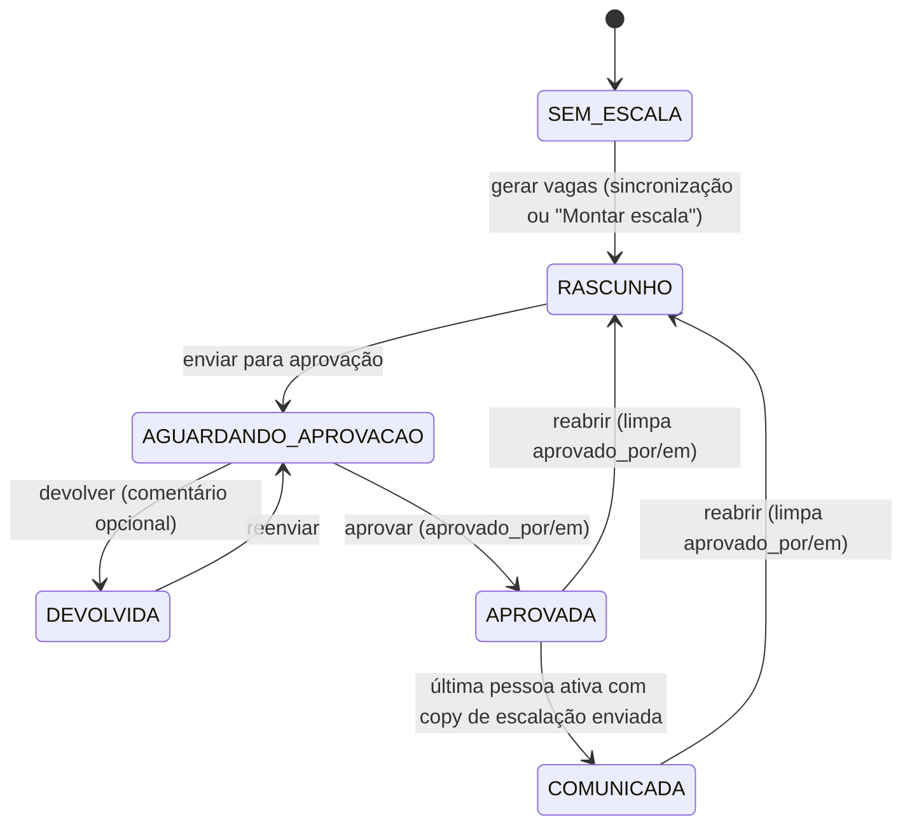
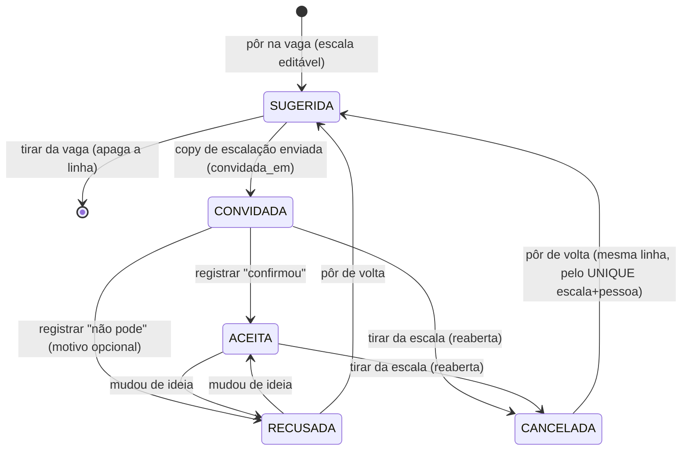
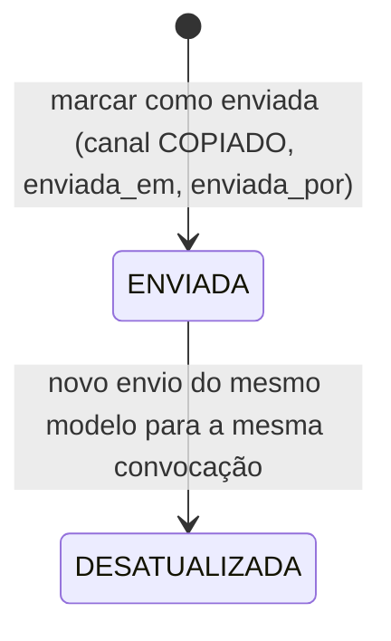
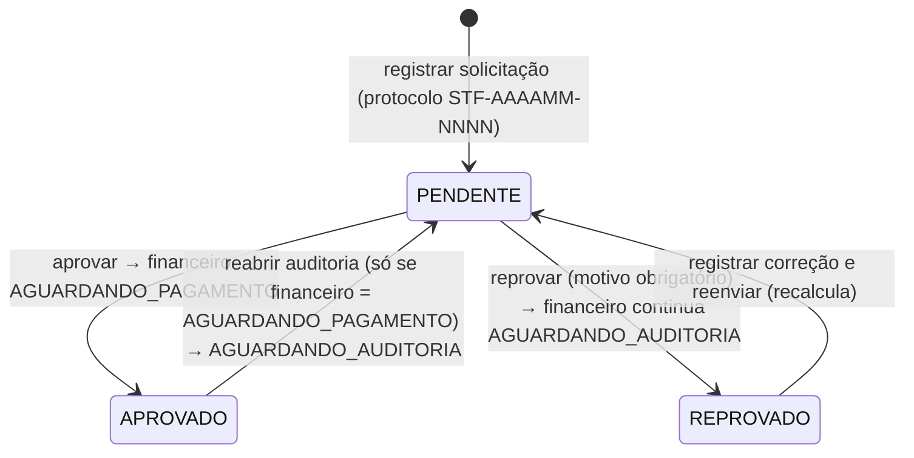
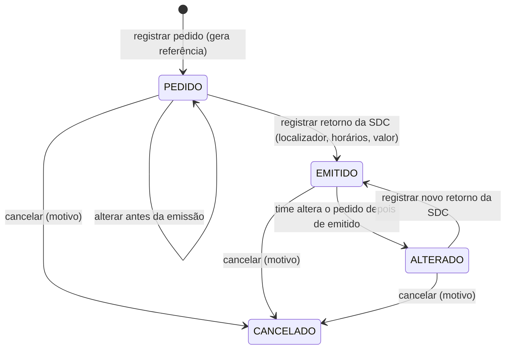
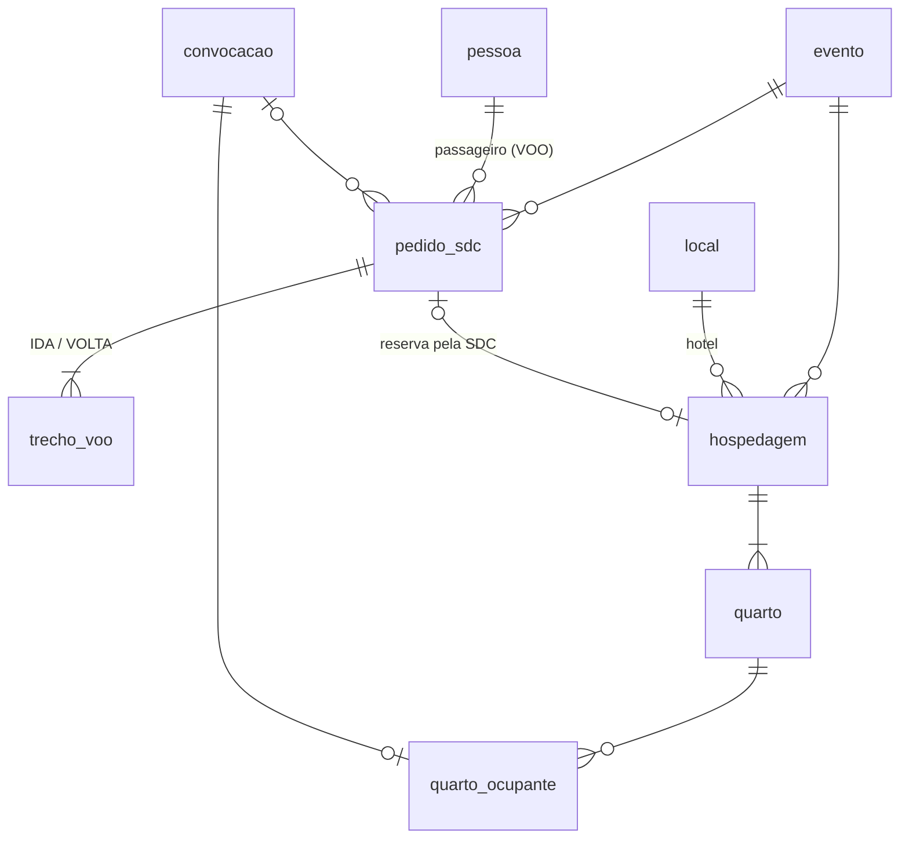

# Sistema Eventos — Arquitetura das abas do time (v0.1, 28/10/2026)

Desenho técnico para implementar as 8 abas que faltam no app do time de eventos (Início, Escalas, Comunicação,
Disponibilidade, Pessoas, Logística e SDC, Custos, Configurações) e testar os fluxos de ponta a ponta no
**banco local**. Não contém código de produção: os trechos de código são contratos e pseudocódigo.

- **Regras de negócio:** `docs/04-planejamento-front.md` e `docs/03-regras-de-custo.md`.
- **Telas, rotas e componentes:** `docs/08-telas-do-time.md` (UI/UX). Este documento segue as rotas de lá.
- **Banco local:** `npm run banco:local` (Postgres em `.banco-local/`, porta 55432, banco `eventos_local`) e
  `npm run dev:local` (Next com `EVENTOS_MODO=local`). A configuração já recusa `EVENTOS_MODO=local` com
  `DATABASE_URL` fora de `localhost`.

**Sumário**

1. Decisões desta rodada
2. Fronteiras e onde fica cada coisa
3. Guarda de escrita, usuário atual e "registrado pelo time"
4. Máquinas de estado
5. Mudanças de banco (migration 0004, só no banco local)
6. As abas, uma a uma
7. Contratos entre frentes
8. Plano em ondas e donos de arquivos compartilhados
9. Testes e roteiro ponta a ponta
10. Riscos e dívida técnica
11. Decisões que precisam do usuário

---

## 1. Decisões desta rodada

| # | Decisão | Por quê |
|---|---|---|
| D1 | Nova camada **`src/fluxos/`** (raiz de composição): combina módulos, abre a transação e liga os repositórios ao banco. As páginas e as server actions chamam só `@/fluxos/<aba>`. | `src/app` não pode importar banco, e módulo não importa módulo. Hoje não há lugar para um caso de uso que escreve em dois módulos **na mesma transação** (ex.: marcar a copy como enviada também muda a convocação e a escala). |
| D2 | **Cada tabela (ou coluna) tem um módulo dono que escreve.** Repositórios podem **ler** tabelas de outros módulos (consulta), nunca gravar nelas. | Evita dependência de código entre frentes: a Comunicação lê a equipe direto das tabelas, sem esperar a frente de Escalas. |
| D3 | **Escrita só com três travas** (modo local na configuração, `DATABASE_URL` em localhost e marcador gravado no próprio banco local). Fora disso as telas abrem **somente leitura**. | Decisão 1 do usuário: produção não recebe escrita destas telas. Fail-closed. |
| D4 | **Usuário atual = usuário de teste semeado** (`7e570000-0000-7000-8000-000000000001`), lido por uma única função `usuarioAtual()`. Fora do modo local ela devolve `null` e toda escrita é recusada. | O login real troca só a implementação dessa função. |
| D5 | Ações que seriam do staff ou da SDC são **"Registrar …"** e gravam `registrado_por` (o usuário do time). `registrado_por` nulo = a própria pessoa, pelo portal futuro. | Decisão 3 do usuário e selo "Registrado pelo time" da doc 08. |
| D6 | Tabela **`eventos.registro_acao`** (histórico só de inclusão): envio, aprovação, devolução e reabertura da escala, auditoria de custos, pedidos da SDC e tudo que foi registrado em nome de alguém. | Guarda o comentário da devolução, o motivo da reprovação e quem fez o quê, sem colunas soltas em cada tabela. |
| D7 | `evento.status_escala` ganha **`AGUARDANDO_APROVACAO`** e **`DEVOLVIDA`** (valores da doc 08). | A fila da líder e o filtro "Devolvidas" viram consulta simples; o `CHECK` continua protegendo os valores. |
| D8 | `convocacao.status` ganha `CHECK` com `SUGERIDA`, `CONVIDADA`, `ACEITA`, `RECUSADA`, `CANCELADA`. | A coluna não tem `CHECK` (nasceu no GH). Os valores já estão documentados no schema. |
| D9 | Mudança de status sempre por **compare-and-set** (`UPDATE … WHERE status = <esperado>`); 0 linhas = "a escala mudou, recarregue". | Sem Realtime no banco local; evita duas pessoas aprovarem/devolverem por cima uma da outra. |
| D10 | **Realtime fica para depois.** As telas são `force-dynamic` e recarregam após cada ação (`revalidatePath`). | O Postgres local não tem Supabase Realtime. |

Esta seção tem o peso de uma ADR. Proposta: o gerente extrai D1 a D3 para `docs/adr/0002-fluxos-e-guarda-de-escrita.md`
quando aprovar (Status: proposta).

### 1.1 Alternativas consideradas para combinar módulos (D1)

| Opção | Prós | Contras |
|---|---|---|
| **A. `src/fluxos/` como raiz de composição** (recomendada) | Uma transação para o caso de uso inteiro; módulos continuam independentes; mesmo papel que `src/jobs/` já tem no lint | Uma pasta e uma regra de lint novas |
| B. Página chama dois serviços, cada um com a sua transação | Nada novo | Não é atômico: a copy fica "enviada" e a convocação não, se a segunda falhar |
| C. Juntar escala, comunicação e logística num módulo só | Transação fácil | Módulo grande, quatro frentes no mesmo `index.ts`, conflito de arquivo em toda onda |

---

## 2. Fronteiras e onde fica cada coisa

### 2.1 Camadas

```mermaid
flowchart TB
  subgraph app["src/app/(time) — páginas e server actions (sem banco)"]
    P[page.tsx<br/>server component]
    A[acoes.ts<br/>'use server' + Zod]
  end
  subgraph fluxos["src/fluxos/&lt;aba&gt; — raiz de composição"]
    F[carregar… / registrar… / aprovar…]
    B[_base: bancoParaLeitura, bancoParaEscrita, transacao]
  end
  subgraph modulos["src/modules/&lt;nome&gt;"]
    D[domain/ puro<br/>regras, máquinas de estado, schemas Zod]
    S[service/ casos de uso<br/>recebem portas]
    R[repository/ Drizzle<br/>criarRepositorioX(executor)]
  end
  C[(src/core: config, db, ambiente, registro de ação)]

  P --> F
  A --> F
  A -. tipos e schemas Zod .-> D
  P -. tipos e rótulos .-> D
  F --> S
  F --> R
  F --> B
  S --> D
  R --> C
  B --> C
```

Regras (as três primeiras já estão no `eslint.config.js`; a quarta é nova):

1. `src/app/**` não importa banco nem `@/modules/*/*`. Pode importar `@/modules/<nome>` (tipos, rótulos, schemas Zod) e `@/fluxos/<aba>`.
2. `src/modules/<nome>/**` não importa outro módulo. `domain/` é puro (sem relógio, sem ambiente, sem I/O).
3. Só `repository/` (e `src/core/db`) usa Drizzle.
4. **Novo:** `src/fluxos/**` segue a mesma regra de `src/jobs/**` (pode importar banco e vários módulos, só pela interface pública).
   Fluxo pode importar outro fluxo só para leitura (o Início lê os resumos das outras abas); sem ciclos.

### 2.2 Como uma página combina dois módulos

```text
src/app/(time)/eventos/[eventoId]/comunicacao/page.tsx
  └─ carregarComunicacaoDoEvento(eventoId, agora)          @/fluxos/comunicacao
       ├─ bancoParaLeitura()                                @/fluxos/_base  (import do cliente sob demanda)
       ├─ criarRepositorioComunicacao(db).equipeDoEvento()  @/modules/comunicacao (lê convocacao/escala/pessoa/hospedagem)
       └─ situacaoDasCopys(...)                             @/modules/comunicacao (domínio puro)

src/app/(time)/eventos/[eventoId]/comunicacao/acoes.ts  ('use server')
  └─ marcarCopyComoEnviada(form)
       ├─ marcarCopyComoEnviadaSchema.safeParse(...)        @/modules/comunicacao
       ├─ usuarioAtual()                                     src/app/(time)/_servidor
       └─ registrarEnvioDaCopy({ ... , usuarioId })          @/fluxos/comunicacao
            └─ bancoParaEscrita() → transacao(tx => {
                 comunicacao.registrarEnvio(criarRepositorioComunicacao(tx), ...)   // mensagem
                 escala.registrarConvite(criarRepositorioEscala(tx), ...)           // convocacao → CONVIDADA
                 escala.concluirComunicacao(criarRepositorioEscala(tx), ...)        // evento → COMUNICADA
               })
```

Os repositórios passam a receber um **`Executor`** (`Db` ou a transação do Drizzle), definido em
`src/core/db/database.ts`: `type Executor = Db | Parameters<Parameters<Db["transaction"]>[0]>[0]`. Os repositórios atuais
(`criarRepositorioVagas(db)`) continuam funcionando: `tx.transaction` vira savepoint.

O import do cliente do banco continua **sob demanda** (`await import("@/core/db/client")`) dentro de
`src/fluxos/_base/banco.ts`, pelo mesmo motivo de `padrao.ts`: o build do Next não pode exigir `DATABASE_URL`.
É a única exceção documentada à regra de imports no topo.

### 2.3 Dono de cada tabela (quem escreve)

| Módulo | Escreve | Lê de outros (só consulta) |
|---|---|---|
| `eventos` (existe) | `evento` (dados: `expectativa_publico`, `pessoas_na_fila`, `local_id`, sincronização), `local`, `tipo_evento` (menos `regra_vagas`) | — |
| `escala` (existe) | `escala`, `convocacao` (menos `carona_id`), `evento.status_escala` / `aprovado_por` / `aprovado_em`, `tipo_evento.regra_vagas` | `pessoa_evento`, `pessoa_funcao`, `disponibilidade`, `local`, `mensagem` (para COMUNICADA) |
| `comunicacao` (existe) | `mensagem`, `modelo_copy` | `convocacao`, `escala`, `evento`, `local`, `core.pessoa`, `pessoa_evento`, `hospedagem`, `quarto*`, `trecho_voo` |
| `disponibilidade` (novo) | `enquete`, `enquete_evento`, `disponibilidade` | `evento`, `core.pessoa`, `pessoa_evento` |
| `pessoas` (novo) | `pessoa_evento`, `pessoa_funcao`, `pessoa_veiculo` | `core.pessoa`, `convocacao` (histórico) |
| `logistica` (novo) | `pedido_sdc`, `trecho_voo`, `hospedagem`, `quarto`, `quarto_ocupante`, `carona`, `convocacao.carona_id` | `convocacao`, `evento`, `local`, `pessoa_evento` |
| `custos` (novo) | `regra_custo`, `solicitacao_custo`, `deslocamento`, `custo_item`, `rota_cache`, `protocolo_sequencia` (pela função `eventos.proximo_protocolo()`) | `convocacao`, `evento`, `pessoa_veiculo`, `tipo_evento` |
| `src/core/db/registro-acao.ts` (infra) | `registro_acao` (chamado pelos repositórios de cada módulo, dentro da mesma transação) | — |

`core.*` é só leitura (ADR 0001, regra 3). O app **não cria pessoa**: "Incluir pessoa como staff" escolhe uma
`core.pessoa` existente e cria a `pessoa_evento` dela (ADR 0001, regra 1). O lint não verifica quem escreve em
qual tabela: isso fica na revisão de código (e, depois, num teste que procura `insert(`/`update(` por tabela).

### 2.4 Estrutura de pastas (alvo)

```text
src/app/(time)/
  _componentes/            painel.tsx + componentes da doc 08 §3 (Cabecalho, Cartao, Botao, Chip, Tabela, Campo, ...)
  _servidor/               usuario-atual.ts, acao.ts (lerFormulario + ResultadoAcao), sem rota
  inicio/                  page.tsx
  eventos/[eventoId]/      layout.tsx (cabeçalho + abas), page.tsx (Resumo), acoes.ts
    escala/  comunicacao/  logistica/  custos/          page.tsx, acoes.ts, _componentes/
  escalas/                 page.tsx (lista), aprovacao/page.tsx
  comunicacao/             page.tsx (lista entre eventos)
  disponibilidade/         page.tsx, nova/, [enqueteId]/
  pessoas/                 page.tsx, [pessoaId]/
  logistica/               voos/, hospedagem/, caronas/, creditos/ (em breve)
  custos/                  page.tsx (+ ?protocolo=), nova/
  configuracoes/           regras-de-custo/, vagas/, modelos-de-copy/, locais/

src/fluxos/
  _base/                   banco.ts (bancoParaLeitura, bancoParaEscrita, transacao), erros.ts
  inicio/  eventos/  escalas/  comunicacao/  disponibilidade/  pessoas/  logistica/  custos/
  (cada pasta: index.ts + um arquivo por caso de uso; *.integracao.test.ts no banco local)
  (sem pasta "configuracoes": cada sub-tela usa o fluxo do módulo dono — custos, escalas, comunicacao, eventos)

src/modules/
  eventos/  escala/  comunicacao/            (existem)
  disponibilidade/  pessoas/  logistica/  custos/   (novos: domain/, repository/, service/, index.ts)

src/core/
  ambiente/                modoLocal(), escritaLiberada(), USUARIO_TESTE (id e nome)
  db/registro-acao.ts      registrarAcao(executor, entrada)
```

### 2.5 Padrão de server action

- Arquivo `acoes.ts` com `"use server"` ao lado da página. Assinatura para `useActionState`:
  `(estado: ResultadoAcao, form: FormData) => Promise<ResultadoAcao>`.
- `ResultadoAcao = { ok: true; mensagem?: string } | { ok: false; erro: string; campos?: Record<string, string[]> }`.
- Sequência fixa: `lerFormulario(form, schema)` (Zod; erro vira `campos`) → `usuarioAtual()` (nulo = "Escrita desligada
  neste ambiente") → fluxo → `revalidatePath` das rotas afetadas.
- **Schemas Zod ficam no `domain/` do módulo dono** (`<acao>Schema`), exportados pelo `index.ts`, e são reaproveitados
  nos testes. IDs com `z.uuid()` (o id de teste `7e57…-7000-8000-…` é UUID v7 válido para o Zod 4).
- Erros de domínio são classes (`TransicaoInvalidaError`, `VagasEsgotadasError`, `CopyDesatualizadaError`…) e o fluxo
  traduz para mensagem. Violação de `CHECK`/`UNIQUE` do Postgres vira mensagem genérica e vai para o log (pino), sem
  vazar SQL para a tela.

---

## 3. Guarda de escrita, usuário atual e "registrado pelo time"

### 3.1 Guarda de escrita (fail-closed)

`bancoParaEscrita()` em `src/fluxos/_base/banco.ts` é **o único caminho** para uma transação de escrita. Ela libera
o banco só se as três travas passarem; senão lança `EscritaDesligadaError`:

| Trava | Onde | O que verifica |
|---|---|---|
| 1. Modo local | `src/core/ambiente` (lê `config.EVENTOS_MODO`, já criado) | `EVENTOS_MODO === "local"` e `NODE_ENV !== "production"` |
| 2. Host local | `src/core/config` (o `refine` já existe) | `DATABASE_URL` aponta para `localhost`, `127.0.0.1` ou `[::1]` |
| 3. Marcador no banco | `bancoParaEscrita()` (consulta uma vez por processo e guarda o resultado) | `select current_setting('eventos.ambiente', true)` devolve `'local'` |

A trava 3 protege contra o caso "variáveis certas, banco errado" (ex.: túnel para a produção em localhost). O
`banco:local` grava o marcador com `ALTER DATABASE eventos_local SET eventos.ambiente = 'local'` (handoff para o
especialista de dados). Produção nunca tem esse parâmetro.

`escritaLiberada()` (travas 1 e 2, síncrona) é usada pelas páginas só para **esconder ou desabilitar** botões e mostrar
a faixa "Somente leitura: escrita desligada neste ambiente". A decisão de verdade é sempre a de `bancoParaEscrita()`.
Leitura (`bancoParaLeitura()`) não tem trava: o Calendário já lê produção hoje.

Testes obrigatórios (Vitest, sem banco): cada trava falhando sozinha recusa a escrita; as três passando liberam.

### 3.2 Usuário atual

- `USUARIO_TESTE = { id: "7e570000-0000-7000-8000-000000000001", nome: "Usuário de teste" }` em `src/core/ambiente`
  (o mesmo id que `scripts/banco-local/semear.ts` já grava em `core.usuario`).
- `usuarioAtual()` em `src/app/(time)/_servidor/usuario-atual.ts`: no modo local devolve `USUARIO_TESTE`; fora dele, `null`.
- Os fluxos **recebem** `usuarioId` como parâmetro (não leem cookie nem sessão). Vai para `aprovado_por`, `criado_por`,
  `confirmada_por`, `enviada_por`, `auditado_por`, `registrado_por` e `registro_acao.usuario_id`.
- O cabeçalho troca "Versão local, sem login" por "Versão local · Usuário de teste" (modo local) ou "Somente leitura".
- Login real (depois): `usuarioAtual()` passa a ler a sessão do Supabase Auth e o acesso de `core.perfil`. **Não basta
  trocar essa função** (revisão de segurança de 28/10): a guarda de escrita também bloqueia a produção, e será preciso
  redesenhar a guarda, a autorização por ação/objeto/polo e a segregação de funções (ver §12).
- Aprovação: sem perfis ainda, o mesmo usuário de teste monta e aprova. Não há bloqueio de "aprovar a própria escala".

### 3.3 "Registrado pelo time"

| Ação do staff/SDC | Onde grava | Marca |
|---|---|---|
| Confirmar / não poder na escala | `convocacao.status`, `respondida_em`, `motivo_recusa` | `convocacao.registrado_por` |
| Responder a enquete | `disponibilidade` (por evento) | `disponibilidade.registrado_por` |
| Enviar solicitação de custo (e corrigir e reenviar) | `solicitacao_custo` + `deslocamento` + `custo_item` | `solicitacao_custo.registrado_por` |
| SDC informar voo emitido / reserva | `pedido_sdc`, `trecho_voo`, `hospedagem` | `pedido_sdc.retorno_registrado_por` |

Regra: coluna preenchida = registrado pelo time (mostra o selo com o nome e a data); nula = feito pela própria pessoa
(portal futuro). Toda ação dessas também grava `registro_acao` com `em_nome_de_pessoa_id`.

---

## 4. Máquinas de estado

Cada máquina vira uma função pura no `domain/` do módulo dono, no formato
`transicao(atual, acao) → { para } | { erro }`, com `switch` exaustivo (caso `default` com `never`). O repositório
aplica com compare-and-set e grava `registro_acao`.

### 4.1 `evento.status_escala` (módulo `escala`)

Valores reais hoje: `SEM_ESCALA`, `RASCUNHO`, `APROVADA`, `COMUNICADA` (`evento_status_escala_check`) e
`evento_aprovacao_check`: `(status_escala IN ('APROVADA','COMUNICADA')) = (aprovado_em IS NOT NULL)`.
A migration 0004 acrescenta `AGUARDANDO_APROVACAO` e `DEVOLVIDA`; o `evento_aprovacao_check` não muda.



| Ação | De | Pré-condições | Efeito |
|---|---|---|---|
| Gerar/recalcular vagas | `SEM_ESCALA`, `RASCUNHO`, `DEVOLVIDA` | evento não `CANCELADO`/`CONCLUIDO` | já existe em `gerarVagasDoEvento`; o conjunto `ESCALA_FECHADA` passa a incluir `AGUARDANDO_APROVACAO` |
| Editar escala (vagas, pessoas) | `RASCUNHO`, `DEVOLVIDA` | — | — |
| Enviar para aprovação | `RASCUNHO`, `DEVOLVIDA` | toda linha de vaga com número confirmado; sem pendência de fila (Confronto) | `AGUARDANDO_APROVACAO`; `registro_acao` ENVIADA |
| Aprovar | `AGUARDANDO_APROVACAO` | — | `APROVADA`, `aprovado_por`, `aprovado_em`; `registro_acao` APROVADA |
| Devolver | `AGUARDANDO_APROVACAO` | comentário opcional (até 1.000 caracteres) | `DEVOLVIDA`; comentário no `registro_acao` |
| Concluir comunicação | `APROVADA` | toda convocação ativa (não `RECUSADA`/`CANCELADA`) tem `mensagem` `ENVIADA` do modelo `ESCALACAO` | `COMUNICADA` (automático, na mesma transação do último envio) |
| Reabrir | `APROVADA`, `COMUNICADA` | motivo opcional | `RASCUNHO`, `aprovado_por`/`aprovado_em` nulos; convocações e mensagens ficam |

- Hipótese conservadora (ver §11): **qualquer mudança depois de aprovada exige reabrir** e aprovar de novo, inclusive
  trocar quem não pode. Em `AGUARDANDO_APROVACAO` a escala fica travada (a doc 08 sugere permitir edição; ver §11).
- Enviar com vagas sem pessoa é permitido; a aprovação mostra "N vagas sem pessoa" no resumo de atenção.
- `COMUNICADA` não volta para `APROVADA` quando uma copy fica desatualizada: a Comunicação e o Início mostram o alerta.
- Impacto no que já existe: `StatusEscala` e `SituacaoNoCalendario` (`eventos/domain/calendario.ts`), `rotuloDaSituacao`
  (o `never` acusa os valores novos), legenda e classes `.situacao-*` em `globals.css`. Fica na onda 0.

### 4.2 `convocacao.status` (módulo `escala`)

Sem `CHECK` hoje (tabela nascida no GH, que usa `ACEITA`/`RECUSADA`). A 0004 cria
`convocacao_status_check`: `SUGERIDA`, `CONVIDADA`, `ACEITA`, `RECUSADA`, `CANCELADA`.



- **Ativa** = `SUGERIDA`, `CONVIDADA` ou `ACEITA`. Conta para a vaga; `RECUSADA` e `CANCELADA` liberam a vaga.
- Pôr na vaga trava a linha de `escala` (`FOR UPDATE`) e recusa se ativas ≥ `quantidade_vagas` (`VagasEsgotadasError`).
  Também recusa se a pessoa já está ativa em outra linha do mesmo evento ou num evento com datas sobrepostas (aviso na
  sugestão, erro na gravação).
- Tirar da vaga: `SUGERIDA` apaga a linha (nunca foi avisada); depois de avisada vira `CANCELADA` (guarda o histórico).
- Registrar resposta: só com a escala `APROVADA` ou `COMUNICADA`; grava `respondida_em`, `motivo_recusa`,
  `registrado_por` e `registro_acao` com `em_nome_de_pessoa_id`.
- `UNIQUE (escala_id, pessoa_id)` já existe: pôr de volta reaproveita a linha em vez de inserir outra.

### 4.3 `mensagem.status` e situação da copy (módulo `comunicacao`)

Valores reais: `status IN ('GERADA','ENVIADA','FALHOU','DESATUALIZADA')`, `canal IS NULL OR IN ('WHATSAPP','COPIADO')`.

Sem WhatsApp, só três valores são gravados: **`ENVIADA`** (canal `COPIADO`), **`DESATUALIZADA`** (um envio anterior
superado por um novo) e, no futuro, `GERADA`/`FALHOU` (fila do WAHA). "Copiar" não grava nada.

A **situação na tela** é calculada por uma função pura `situacaoDaCopy(copyAtual, ultimaEnviada)`:

| Situação | Regra |
|---|---|
| `FALTA_DADO` | `gerarCopy(...).pronta === false` → envio bloqueado, lista de `faltando` destacada |
| `PRONTA` | pronta e nenhuma mensagem `ENVIADA` deste modelo para a convocação |
| `ENVIADA` | última `ENVIADA` tem `dados_hash` igual ao atual |
| `DESATUALIZADA` | última `ENVIADA` tem `dados_hash` diferente do atual (reenviar) |
| `FALHOU` | reservado para o WAHA |



Marcar como enviada recebe o `dados_hash` que estava na tela. O fluxo gera a copy de novo; se o hash mudou, recusa
com `CopyDesatualizadaError` ("A copy mudou desde que você copiou. Copie de novo."). Se ainda falta dado, recusa.
Só com a escala `APROVADA`/`COMUNICADA` e convocação ativa. A 0004 acrescenta
`mensagem_enviada_check`: `status <> 'ENVIADA' OR (enviada_em IS NOT NULL AND canal IS NOT NULL)`.

### 4.4 `solicitacao_custo` — auditoria (módulo `custos`)

Valores reais: `status_auditoria IN ('PENDENTE','APROVADO','REPROVADO')`;
`status_financeiro IN ('AGUARDANDO_AUDITORIA','AGUARDANDO_PAGAMENTO','PENDENTE_CADASTRO','PAGO','REJEITADO')`;
`solicitacao_custo_pago_check`: `(status_financeiro = 'PAGO') = (pago_em IS NOT NULL)`.



- Aprovar/reprovar grava `auditado_por`, `auditado_em`, `parecer` (motivo) e `registro_acao`. O `parecer` mostra a última
  decisão; o histórico completo fica no `registro_acao`.
- `PENDENTE_CADASTRO` (sem PIX) não é usado agora: o PIX está em `sensivel` (GH), que o Eventos não lê. Fica para o financeiro.
- `PAGO` e `REJEITADO` são do financeiro, fora do escopo: nenhuma tela desta rodada grava esses valores.

### 4.5 Pedido à SDC — voo e hospedagem (módulo `logistica`)

Valores novos (`pedido_sdc_situacao_check`): `PEDIDO`, `EMITIDO`, `ALTERADO`, `CANCELADO`.
"A pedir" (doc 08) **não é gravado**: é a convocação ativa com `deslocamento = 'VOO'` sem pedido ativo.



- `EMITIDO` exige, no serviço: voo com `localizador`, `companhia`, `numero_voo`, `partida_em` e `chegada_em` em cada
  trecho; hospedagem com `numero_reserva`. O banco garante `emitido_em` (ver §5.3).
- Janela de compra **D-90**: função pura `janelaDeCompra(dataDoEvento, hoje)` → `FORA_DA_JANELA | NA_JANELA | ATRASADO`
  (atrasado = menos de 60 dias, a confirmar). Alimenta Logística › Voos e o Início.
- Cancelar não apaga: o pedido continua na lista da SDC e na conciliação futura da fatura.

---

## 5. Mudanças de banco (migration 0004, só no banco local)

Dono: **especialista de dados**. Uma migration Drizzle nova (`0004_abas-do-time`, com `.down.sql`), aplicada pelo
`banco:local`. **Não aplicar no `iam-pessoas`** nesta rodada (ver risco R2).

Obrigatório em toda tabela nova: `ALTER TABLE … ENABLE ROW LEVEL SECURITY` (o laço da 0002 só pegou as tabelas que
existiam), `id uuid DEFAULT public.uuid_v7()`, `criado_em`/`atualizado_em timestamptz`, índice em **toda** FK.

### 5.1 Alterações em tabelas existentes

| Tabela | Mudança |
|---|---|
| `evento` | `evento_status_escala_check` passa a aceitar também `AGUARDANDO_APROVACAO` e `DEVOLVIDA`. `evento_aprovacao_check` igual. |
| `escala` | `+ confirmada_em timestamptz`, `+ confirmada_por uuid → core.usuario ON DELETE SET NULL` (índice `escala_confirmada_por_idx`). `CHECK (confirmada_por IS NULL OR confirmada_em IS NOT NULL)`. |
| `convocacao` | `convocacao_status_check` (§4.2). `+ registrado_por uuid → core.usuario ON DELETE SET NULL` (índice). |
| `disponibilidade` | `+ registrado_por uuid → core.usuario ON DELETE SET NULL` (índice). |
| `solicitacao_custo` | `+ registrado_por uuid → core.usuario ON DELETE SET NULL` (índice). |
| `mensagem` | `mensagem_enviada_check` (§4.3). |
| `tipo_evento` (dado) | Regra do Confronto ganha `{"funcao": "STAFF", "digitado": true}` (vaga sem número, quem monta digita). O domínio de vagas (`escala/domain/vagas.ts`) passa a aceitar `digitado` e devolve a função como pendência do tipo "digitar". |

Antes de criar o `convocacao_status_check`: `SELECT DISTINCT status FROM eventos.convocacao` no banco local (cópia da
produção) para garantir que nenhum valor do GH fica de fora.

### 5.2 `eventos.registro_acao` (histórico só de inclusão)

| Coluna | Tipo | Regra |
|---|---|---|
| `id` | uuid PK | `uuid_v7()` |
| `entidade` | text not null | `CHECK IN ('ESCALA_DO_EVENTO','CONVOCACAO','MENSAGEM','DISPONIBILIDADE','SOLICITACAO_CUSTO','PEDIDO_SDC','HOSPEDAGEM')` |
| `entidade_id` | uuid not null | sem FK (polimórfica) |
| `evento_id` | uuid → `evento` ON DELETE SET NULL | filtro por evento |
| `acao` | text not null | `CHECK (acao ~ '^[A-Z_]{3,40}$')` (ex.: `ENVIADA_APROVACAO`, `APROVADA`, `DEVOLVIDA`, `REABERTA`, `RESPOSTA_REGISTRADA`, `AUDITORIA_APROVADA`) |
| `status_de`, `status_para` | text | opcionais |
| `comentario` | text | `CHECK (comentario IS NULL OR length(comentario) <= 2000)` |
| `em_nome_de_pessoa_id` | uuid → `core.pessoa` ON DELETE SET NULL | preenchido = registrado pelo time em nome desta pessoa |
| `usuario_id` | uuid → `core.usuario` ON DELETE SET NULL | quem fez |
| `dados` | jsonb not null default `'{}'` | detalhes (ex.: números de vagas aprovados) |
| `criado_em` | timestamptz not null default now() | |

Índices: `(entidade, entidade_id, criado_em)`, `evento_id`, `em_nome_de_pessoa_id`, `usuario_id`.
Só inclusão: trigger `BEFORE UPDATE OR DELETE` que lança erro (ou `REVOKE UPDATE, DELETE` no papel do app, quando existir).
Avaliar depois se migra para o schema `auditoria` do GH.

### 5.3 Logística: pedidos à SDC, voos e hospedagem



Referência única: sequência `eventos.pedido_sdc_referencia_seq`, formato **`SDC-000001`** (uma numeração para voo e
hotel, que a fatura da SDC vai citar). Formato a confirmar (§11).

**`eventos.pedido_sdc`** — o que a IAM pede à SDC (um passageiro com ida e/ou volta, ou uma reserva de hotel).

| Coluna | Tipo | Regra |
|---|---|---|
| `id` | uuid PK | |
| `referencia` | text not null unique | default `'SDC-' \|\| lpad(nextval('eventos.pedido_sdc_referencia_seq')::text, 6, '0')`; `CHECK (referencia ~ '^SDC-[0-9]{6,}$')` |
| `tipo` | text not null | `CHECK IN ('VOO','HOSPEDAGEM')` |
| `evento_id` | uuid not null → `evento` ON DELETE RESTRICT | |
| `pessoa_id` | uuid → `core.pessoa` ON DELETE RESTRICT | `CHECK ((tipo = 'VOO') = (pessoa_id IS NOT NULL))` |
| `convocacao_id` | uuid → `convocacao` ON DELETE SET NULL | de qual escala nasceu |
| `situacao` | text not null default `'PEDIDO'` | `CHECK IN ('PEDIDO','EMITIDO','ALTERADO','CANCELADO')` |
| `valor_centavos` | integer | `CHECK (valor_centavos IS NULL OR valor_centavos >= 0)`; informado pela SDC |
| `observacao_time` | text | o que a IAM pediu (horário preferido, bagagem) |
| `observacao_sdc` | text | o que a SDC respondeu |
| `solicitado_por` | uuid → `core.usuario` ON DELETE SET NULL | |
| `solicitado_em` | timestamptz not null default now() | |
| `emitido_em` | timestamptz | `CHECK (situacao <> 'EMITIDO' OR emitido_em IS NOT NULL)` (em `ALTERADO` o `emitido_em` da emissão anterior fica) |
| `retorno_registrado_por` | uuid → `core.usuario` ON DELETE SET NULL | quem lançou o retorno da SDC (selo "Registrado pelo time") |
| `cancelado_em` | timestamptz | `CHECK ((situacao = 'CANCELADO') = (cancelado_em IS NOT NULL))` |
| `cancelado_por` | uuid → `core.usuario` ON DELETE SET NULL | |
| `motivo_cancelamento` | text | |
| `criado_em`, `atualizado_em` | timestamptz not null default now() | |

Índices: `evento_id`, `pessoa_id`, `convocacao_id`, `solicitado_por`, `retorno_registrado_por`, `cancelado_por`,
`situacao`; único parcial `pedido_sdc_voo_ativo_unique (evento_id, pessoa_id) WHERE tipo = 'VOO' AND situacao <> 'CANCELADO'`
(um pedido de voo ativo por pessoa por evento).

**`eventos.trecho_voo`** — ida e volta de um pedido de voo.

| Coluna | Tipo | Regra |
|---|---|---|
| `id` | uuid PK | |
| `pedido_id` | uuid not null → `pedido_sdc` ON DELETE CASCADE | `UNIQUE (pedido_id, sentido)` (cobre o índice da FK) |
| `sentido` | text not null | `CHECK IN ('IDA','VOLTA')` |
| `origem_iata`, `destino_iata` | text not null | `CHECK (origem_iata ~ '^[A-Z]{3}$' AND destino_iata ~ '^[A-Z]{3}$' AND origem_iata <> destino_iata)` |
| `data_desejada` | date not null | |
| `preferencia_horario` | text | `CHECK IN ('MANHA','TARDE','NOITE','QUALQUER')` ou nulo |
| `companhia` | text | preenchido pela SDC |
| `numero_voo` | text | `CHECK (numero_voo IS NULL OR numero_voo ~ '^[A-Z0-9]{2}[0-9]{1,4}$')` |
| `localizador` | text | `CHECK (localizador IS NULL OR localizador ~ '^[A-Z0-9]{5,8}$')` |
| `partida_em`, `chegada_em` | timestamptz | `CHECK (partida_em IS NULL OR chegada_em IS NULL OR chegada_em > partida_em)` |
| `cartao_embarque_url` | text | `CHECK (cartao_embarque_url IS NULL OR cartao_embarque_url ~ '^https://')` (upload fica para depois) |
| `criado_em`, `atualizado_em` | timestamptz | |

**`eventos.hospedagem`** — onde a equipe dorme num evento (hotel pela SDC ou apartamento da IAM, sem pedido).

| Coluna | Tipo | Regra |
|---|---|---|
| `id` | uuid PK | |
| `evento_id` | uuid not null → `evento` ON DELETE RESTRICT | índice |
| `local_id` | uuid not null → `local` ON DELETE RESTRICT | índice; o serviço exige `local.tipo IN ('HOTEL','APARTAMENTO')` |
| `pedido_id` | uuid → `pedido_sdc` ON DELETE RESTRICT, **unique** | nulo = sem SDC (AP IAM); o serviço exige `pedido_sdc.tipo = 'HOSPEDAGEM'` e o mesmo `evento_id` |
| `check_in`, `check_out` | date not null | `CHECK (check_out > check_in)` |
| `numero_reserva` | text | confirmação da SDC/hotel |
| `observacao` | text | |
| `criado_por` | uuid → `core.usuario` ON DELETE SET NULL | índice |
| `criado_em`, `atualizado_em` | timestamptz | |

**`eventos.quarto`** — rooming list.

| Coluna | Tipo | Regra |
|---|---|---|
| `id` | uuid PK | |
| `hospedagem_id` | uuid not null → `hospedagem` ON DELETE CASCADE | `UNIQUE (hospedagem_id, nome)` (cobre o índice da FK) |
| `nome` | text not null | "Quarto 1" |
| `capacidade` | smallint not null | `CHECK (capacidade BETWEEN 1 AND 4)` (single a quádruplo) |
| `sexo` | text | `CHECK (sexo IS NULL OR sexo IN ('F','M'))`; nulo = misto/família |
| `valor_diaria_centavos` | integer | `CHECK (valor_diaria_centavos IS NULL OR valor_diaria_centavos >= 0)` |
| `criado_em`, `atualizado_em` | timestamptz | |

**`eventos.quarto_ocupante`**

| Coluna | Tipo | Regra |
|---|---|---|
| `quarto_id` | uuid not null → `quarto` ON DELETE CASCADE | PK `(quarto_id, convocacao_id)` |
| `convocacao_id` | uuid not null → `convocacao` ON DELETE CASCADE | **unique** (uma cama por convocação; cobre o índice da FK) |
| `criado_em` | timestamptz not null default now() | |

Regras no serviço (com `FOR UPDATE` no quarto): ocupantes < `capacidade`; sexo da pessoa igual ao do quarto quando o
quarto tem sexo; convocação ativa e do mesmo evento da hospedagem.

Fora desta migration: **créditos de hotel** e **fatura da SDC** (aba "Créditos de hotel" fica "em breve"; ver §11).

### 5.4 Semente do banco local (`banco:local`)

Além do que já existe (cópia da produção + staff fictício + usuário de teste):
- `ALTER DATABASE eventos_local SET eventos.ambiente = 'local'` (trava 3).
- Staff fictício com `pessoa_evento` (sexo, coordenadas), `pessoa_funcao`, `pessoa_veiculo`, alguns sem sexo ou sem coordenada (para testar "falta dado").
- Pelo menos 1 hotel e 1 apartamento em `local` com coordenadas; locais de evento com coordenadas.
- Um cenário pronto por frente, para as frentes não dependerem umas das outras: (a) um Confronto em `RASCUNHO` com fila;
  (b) um ASM `APROVADA` com convocações `SUGERIDA`, uma pessoa com `deslocamento = 'VOO'`; (c) uma enquete aberta com
  respostas; (d) uma solicitação de custo `PENDENTE` com deslocamento em alerta; (e) uma hospedagem com quarto e ocupantes.

---

## 6. As abas, uma a uma

Convenção: `L` = lê, `E` = escreve. Cada rota tem `page.tsx` (server component, `dynamic = "force-dynamic"`),
`error.tsx` e, quando escreve, `acoes.ts`. Nome de fluxo = nome da função exportada por `@/fluxos/<aba>`.

### 6.1 Evento (porta de entrada) — `/eventos/[eventoId]` e abas

Não é item do menu, mas é onde o trabalho acontece (doc 08 §2). O `layout.tsx` (cabeçalho + abas Resumo · Escala ·
Comunicação · Logística · Custos) é compartilhado; cada aba é da frente da aba correspondente.

| | |
|---|---|
| Rota | `src/app/(time)/eventos/[eventoId]/page.tsx` (Resumo) + `layout.tsx` |
| Lê | evento, tipo, polo, local, expectativa, fila, vagas (resumo), andamento da escala |
| Escreve | `evento.expectativa_publico`, `evento.pessoas_na_fila`, `evento.local_id` e, em seguida, recalcula as vagas |
| Módulos | `eventos` (dados) + `escala` (`gerarVagasDoEvento`) |
| Fluxo | `carregarResumoDoEvento(eventoId)`, `salvarDadosDoEvento(entrada, usuarioId)` (uma transação: grava os dados e chama `gerarVagasDoEvento`) |
| Novo no módulo | `eventos/repository/evento-repository.ts` (`dadosDoEvento`, `atualizarDadosDoEvento` com compare-and-set em `atualizado_em`), `eventos/domain/schemas.ts` |
| Server action (Zod) | `salvarDadosDoEvento` ← `salvarDadosDoEventoSchema = { eventoId: uuid, expectativaPublico: int ≥ 0 \| null, pessoasNaFila: int ≥ 0 \| null, localId: uuid \| null, atualizadoEm: iso }` |

### 6.2 Escalas — `/escalas`, `/escalas/aprovacao`, `/eventos/[eventoId]/escala`

| | |
|---|---|
| Rotas | `escalas/page.tsx` (lista entre eventos, filtros `situacao`, `polo`, `tipo`, `periodo`), `escalas/aprovacao/page.tsx` (fila da líder), `eventos/[eventoId]/escala/page.tsx` (montar + aprovar/devolver + registrar resposta) |
| Lê | eventos com `status_escala`, linhas de `escala` (número atual, sugerido pela regra calculado na hora com `calcularVagas`, confirmação), convocações com pessoa e função, sugestões, histórico de aprovação (`registro_acao`) |
| Escreve | `escala` (confirmação, linha manual), `convocacao`, `evento.status_escala`/`aprovado_*`, `registro_acao` |
| Módulo | `escala` |
| Fluxos | `listarEscalas(filtros, agora)`, `carregarFilaDeAprovacao(agora)`, `carregarMontagem(eventoId, agora)`, `sugerirPessoas(escalaId, agora)`, `confirmarVagas`, `adicionarVagaManual`, `removerVagaManual`, `porNaVaga`, `tirarDaVaga`, `atualizarConvocacao`, `enviarParaAprovacao`, `aprovarEscala`, `devolverEscala`, `reabrirEscala`, `registrarRespostaDoStaff` |
| Novo no domínio | `status-escala.ts` (§4.1), `convocacao.ts` (§4.2), `sugestao.ts` (ordenação), `distancia.ts` (haversine), `schemas.ts`; `vagas.ts` aceita `digitado`; `plano-vagas.ts` **não mexe em linha confirmada** (como já faz com `MANUAL`) |
| Novo em repository | `montagem-repository.ts` (leitura da escala, gravações com `FOR UPDATE` e compare-and-set), `candidatos-repository.ts` (lê `pessoa_evento`, `pessoa_funcao`, `disponibilidade`, convocações recentes e sobrepostas, `local`) |
| Novo em service | `montar-escala.ts`, `aprovacao.ts`, `resposta-do-staff.ts`, `convite.ts` (`registrarConvite`, `concluirComunicacao`, usados pela Comunicação) |

Server actions (Zod):

| Action | Schema |
|---|---|
| `confirmarVagas` | `{ eventoId, linhas: [{ escalaId: uuid, quantidade: int 1..500 }] }` — grava número + `confirmada_em/por`; mudar o número depois desfaz a confirmação (doc 08) |
| `adicionarVagaManual` / `removerVagaManual` | `{ eventoId, funcaoId, quantidade }` / `{ escalaId }` (origem `MANUAL`, já confirmada) |
| `porNaVaga` | `{ escalaId, pessoaId, sugestaoScore?: number }` |
| `tirarDaVaga` | `{ convocacaoId }` |
| `atualizarConvocacao` | `{ convocacaoId, deslocamento?: enum do CHECK, montagem?: boolean, observacao?: string ≤ 500 }` |
| `enviarParaAprovacao` | `{ eventoId, statusEsperado: 'RASCUNHO' \| 'DEVOLVIDA' }` |
| `aprovarEscala` | `{ eventoId }` (esperado `AGUARDANDO_APROVACAO`) |
| `devolverEscala` | `{ eventoId, comentario?: string ≤ 1000 }` |
| `reabrirEscala` | `{ eventoId, motivo?: string ≤ 1000 }` |
| `registrarRespostaDoStaff` | `{ convocacaoId, resposta: 'ACEITA' \| 'RECUSADA', motivoRecusa?: string ≤ 500 }` |

**Sugestão de pessoas** (`escala/domain/sugestao.ts`, pura). Entrada por candidato: disponibilidade para o evento
(`PODE`, `SEM_RESPOSTA`, `NAO_PODE`), nível na função (`HABILITADO`, `TRAINEE`, sem a função), distância em km até o
local (haversine com `pessoa_evento.lat/lng` e `local.lat/lng`; sem coordenada = fim da fila e aviso), convocações nos
últimos 90 dias e dias desde a última. Ordem **lexicográfica**: disponibilidade → função → distância (faixas de 50 km) →
rodízio (menos convocações, depois mais tempo parado). Espaço reservado para "desempenho" (entra entre disponibilidade e
função quando existir). Exclui quem já está ativo no evento; marca (sem excluir) conflito de datas e "não pode".
`sugestao_score` grava uma pontuação só para explicar ("por que sugeriu"); a ordem vem do comparador. "Polo da pessoa"
não existe no schema do Eventos (está no GH): a distância substitui o polo por enquanto.

**Resumo de atenção da aprovação:** vagas sem pessoa, funções sem confirmação, pessoas com `deslocamento = 'VOO'` sem
pedido, pessoas sem resposta na enquete. "Sem PIX" fica fora (dado em `sensivel`).

### 6.3 Comunicação — `/comunicacao`, `/eventos/[eventoId]/comunicacao`

| | |
|---|---|
| Rotas | `comunicacao/page.tsx` (lista entre eventos `APROVADA`/`COMUNICADA`, filtro `situacao`: `falta-dado`, `desatualizada`, `pronta`), `eventos/[eventoId]/comunicacao/page.tsx` (por pessoa, `?modelo=ESCALACAO\|HOSPEDAGEM`) |
| Lê | equipe ativa do evento (convocação, pessoa, sexo, função, horário, deslocamento), evento/local/tipo, hospedagem e colegas de quarto, trechos de voo, modelos ativos, últimas mensagens por convocação e modelo |
| Escreve | `mensagem` (ENVIADA / DESATUALIZADA); pela escala: `convocacao` → `CONVIDADA` e `evento` → `COMUNICADA` |
| Módulos | `comunicacao` + `escala` (`registrarConvite`, `concluirComunicacao`) |
| Fluxos | `listarComunicacao(filtros, agora)`, `carregarComunicacaoDoEvento(eventoId, modelo, agora)`, `registrarEnvioDaCopy(entrada, usuarioId, agora)` |
| Novo no domínio | `contexto-da-copy.ts` (`dadosDaCopy(contexto) → DadosCopy`, pura: monta `evento.*`, `pessoa.*`, `hospedagem.*`, `voo.*`), `situacao.ts` (§4.3), `schemas.ts`; `VARIAVEIS_COPY` ganha `voo.ida` e `voo.volta` |
| Novo em repository | `comunicacao-repository.ts` (`equipeDoEvento`, `ultimasMensagens`, `registrarEnvio`), `modelo-repository.ts` |
| Server action (Zod) | `marcarCopyComoEnviada` ← `{ convocacaoId: uuid, modeloId: uuid, dadosHash: string(64) }` |

- "Copiar" é só no navegador (`navigator.clipboard`), sem gravar. Não existe "marcar todas".
- `{{link_custos}}`: o staff ainda não tem portal. Enquanto isso o valor vem de configuração (link do formulário de hoje)
  ou a copy de escalação fica sempre bloqueada (decisão em §11).
- Alerta "falta dado" no Início e na lista: contagem de convocações ativas com situação `FALTA_DADO`.

### 6.4 Disponibilidade — `/disponibilidade`, `/disponibilidade/nova`, `/disponibilidade/[enqueteId]`

| | |
|---|---|
| Lê | enquetes (aberta = `fecha_em` no futuro), eventos de cada enquete, matriz pessoa × evento com respostas e selo "registrado pelo time" |
| Escreve | `enquete`, `enquete_evento`, `disponibilidade` (+ `registrado_por`, `registro_acao`) |
| Módulo | `disponibilidade` (novo) |
| Fluxos | `listarEnquetes(agora)`, `carregarEnquete(enqueteId, agora)`, `abrirEnquete`, `alterarEnquete`, `encerrarEnquete`, `registrarDisponibilidade` |
| Domínio | `enquete.ts` (aberta/encerrada, validações), `schemas.ts` |
| Repository | `enquete-repository.ts`, `disponibilidade-repository.ts` |

Server actions (Zod): `abrirEnquete` ← `{ titulo: 3..120, fechaEm: iso futuro, eventoIds: uuid[] ≥ 1 }`;
`alterarEnquete` ← `{ enqueteId, titulo?, fechaEm?, eventoIds? }`; `encerrarEnquete` ← `{ enqueteId }` (grava `fecha_em = agora`;
"Reabrir" = `alterarEnquete` com nova data); `registrarDisponibilidade` ← `{ enqueteId, pessoaId, respostas: [{ eventoId, disponivel: boolean }] ≥ 1 }`.

- Quem aparece na enquete: toda pessoa com `pessoa_evento` e `core.pessoa.ativo` (não há lista de convidados).
- A chave de `disponibilidade` é `(evento_id, pessoa_id)`: se o evento estiver em duas enquetes, a resposta é uma só
  (upsert troca o `enquete_id`). O time pode registrar depois de encerrada (aviso "fora do prazo").

### 6.5 Pessoas — `/pessoas`, `/pessoas/[pessoaId]`

| | |
|---|---|
| Lê | `core.pessoa` (nome, e-mail, telefone, ativo), `pessoa_evento`, `pessoa_funcao`, `pessoa_veiculo`, histórico de convocações (eventos, função, resposta) |
| Escreve | `pessoa_evento`, `pessoa_funcao`, `pessoa_veiculo` |
| Módulo | `pessoas` (novo) |
| Fluxos | `listarPessoas(filtros)`, `carregarPessoa(pessoaId)`, `buscarPessoaDoCadastro(texto)`, `incluirComoStaff`, `salvarPerfilDoStaff`, `definirFuncoes`, `salvarVeiculo`, `removerVeiculo`, `salvarCoordenadas` |
| Domínio | `cadastro.ts` (o que falta: sexo, camiseta, função, coordenada, veículo sem consumo), `schemas.ts` |
| Repository | `pessoas-repository.ts` |

Server actions (Zod): `incluirComoStaff` ← `{ pessoaId }`; `salvarPerfilDoStaff` ← `{ pessoaId, sexo?: 'F'|'M'|null,
camisetaModelo?: 'CAMISETA'|'BABY_LOOK'|null, camisetaTamanho?: 'PP'…'XG'|null, possuiCamiseta?, fezConfronto?, temCnpj? }`;
`definirFuncoes` ← `{ pessoaId, funcoes: [{ funcaoId, nivel: 'TRAINEE'|'HABILITADO' }] }` (substitui o conjunto);
`salvarVeiculo` ← `{ pessoaId, lugares: 1..8, consumoKmL?: > 0 }`; `removerVeiculo` ← `{ pessoaId }`;
`salvarCoordenadas` ← `{ pessoaId, lat: -90..90, lng: -180..180 }` (manual até existir geocodificação).
Endereço, CPF e PIX ficam no `sensivel` (GH) e não aparecem nesta rodada.

### 6.6 Logística e SDC — `/logistica/voos`, `/logistica/hospedagem`, `/logistica/caronas`, `/eventos/[eventoId]/logistica`

| | |
|---|---|
| Rotas | `logistica/voos` (pedidos entre eventos + "a pedir" na janela D-90; painel do pedido `?ref=SDC-…`), `logistica/hospedagem` (rooming por evento), `logistica/caronas` (onda 2), `logistica/creditos` ("em breve"), `eventos/[eventoId]/logistica` (o mesmo, filtrado) |
| Lê | convocações ativas com deslocamento, pedidos e trechos, hospedagens, quartos e ocupantes, locais `HOTEL`/`APARTAMENTO`, caronas |
| Escreve | `pedido_sdc`, `trecho_voo`, `hospedagem`, `quarto`, `quarto_ocupante`, `carona`, `convocacao.carona_id`, `registro_acao` |
| Módulo | `logistica` (novo) |
| Fluxos | `carregarVoos(filtros, agora)`, `carregarPedido(referencia)`, `registrarPedidoDeVoo`, `alterarPedido`, `cancelarPedido`, `registrarRetornoDaSdc`, `carregarHospedagem(eventoId)`, `criarHospedagem`, `alterarHospedagem`, `registrarPedidoDeHospedagem`, `adicionarQuarto`, `removerQuarto`, `porNoQuarto`, `tirarDoQuarto`; onda 2: `sugerirRooming`, `criarCarona`, `definirCarona` |
| Domínio | `pedido.ts` (§4.5), `janela.ts` (D-90), `rooming.ts` (sugestão por sexo, pura), `schemas.ts` |
| Repository | `pedidos-repository.ts`, `hospedagem-repository.ts`, `caronas-repository.ts` |

Server actions (Zod):

| Action | Schema |
|---|---|
| `registrarPedidoDeVoo` | `{ convocacaoId, trechos: [{ sentido: 'IDA'\|'VOLTA', origemIata: /^[A-Z]{3}$/, destinoIata, dataDesejada: date, preferenciaHorario? }] 1..2 (sem sentido repetido), observacaoTime? }` |
| `alterarPedido` | `{ pedidoId, trechos?, observacaoTime?, atualizadoEm }` (EMITIDO → ALTERADO) |
| `cancelarPedido` | `{ pedidoId, motivo: 3..500 }` |
| `registrarRetornoDaSdc` | voo: `{ pedidoId, valorCentavos ≥ 0, observacaoSdc?, trechos: [{ sentido, companhia, numeroVoo, localizador, partidaEm, chegadaEm, cartaoEmbarqueUrl? }] }`; hotel: `{ pedidoId, valorCentavos, numeroReserva }` |
| `criarHospedagem` / `alterarHospedagem` | `{ eventoId, localId, checkIn, checkOut, observacao? }` |
| `registrarPedidoDeHospedagem` | `{ hospedagemId, observacaoTime? }` (cria `pedido_sdc` tipo HOSPEDAGEM e liga) |
| `adicionarQuarto` / `removerQuarto` | `{ hospedagemId, nome, capacidade: 1..4, sexo?, valorDiariaCentavos? }` / `{ quartoId }` (só vazio) |
| `porNoQuarto` / `tirarDoQuarto` | `{ quartoId, convocacaoId }` / `{ quartoId, convocacaoId }` |

A SDC ainda não tem portal: depois de registrar o pedido, a tela oferece "Copiar pedido" (texto pronto para o canal de
hoje). Toda mudança de voo/quarto muda o `dados_hash` da copy de hospedagem → a Comunicação mostra "Desatualizada".

### 6.7 Custos — `/custos`, `/custos/nova`, `/eventos/[eventoId]/custos`

| | |
|---|---|
| Rotas | `custos/page.tsx` (fila de auditoria, filtros evento/situação/alerta; painel lateral `?protocolo=STF-…`), `custos/nova/page.tsx` (registrar em nome do staff, `?evento=&pessoa=`), `eventos/[eventoId]/custos` (o mesmo, filtrado) |
| Lê | solicitações com deslocamentos, itens, alertas, regras de custo vigentes, convocações do evento, veículo da pessoa |
| Escreve | `solicitacao_custo` (+ `registrado_por`), `deslocamento`, `custo_item`, `registro_acao` |
| Módulo | `custos` (novo) |
| Fluxos | `carregarFilaDeAuditoria(filtros)`, `carregarSolicitacao(protocolo)`, `prepararSolicitacao(eventoId, pessoaId)` (pré-cálculo pela regra), `registrarSolicitacao`, `corrigirSolicitacao`, `aprovarSolicitacao`, `reprovarSolicitacao`, `reabrirAuditoria` |
| Domínio | `calculo.ts` (combustível = km ÷ consumo × preço do litro; ida e volta conta os dois trechos; depreciação por faixa **por deslocamento**; nível de exceção pelas regras `LIMITE`; total), `regra-vigente.ts` (maior `vigente_desde` ≤ data do evento, por tipo e UF), `auditoria.ts` (§4.4), `schemas.ts` |
| Repository | `solicitacoes-repository.ts` (protocolo por `select eventos.proximo_protocolo()` na mesma transação), `regras-repository.ts` |

Server actions (Zod): `registrarSolicitacao` ← `{ eventoId, pessoaId, deslocamentos: [{ origem, destino, idaVolta, km ≥ 0,
consumoKmL > 0, precoLitroCentavos ≥ 0, pedagioCentavos ≥ 0 }], itens: [{ categoria: enum do CHECK, regraCustoId?, descricao,
quantidade > 0, valorCentavos ≥ 0 }] }` (o servidor **recalcula** combustível, depreciação, exceção e total; não confia no
navegador); `corrigirSolicitacao` ← o mesmo + `solicitacaoId` (só `REPROVADO`); `aprovarSolicitacao` ← `{ solicitacaoId, parecer? }`;
`reprovarSolicitacao` ← `{ solicitacaoId, motivo: 3..1000 }`; `reabrirAuditoria` ← `{ solicitacaoId }`.

- Km digitado (sem Google Maps ainda; `rota_cache_id` nulo). Preço do litro digitado enquanto não houver regra
  `COMBUSTIVEL` por UF. Consumo vem de `pessoa_veiculo`, editável.
- Remuneração e alimentação vêm pré-preenchidas da `regra_custo` do tipo do evento.
- `UNIQUE (evento_id, pessoa_id)`: uma solicitação por pessoa por evento; "Registrar" vira "Abrir" quando já existe.

### 6.8 Configurações — `/configuracoes/regras-de-custo`, `/vagas`, `/modelos-de-copy`, `/locais`

Cada sub-tela é do módulo dono do dado (e da frente dona desse módulo). O `layout.tsx` com as abas é compartilhado.

| Sub-tela | Módulo | Lê / escreve | Fluxos e actions (Zod) |
|---|---|---|---|
| Regras de custo | `custos` | `regra_custo` | `listarRegrasDeCusto`; `criarVigenciaDeRegra` ← `{ regraId, valorCentavos?, parametros?, vigenteDesde: date }` (nova linha; nunca edita a antiga, porque solicitações apontam para ela); `desativarRegra` ← `{ regraId }` |
| Regras de vagas | `escala` | `tipo_evento.regra_vagas` | `listarRegrasDeVagas`; `salvarRegraDeVagas` ← `{ tipoEventoId, funcoes: [{ funcao, formula? \| fixo? \| digitado? }] }` (validado por `compilarRegraVagas`; prévia com público de exemplo); `recalcularVagasDoTipo` ← `{ tipoEventoId }` (chama `gerarVagasDoEvento` nos eventos futuros em `SEM_ESCALA`/`RASCUNHO`/`DEVOLVIDA`; linhas confirmadas não mudam) |
| Modelos de copy | `comunicacao` | `modelo_copy` | `listarModelos`; `salvarModelo` ← `{ modeloId?, tipo: enum do CHECK, nome, corpo }` (recusa se `validarModelo` devolver erro); `ativarModelo`/`desativarModelo` ← `{ modeloId }`. Mudar o texto não deixa copy enviada "desatualizada" (o hash é dos dados) |
| Locais e hotéis | `eventos` | `local` | `listarLocais`; `salvarLocal` ← `{ localId?, nome, tipo: 'EVENTO'\|'HOTEL'\|'APARTAMENTO', endereço…, cidade, uf: /^[A-Z]{2}$/, lat?, lng?, capacidade? }`; `arquivarLocal` ← `{ localId }` (`deleted_at`) |

### 6.9 Início — `/inicio`

| | |
|---|---|
| Rota | `inicio/page.tsx`; `src/app/page.tsx` passa a redirecionar para `/inicio` |
| Lê | escalas a montar (30 dias), aguardando aprovação, devolvidas, Confronto sem fila, eventos sem código, convocações sem resposta há mais de 2 dias, copys bloqueadas e desatualizadas, voos na janela D-90 sem pedido, custos para auditar (com críticos) |
| Escreve | nada |
| Fluxo | `carregarInicio(agora)` combina os `resumoParaInicio(agora)` de cada fluxo (contrato em §7.1) |

---

## 7. Contratos entre frentes

Fixados aqui para as frentes trabalharem em paralelo. Mudar um contrato passa pelo gerente.

### 7.1 Base (onda 0)

```ts
// src/core/db/database.ts
export type Executor = Db | Parameters<Parameters<Db["transaction"]>[0]>[0];

// src/core/db/registro-acao.ts — chamado pelos repositórios, dentro da transação do caso de uso
registrarAcao(executor: Executor, entrada: {
  entidade: EntidadeRegistrada; entidadeId: string; eventoId?: string | null;
  acao: string; statusDe?: string | null; statusPara?: string | null; comentario?: string | null;
  emNomeDePessoaId?: string | null; usuarioId: string; dados?: Record<string, unknown>;
}): Promise<void>

// src/core/ambiente
modoLocal(): boolean; escritaLiberada(): boolean; USUARIO_TESTE: { id: string; nome: string }

// src/fluxos/_base
bancoParaLeitura(): Promise<Db>
transacao<T>(trabalho: (tx: Executor) => Promise<T>): Promise<T>   // passa por bancoParaEscrita (3 travas)
class EscritaDesligadaError; class ConflitoDeVersaoError; class RegraDeNegocioError { mensagem }

// src/app/(time)/_servidor
usuarioAtual(): Promise<{ id: string; nome: string } | null>
lerFormulario<T>(form: FormData, schema: ZodType<T>): { ok: true; dados: T } | ResultadoAcao
type ResultadoAcao = { ok: true; mensagem?: string } | { ok: false; erro: string; campos?: Record<string, string[]> }
```

### 7.2 Escala → Comunicação (entregue pela frente B nos primeiros dias da onda 1)

```ts
// exportado por @/modules/escala
criarRepositorioConvite(executor: Executor): RepositorioConvite
registrarConvite(repo, { convocacaoId: string; instante: Date }): Promise<"CONVIDADA" | "SEM_MUDANCA">
  // SUGERIDA → CONVIDADA e convidada_em; outros status ativos: SEM_MUDANCA (idempotente); inativa: erro
concluirComunicacao(repo, { eventoId: string; usuarioId: string; instante: Date }): Promise<"COMUNICADA" | "SEM_MUDANCA">
  // APROVADA → COMUNICADA se toda convocação ativa tem mensagem ENVIADA do modelo ESCALACAO (idempotente)
podeComunicar(statusEscala: StatusEscala): boolean   // APROVADA ou COMUNICADA (domínio)
```

Até a entrega, a frente C trabalha a tela e a leitura com o cenário (b) da semente e deixa o fluxo de envio por último.

### 7.3 Resumo para o Início (cada frente entrega na onda 1, B consome na onda 2)

Cada `@/fluxos/<aba>` exporta `resumoParaInicio(agora: Date)` com itens no mesmo formato:

```ts
type ItemDoInicio = { chave: string; titulo: string; quantidade: number; href: string;
  exemplos: { rotulo: string; detalhe?: string; href: string }[] /* até 6 */ };
```

| Fluxo | Itens |
|---|---|
| `escalas` (B) | escalas a montar (30 dias), aguardando aprovação, devolvidas, sem resposta há mais de 2 dias |
| `eventos` (B) | Confronto sem fila, eventos sem código (reaproveita `pendenciasDosEventos`) |
| `comunicacao` (C) | copys com falta de dado, copys desatualizadas |
| `logistica` (D) | voos a pedir na janela D-90, pedidos alterados sem novo retorno da SDC |
| `custos` (D) | solicitações para auditar (destaque para as críticas) |
| `disponibilidade` (A) | enquetes que fecham em até 3 dias |

### 7.4 O que se lê direto das tabelas (sem depender do código de outra frente)

Pela regra D2, estas leituras ficam no repositório de quem precisa, usando o schema Drizzle da onda 0:
Comunicação lê convocação, escala, pessoa, hospedagem, quartos e trechos de voo; Escalas lê disponibilidade, funções e
coordenadas; Logística lê convocações com deslocamento; Custos lê convocações e veículo; Pessoas lê o histórico de
convocações. Se uma consulta ficar repetida em dois módulos, ela continua duplicada (é leitura, muda pouco) até a
segunda mudança pedir uma visão no banco.

---

## 8. Plano em ondas e donos de arquivos compartilhados

### 8.1 Ondas

```mermaid
flowchart LR
  subgraph O0[Onda 0 · fundação]
    D0[0a dados: migration 0004, schema, semente]
    F0[0b dev: lint, core/ambiente, fluxos/_base, _servidor, componentes, painel, rotas-esqueleto, calendário]
  end
  subgraph O1[Onda 1 · 4 frentes em paralelo]
    A1[A Pessoas + Disponibilidade]
    B1[B Evento Resumo + Escalas + Aprovação]
    C1[C Comunicação + Modelos de copy]
    D1[D Logística voos/hospedagem + Custos + Regras de custo]
  end
  subgraph O2[Onda 2]
    B2[B Início + Regras de vagas]
    C2[C Locais e hotéis + copy de hospedagem/voo]
    D2[D Caronas + rooming sugerido]
    A2[A Testes ponta a ponta + histórico da pessoa]
  end
  O3[Onda 3 · revisão de segurança e UI/UX, validação com o usuário]
  D0 --> F0
  O0 --> O1 --> O2 --> O3
  B1 -. 7.2 convite .-> C1
```

**Onda 0 — fundação (bloqueia as outras; 2 pessoas).**
- *0a, especialista de dados:* migration 0004 (§5) e `.down.sql`; schema Drizzle (`schema/eventos/logistica.ts` e
  `registro-acao.ts` novos; `evento.ts`, `disponibilidade.ts`, `custos.ts`, `comunicacao.ts`, `index.ts` alterados);
  semente (§5.4) e marcador `eventos.ambiente`.
- *0b, dev-fullstack:* regra de lint de `src/fluxos/**`; `src/core/ambiente`; `Executor` e `registrarAcao`
  (depois do schema da 0a); `src/fluxos/_base`; `src/app/(time)/_servidor`; componentes da doc 08 §3 em
  `_componentes/`; `painel.tsx` com todos os links, item ativo nas rotas `/eventos/[id]/…`, logo → `/inicio` e o texto do
  cabeçalho (§3.2); `eventos/[eventoId]/layout.tsx` e `configuracoes/layout.tsx`; **páginas-esqueleto** ("em construção")
  de todas as rotas da §6, para nenhuma frente criar pasta que outra também cria; `index.ts` vazios dos módulos novos e
  das pastas de `src/fluxos/`; ajustes do Calendário (valores novos de `status_escala`, rótulos, legenda, `.situacao-*`,
  `CartaoDoEvento` como link) e `ESCALA_FECHADA` em `gerar-vagas.ts`.
- Pronto quando: `npm run lint`, `typecheck`, `test` verdes; `banco:local` sobe com a 0004; os testes da guarda passam;
  todas as rotas abrem (esqueleto) em `dev:local` e em modo somente leitura.

**Onda 1 — quatro frentes (pastas exclusivas).**

| Frente | Pastas e arquivos que só ela toca |
|---|---|
| A · Pessoas + Disponibilidade | `src/modules/pessoas/**`, `src/modules/disponibilidade/**`, `src/fluxos/pessoas/**`, `src/fluxos/disponibilidade/**`, `src/app/(time)/pessoas/**`, `src/app/(time)/disponibilidade/**` |
| B · Evento + Escalas + Aprovação | `src/modules/escala/**`, `src/modules/eventos/**` (menos os arquivos do Calendário, congelados), `src/fluxos/eventos/**`, `src/fluxos/escalas/**`, `src/app/(time)/eventos/[eventoId]/page.tsx` e `acoes.ts`, `…/eventos/[eventoId]/escala/**`, `src/app/(time)/escalas/**` |
| C · Comunicação + Modelos de copy | `src/modules/comunicacao/**`, `src/fluxos/comunicacao/**`, `src/app/(time)/comunicacao/**`, `…/eventos/[eventoId]/comunicacao/**`, `src/app/(time)/configuracoes/modelos-de-copy/**` |
| D · Logística + Custos + Regras de custo | `src/modules/logistica/**`, `src/modules/custos/**`, `src/fluxos/logistica/**`, `src/fluxos/custos/**`, `src/app/(time)/logistica/**`, `src/app/(time)/custos/**`, `…/eventos/[eventoId]/logistica/**`, `…/eventos/[eventoId]/custos/**`, `src/app/(time)/configuracoes/regras-de-custo/**` |

Ordem dentro de cada frente: domínio com testes → repositório → fluxo (teste de integração no banco local) → página →
actions. B entrega primeiro o contrato 7.2. Todas entregam `resumoParaInicio` (7.3) antes de fechar a onda.

**Onda 2.**

| Frente | O quê | Pastas |
|---|---|---|
| B | Início; `/` → `/inicio`; Configurações › Regras de vagas (+ recalcular) | `src/app/(time)/inicio/**`, `src/fluxos/inicio/**`, `src/app/page.tsx`, `src/app/(time)/configuracoes/vagas/**`, `src/modules/escala/**`, `src/fluxos/escalas/**` |
| C | Configurações › Locais e hotéis; copy de hospedagem e `voo.*` (se não fechou na onda 1) | `src/app/(time)/configuracoes/locais/**`, `src/modules/eventos/**` (dono passa de B para C), `src/fluxos/eventos/**`, `src/modules/comunicacao/**`, `src/fluxos/comunicacao/**` |
| D | Caronas (`/logistica/caronas`), rooming sugerido por sexo | as mesmas da onda 1 |
| A | Testes ponta a ponta dos fluxos (§9), histórico na ficha da pessoa | `src/test/ponta-a-ponta/**` (novo), as mesmas da onda 1 |

**Onda 3.** Revisão de segurança (guarda de escrita, validação das actions, dados pessoais na cópia local) e de UI/UX
(estados, acessibilidade), validação dos fluxos com o usuário, correções pontuais com dono definido pelo gerente.

### 8.2 Arquivos compartilhados e dono por onda

Fora da onda do dono, o arquivo fica **congelado**; quem precisar mudar pede ao gerente.

| Arquivo | Onda 0 | Onda 1 | Onda 2 |
|---|---|---|---|
| `src/app/(time)/_componentes/painel.tsx` | 0b | congelado | B (só se o Início pedir ajuste) |
| `src/app/(time)/_componentes/*` (componentes da doc 08 §3) | 0b | congelado (componente novo e local vai em `_componentes/` da própria rota) | congelado |
| `src/app/(time)/_servidor/*` | 0b | congelado | congelado |
| `src/app/(time)/eventos/[eventoId]/layout.tsx` | 0b | congelado | congelado |
| `src/app/(time)/configuracoes/layout.tsx` | 0b | congelado | congelado |
| `src/app/page.tsx` | — | congelado | B |
| `src/app/globals.css`, `src/app/estilos/design-system.css` | 0b | congelado | congelado |
| `src/app/(time)/calendario/**` | 0b | congelado | congelado |
| `src/modules/eventos/index.ts` | 0b (só Calendário) | B | C |
| `src/modules/escala/index.ts` | 0b (só `ESCALA_FECHADA`) | B | B |
| `src/modules/comunicacao/index.ts` | — | C | C |
| `src/modules/pessoas/index.ts`, `src/modules/disponibilidade/index.ts` | 0b (vazio) | A | A |
| `src/modules/logistica/index.ts`, `src/modules/custos/index.ts` | 0b (vazio) | D | D |
| `src/fluxos/_base/*` | 0b | congelado | congelado |
| `src/fluxos/<aba>/index.ts` | 0b (vazio) | frente da aba | frente da aba (`inicio`: B; `eventos`: C) |
| `src/core/config/index.ts`, `src/core/ambiente/*` | 0b | congelado | congelado |
| `src/core/db/database.ts`, `src/core/db/registro-acao.ts` | 0b | congelado | congelado |
| `src/core/db/schema/**`, `src/core/db/migrations/**`, `scripts/banco-local/**`, `src/test/banco.ts` | 0a | especialista de dados (a pedido) | especialista de dados (a pedido) |
| `eslint.config.js`, `package.json`, `package-lock.json` | 0b | congelado | congelado |

Dependência nova de pacote: nenhuma prevista (Zod, Drizzle, lucide e Tailwind bastam; cópia para a área de
transferência é API do navegador).

---

## 9. Testes e roteiro ponta a ponta

| Camada | O quê | Como |
|---|---|---|
| Domínio | máquinas de estado (§4), sugestão, cálculo de custo, janela D-90, situação da copy, rooming | Vitest puro, tabela de casos; toda transição inválida testada |
| Serviço | casos de uso com repositório falso | Vitest (padrão de `gerar-vagas.test.ts`) |
| Fluxo | transação real, compare-and-set, travas, `registro_acao` | `*.integracao.test.ts` no banco local (padrão de `sincronizar-turmas.integracao.test.ts`) |
| Guarda | as três travas | Vitest sem banco + um teste de integração com o marcador ausente |
| Ponta a ponta (onda 2, A) | o roteiro abaixo encadeado pelos fluxos | `src/test/ponta-a-ponta/*.integracao.test.ts` |

**Roteiro que o usuário vai testar no `dev:local`:**
1. Pessoas: completar o perfil de uma pessoa (sexo, funções, veículo, coordenadas).
2. Disponibilidade: abrir enquete com dois eventos; registrar respostas em nome de três pessoas (selo aparece).
3. Evento (Confronto): informar a fila → vagas de pai/mãe aparecem; digitar o número de Staff; confirmar todas as funções.
4. Montar escala: sugestões ordenadas por disponibilidade; pôr pessoas; tentar passar do número de vagas (recusa).
5. Enviar para aprovação → Aprovação: devolver com comentário → corrigir → reenviar → aprovar.
6. Comunicação: uma pessoa sem sexo aparece "Falta dado"; corrigir em Pessoas; copiar e marcar como enviada; a pessoa
   vira "Aguardando resposta"; ao enviar a última, a escala fica "Comunicada".
7. Escala: registrar "Confirmou" e "Não pode"; reabrir para trocar quem não pode; aprovar de novo; comunicar o substituto.
8. Logística: registrar pedido de voo (ida e volta) → registrar retorno da SDC → copy de hospedagem fica "Desatualizada".
   Montar quartos por sexo e alocar.
9. Custos: registrar solicitação em nome do staff (alerta de consumo aparece); reprovar com motivo; corrigir; aprovar.
10. Início: cada pendência criada acima aparece e some depois de resolvida.
11. Rodar `npm run dev` (sem modo local): telas abrem somente leitura, nenhuma ação grava.

---

## 10. Riscos e dívida técnica

| # | Risco | Mitigação / o que monitorar |
|---|---|---|
| R1 | Escrita chegar à produção por configuração errada (túnel em localhost, variável copiada) | Três travas (§3.1), a terceira no próprio banco; testes da guarda no CI |
| R2 | A 0004 está no repositório: um `npm run db:migrate` com o `.env` de produção a aplicaria no `iam-pessoas` | Decidir antes da onda 0 como a 0004 fica fora da produção (ex.: `db:migrate` recusar rodar sem confirmação explícita, ou manter a 0004 fora da `main` até a liberação). Handoff dados/DevOps |
| R3 | `convocacao_status_check` e `AGUARDANDO_APROVACAO`/`DEVOLVIDA` em tabelas nascidas no GH | O GH grava `ACEITA`/`RECUSADA` (cobertos) e não usa `status_escala`; conferir com o Lucas antes de levar à produção |
| R4 | Sem Realtime: duas pessoas editando a mesma escala | Compare-and-set nas transições e `FOR UPDATE` nas vagas; a tela pede recarregar. Realtime volta com o Supabase |
| R5 | Dados pessoais da produção copiados para o disco local (`.banco-local/`) | Confirmar o que `copiar-producao.ts` traz de `core.pessoa`; `.banco-local/` no `.gitignore`; revisão de segurança (LGPD) |
| R6 | `{{link_custos}}` sem portal bloqueia toda copy de escalação | Decisão do usuário (§11) |
| R7 | Km, preço do litro e coordenadas digitados à mão | Aceito para o teste local; Google Maps (ADR 0001) depois. Os campos já existem (`rota_cache_id`) |
| R8 | `src/fluxos` virar "serviço de tudo" | Regra: fluxo só orquestra (transação, ordem, tradução de erro). Regra de negócio fica no `domain/` do módulo; revisão recusa `if` de negócio em fluxo |
| R9 | Quem escreve em qual tabela não é verificado pelo lint | Tabela 2.3 na revisão; depois, teste que procura `insert/update/delete` por tabela fora do módulo dono |
| R10 | PIX, endereço e polo da pessoa ficam no GH | "Sem PIX" e "endereço no mapa" fora desta rodada; doc 08 §14 propõe uma visão no `sensivel` (PR no GH) |
| Dívida | `padrao.ts` e o Calendário usam o padrão antigo (página → módulo) | Funciona; migrar para `@/fluxos/calendario` quando alguém mexer no Calendário |

---

## 11. Decisões que precisam do usuário

Hipótese adotada entre parênteses; dá para seguir com ela, mas muda telas e regras.

1. **Mudança depois de aprovada:** trocar quem disse "não pode" exige reabrir e aprovar de novo? (Sim, sempre reabrir.)
2. **Escala aguardando aprovação:** quem monta ainda pode mexer? (Não: fica travada até aprovar ou devolver. A doc 08 supunha que sim.)
3. **`{{link_custos}}` enquanto o staff não tem portal:** usar o link do formulário de hoje (configurável) ou tirar a variável do modelo? (Bloquear até decidir.)
4. **Referência do pedido à SDC:** `SDC-000001`, uma numeração para voo e hotel? E um pedido de voo = um passageiro com ida e volta? (Sim aos dois.)
5. **Créditos de hotel e fatura da SDC:** ficam para a próxima rodada? (Sim; aba "Créditos" como "em breve".)
6. **Enviar para aprovação com vagas sem pessoa:** permitir, com aviso para a líder? (Sim.)
7. **Janela de voo:** D-90 abre a compra; a partir de quantos dias o pedido conta como "atrasado"? (D-60.)
8. **Staff do Confronto digitado:** a regra do tipo `CONF` ganha `STAFF` com `digitado` (vale também quando levar à produção)? (Sim.)

### 11.1 Decisões provisórias do gerente (28/10, para os testes no banco local)

Valem para esta rodada; validar com o Vitor e a Patricia antes de levar à produção.
Onde a doc 08 diverge, vale o que está aqui.

| Tema | Decisão provisória |
|---|---|
| Itens 1, 2, 4, 5, 6, 7 e 8 acima | Seguem a hipótese entre parênteses. |
| Item 3, `{{link_custos}}` | Vira um valor configurável em Configurações. Vazio = copy bloqueada (regra do dado faltando). A semente local preenche `https://exemplo.test/custos` para o fluxo ser testável. |
| `convocacao.status` | `SUGERIDA`, `CONVIDADA`, `ACEITA`, `RECUSADA`, `CANCELADA` (§4.2). `ACEITA` coincide com o GH. A semente local troca `ESCALADA`→`SUGERIDA` e `CONFIRMADA`→`ACEITA`. Avisar o Lucas antes do CHECK ir à produção. |
| `regra_custo.vigente_desde` | Fixar `2026-10-22` (data da carga na produção) na semente local; migration de correção fica para quando for à produção. |
| Escala comunicada | Passa a `COMUNICADA` sozinha quando todas as copys de escalação forem marcadas como enviadas. |
| Aprovação sem login | Registra data/hora e o usuário de teste. |
| Motivo em custos | Obrigatório para reprovar e para aprovar com alerta crítico; opcional no resto. |
| Pessoa nova | Sem botão "Nova pessoa" (cadastro é do GH); no local, usar as 60 pessoas semeadas. |
| WhatsApp | Só copiar e marcar como enviada; botão do WhatsApp inativo com "em breve". |
| Permissões por papel | Fora desta rodada (sem login). |
| Proteção da migration 0004 | `npm run db:migrate` recusa rodar contra host que não seja localhost sem confirmação explícita. |
| Copy desatualizada × COMUNICADA | A escala vira COMUNICADA quando toda pessoa ativa recebeu a copy ao menos uma vez; copy desatualizada depois disso aparece como pendência (Comunicação e Início), sem voltar o status. |
| Mudar o link de custos | Deixa as copys de escalação já enviadas como desatualizadas (o link é dado da copy). |
| Modelos ativos do mesmo tipo | Ativar um modelo desativa os outros do mesmo tipo (um ativo por tipo). |
| Polo da pessoa | Lido de `core.vinculo` (STAFF ativo), só leitura, até existir a visão do GH. |
| Alterar eventos de uma enquete criada | Fora desta rodada (remover evento apagaria as respostas). |
| "Último evento" da pessoa | Conta só convocações ACEITAS em eventos já iniciados (quem de fato serviu). |
| Deslocamento depois de aprovada | Editável sem reabrir (não muda quem está na escala); travado só enquanto a escala está com a líder. |
| Conflito de agenda | Recusa incluir a pessoa (§4.2). Validar com a Patricia se há casos legítimos (ex.: Masterclass e evento no mesmo dia). |
| "Desfazer" ao aprovar | Não nesta rodada; o caminho é reabrir e aprovar de novo. |
| Trocar o tipo de um modelo ativo | Recusado ("desative antes"). |
| Local com nome repetido | Recusado no mesmo tipo, cidade e UF (sem diferenciar maiúsculas), a chave que a sincronização usa. |
| Masterclasses nas listas | Escalas abre escondendo Masterclasses; o Início agrupa ("+N Masterclasses"). |
| Alerta de custo por km | Texto "acima do limite de R$ 0,95" (sem arredondamento enganoso); o modal de aprovar com crítico lista todos os alertas. |
| Lugares do veículo | `pessoa_veiculo.lugares` = lugares para passageiros (sem o motorista). |
| Cálculo de custo (doc 03, a confirmar com o financeiro) | Pedágio digitado é de um sentido (×2 na ida e volta); custo por km dos alertas = preço do litro ÷ consumo; `custo_item` é unitário × quantidade; faixa de depreciação sobre os km de ida e volta somados. |


## 12. Antes de publicar (revisão de segurança de 28/10)

Corrigido nesta rodada: servidor de desenvolvimento só em `127.0.0.1` (A1), travas que não aceitam `host`/`options`
na URL e marcador lido do banco e não da sessão (M1), limite de tamanho nos formulários (M2), logs de erro sem os
valores das consultas (M3).

Pendente, obrigatório antes de publicar:

- **Login e autorização** por papel, objeto e polo, com segregação de funções (quem monta não aprova; quem registra
  custo não audita) — M7.
- **Papel de banco com o mínimo de privilégio** para o app (sem `sensivel`/`gh`), leitura em transação somente
  leitura fora do modo local — M4; papel da cópia local só com SELECT nas 8 tabelas.
- **Trilha de auditoria completa**: registrar quem fez em perfil/coordenadas, locais, enquete, evento, vagas e
  convocação; entidades `PESSOA`, `LOCAL`, `ENQUETE`, `EVENTO` no `registro_acao` — M5.
- **`registro_acao` só-inclusão de verdade** (papel sem UPDATE/DELETE/TRUNCATE) e decisão sobre as FKs com
  `ON DELETE SET NULL`, que hoje conflitam com o trigger e afetam apagar pessoa/usuário no banco compartilhado com
  o GH — M6 (decisão de produto: pseudonimizar ou anular a referência).
- **Privacidade**: base legal e finalidade das coordenadas e do sexo, retenção de `registro_acao`/`mensagem`/
  `pedido_sdc`, caminho de eliminação, avaliar RIPD (geolocalização de casa do staff); Postgres local sem `trust` — B2.
