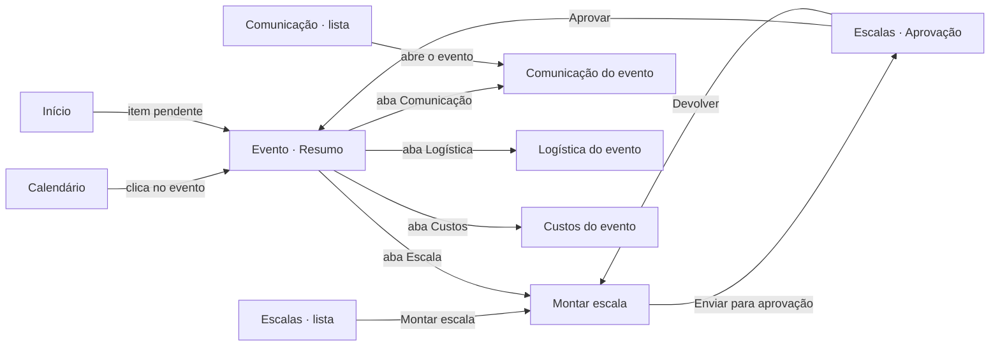
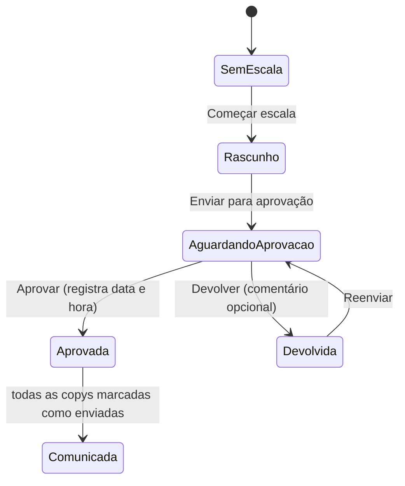

# Sistema Eventos — Telas do time de eventos (v0.1)

Especificação das 8 abas que faltam no app do time de eventos, no mesmo visual da tela de **Calendário**
(`src/app/(time)/calendario/`). Serve para as frentes de dev implementarem sem precisar redesenhar.

- **Usuária principal:** Patricia, líder do time de eventos. O time usa computador (notebook de 1280 px no mínimo).
- **Fonte das regras de negócio:** `docs/04-planejamento-front.md` (decisões e respostas do Vitor) e `docs/03-regras-de-custo.md`.
- **Fora desta versão:** login (o cabeçalho continua com "Versão local, sem login"), portal do staff, da SDC e do financeiro,
  e envio pelo WhatsApp (o espaço fica previsto, sem botão ativo).
- Nomes entre colchetes (`[Staff 03]`, `[REF-0001]`) são exemplos.

**Sumário**

1. Princípios e convenções
2. Navegação e rotas
3. Guia de componentes reutilizáveis
4. Início
5. Evento (detalhe) — porta de entrada para montar a escala
6. Escalas (lista, montar escala, aprovação)
7. Comunicação
8. Disponibilidade
9. Pessoas
10. Logística e SDC
11. Custos
12. Configurações
13. Tabela de situações (rótulo, tom e ícone)
14. Dados que faltam no banco para estas telas
15. Ordem sugerida de construção

---

## 1. Princípios e convenções

1. **Primeiro o que pede ação.** Toda tela abre pelo que está pendente; o resto vem depois.
2. **Uma ação principal por tela ou bloco.** Um único botão primário (azul) por área visível.
3. **Situação sempre com texto + ícone.** A cor reforça, nunca é o único sinal.
4. **Ação feita em nome de outra pessoa fica explícita.** Staff, SDC e financeiro ainda não têm portal. Quando o time
   registra algo que seria feito por eles (resposta à escala, disponibilidade, solicitação de custo, voo emitido),
   a ação se chama **"Registrar …"** e o registro ganha o selo **"Registrado pelo time"** (ver 3.11).
5. **Nada se perde em silêncio.** Toda ação tem retorno: toast de confirmação, indicador "Salvo" ou mensagem de erro com o que fazer.
6. **Sugestão é sugestão.** Vagas e pessoas sugeridas pelo sistema aparecem como "sugerido" e quem monta confirma.
7. **Mesma linguagem do time.** Termos fixos (use sempre os mesmos):

| Use | Não use |
|---|---|
| Evento, Masterclass | Turma (só ao falar do IAM Control) |
| Escala, vaga, função | Alocação, slot, cargo |
| Pessoa / staff | Usuário, colaborador |
| Copy | Template, payload |
| Confirmou / Não pode / Aguardando resposta | Aceita / Recusada / Pendente |
| Aprovar / Devolver | Rejeitar (na escala) |
| Aprovar / Reprovar (nos custos) | Deferir / Indeferir |
| Registrado pelo time | Inserido manualmente, override |

**Formatos (pt-BR, fuso `America/Sao_Paulo`):**

| Dado | Formato | Exemplo |
|---|---|---|
| Data curta (no ano corrente) | `dd/mm` | 12/11 |
| Data completa | `dd/mm/aaaa` | 12/11/2026 |
| Data e hora | `dd/mm às hh:mm` | 12/11 às 14:30 |
| Período | `dd/mm a dd/mm` | 12/11 a 14/11 |
| Horário | `hh:mm–hh:mm` | 08:00–18:00 |
| Dinheiro | `Intl.NumberFormat("pt-BR", { style: "currency", currency: "BRL" })` (banco em centavos) | R$ 1.234,56 |
| Distância | 1 casa decimal + "km" | 123,4 km |
| Consumo | 1 casa decimal + "km/l" | 10,5 km/l |
| Custo por km | 2 casas | R$ 0,74/km |
| Quantidade de | "N de M" | 18 de 22 vagas |

Números em tabela e cartões usam `tabular-nums` (já aplicado em `th`, `td`, `strong`, `time` dentro de `[data-ds]`)
e ficam alinhados à direita quando são valores para comparar (dinheiro, km, quantidades).

---

## 2. Navegação e rotas

O menu lateral (`painel.tsx`) mantém a ordem atual. Cada aba nova troca o item "em breve" por um link.
O logo passa a levar para `/inicio` quando a tela Início existir.

| Menu | Rota | Telas internas |
|---|---|---|
| Início | `/inicio` | — |
| Calendário | `/calendario` (pronta) | — |
| Escalas | `/escalas` | `/escalas/aprovacao` (fila da líder) |
| Comunicação | `/comunicacao` | — |
| Disponibilidade | `/disponibilidade` | `/disponibilidade/nova`, `/disponibilidade/[enqueteId]` |
| Pessoas | `/pessoas` | `/pessoas/[pessoaId]` |
| Logística e SDC | `/logistica/voos` | `/logistica/hospedagem`, `/logistica/caronas`, `/logistica/creditos` |
| Custos | `/custos` | `/custos/nova`; detalhe em painel lateral com `?protocolo=STF-…` |
| Configurações | `/configuracoes/regras-de-custo` | `/configuracoes/vagas`, `/configuracoes/modelos-de-copy`, `/configuracoes/locais` |
| (sem item no menu) | `/eventos/[eventoId]` | `/eventos/[eventoId]/escala`, `/comunicacao`, `/logistica`, `/custos` |

**Regra de ouro:** o trabalho de um evento acontece sempre em `/eventos/[eventoId]/…`. As abas do menu (Escalas,
Comunicação, Logística, Custos) são **listas entre eventos** que levam para lá. Assim não existe "montar escala" em dois lugares.

O item do menu fica ativo também nas rotas do evento conforme a origem: `/eventos/[id]/escala` acende **Escalas**,
`/eventos/[id]/comunicacao` acende **Comunicação**, e assim por diante; `/eventos/[id]` (resumo) acende **Calendário**.



**Mudanças no Calendário (pequenas, para fechar a navegação):**
- `CartaoDoEvento` vira um `Link` para `/eventos/[id]` (hoje é `div` com `title`). O conteúdo do `title` passa a aparecer
  também no foco do teclado (popover simples ou `aria-describedby` com o texto visível em `sr-only`).
- Os itens das listas "Precisa de ação" viram links para o evento (e "e mais N" leva para `/escalas` com o filtro certo).

**Migalha (breadcrumb)** nas telas internas, acima do título, 13 px `text-[var(--ds-label-2)]`, dentro de
`<nav aria-label="Você está em">`: `Calendário › CONF_AM_60 › Escala`. O último item tem `aria-current="page"`.

---

## 3. Guia de componentes reutilizáveis

Todos ficam em `src/app/(time)/_componentes/` (ou `src/componentes/` se o projeto preferir) e são usados pelas 8 abas.
**Não criar cor, raio ou espaçamento fora dos tokens `--ds-*`.** As classes abaixo são as mesmas da tela de Calendário.

### 3.1 Cabeçalho de página — `CabecalhoDaPagina`

Já existe como `Cabecalho` em `calendario/page.tsx`; extrair para o compartilhado e acrescentar a área de ações.

```
<div class="mb-5 flex flex-wrap items-start justify-between gap-3">
  <div>
    [migalha opcional]
    <h1 class="text-[28px] font-bold leading-[1.2] tracking-[-0.02em]">Título</h1>
    <p class="mt-1 text-[14px] text-[var(--ds-label-2)]">Subtítulo</p>
  </div>
  <div class="flex flex-wrap gap-2">[botões da página]</div>
</div>
```

Só um `h1` por página. Blocos internos usam `h2` 17 px (`text-[17px] font-semibold tracking-[-0.01em]`) e cartões `h3` 15 px.

### 3.2 Cartão — `Cartao`

```
CARTAO = "rounded-[var(--ds-radius-lg)] bg-[var(--ds-surface)] shadow-[var(--ds-shadow-1)]"
```

- Padding: `p-5` (padrão), `px-5 py-4` (cartão de número), `p-4 md:p-5` (cartão com tabela ou calendário).
- Título do cartão: `h3` `text-[15px] font-semibold`; explicação logo abaixo `mt-0.5 text-[12px] text-[var(--ds-label-2)]`.
- Cartão clicável inteiro: o `Link` envolve o título (não o cartão todo com `onClick`), e o cartão ganha
  `hover:shadow-[var(--ds-shadow-2)]`. Foco usa o anel padrão do `[data-ds] :focus-visible`.

**Cartão de número — `Numero`** (já existe no Calendário): rótulo 12 px `text-[var(--ds-label-2)]` e valor 28 px
`font-semibold tabular-nums`, com "de N" opcional. Quando o número é um atalho para uma lista, o rótulo vira link.

**Cartão de pendência — `Pendencia`** (já existe no Calendário): título + contador em pílula (laranja quando > 0,
verde quando 0) + explicação + até 6 itens + "e mais N". Acrescentar a prop `href` para o "Ver todos".

### 3.3 Botões — `Botao`

Altura `h-10` (40 px, `--ds-control-h`), raio `rounded-[10px]`, texto 14 px. Ícone `lucide-react` 18 px à esquerda, com `aria-hidden`.

| Variante | Classes | Uso |
|---|---|---|
| Primário | `inline-flex h-10 items-center justify-center gap-2 rounded-[10px] bg-[var(--ds-brand)] px-4 text-[14px] font-semibold text-white hover:bg-[var(--ds-tint-deep)]` | A ação principal da área (uma por área). |
| Secundário | `inline-flex h-10 items-center justify-center gap-2 rounded-[10px] border border-[var(--ds-separator)] bg-[var(--ds-surface)] px-3 text-[14px] font-medium text-[var(--ds-label)] hover:bg-[var(--ds-surface-2)]` (é o `BOTAO` do Calendário) | Ações de apoio, filtros, navegação. |
| Perigo | `… rounded-[10px] border border-[var(--ds-red-deep)] bg-[var(--ds-surface)] px-3 text-[14px] font-medium text-[var(--ds-red-deep)] hover:bg-[var(--ds-red-soft)]` | Remover, Reprovar, Devolver (abre confirmação). |
| Perigo confirmado | `… bg-[var(--ds-red-deep)] px-4 font-semibold text-white` | Só dentro do modal de confirmação. |
| Texto (link) | `inline-flex h-10 items-center gap-1 px-1 text-[14px] font-medium text-[var(--ds-tint-text)] hover:underline` | "Ver todos", "Ir para Logística". |
| Só ícone | `inline-flex h-10 w-10 items-center justify-center rounded-[10px] border border-[var(--ds-separator)] …` + **`aria-label` obrigatório** | Mês anterior, fechar painel. |
| Pequeno | Troca `h-10` por `h-8` (`--ds-control-h-sm`) e `px-3` por `px-2.5`, 13 px | Ações dentro de linhas de tabela. |

**Desabilitado:** use `aria-disabled="true"` (não `disabled`) quando a pessoa precisa saber **por quê**: o botão continua
focável, ganha `opacity-50 cursor-not-allowed` e um texto visível ao lado ou abaixo com o motivo, ligado por
`aria-describedby`. Ex.: "Copiar" bloqueado mostra "Falta o voo de ida". O clique não faz nada.

**Carregando:** troca o ícone por um `Loader2` girando (`animate-spin motion-reduce:animate-none`), mantém a largura,
texto no gerúndio ("Salvando…") e `aria-busy="true"`. Não desabilitar a tela inteira.

### 3.4 Chip de situação — `ChipDeSituacao`

Duas famílias:

**a) Situação da escala no calendário** (já existe): `situacao-{SEM_ESCALA|RASCUNHO|APROVADA|COMUNICADA|CANCELADO|CONCLUIDO}`
com `rounded-[7px] border border-l-[3px] px-2 py-0.5 text-[12px] font-medium`. Usar **só** para a situação da escala do evento,
para manter o mesmo código de cor do Calendário. Acrescentar `situacao-AGUARDANDO_APROVACAO` e `situacao-DEVOLVIDA` (ver seção 14).

**b) Chip de status (pílula)** para todo o resto (convocação, copy, auditoria, alerta de custo, enquete):

```
"inline-flex items-center gap-1 rounded-full px-2 py-0.5 text-[12px] font-medium"
```

| Tom | Fundo | Texto | Quando |
|---|---|---|---|
| Neutro | `bg-[var(--ds-fill-4)]` | `text-[var(--ds-label-2)]` | Sem resposta, rascunho, encerrado |
| Informação | `bg-[var(--ds-tint-soft)]` | `text-[var(--ds-tint-text)]` | Aguardando, enviada, emitido |
| Sucesso | `bg-[var(--ds-green-soft)]` | `text-[var(--ds-green-deep)]` | Confirmou, pronta, aprovado, pode |
| Atenção | `bg-[var(--ds-orange-soft)]` | `text-[var(--ds-orange-deep)]` | Falta dado, desatualizada, alerta |
| Perigo | `bg-[var(--ds-red-soft)]` | `text-[var(--ds-red-deep)]` | Não pode, reprovado, crítico, falhou |

Sempre com **ícone 14 px** (`aria-hidden`) + **texto**. O mapeamento de cada status está na seção 13.
Todos os pares acima passam de 4,5:1 no tema claro e no escuro (os tokens `-deep` já são ajustados no escuro).

### 3.5 Tabela — `Tabela`

Para listas com mais de ~6 itens e dados para comparar. Cartão vale para poucos itens com muita informação ou ações próprias.

```
<section class="CARTAO min-w-0 p-0">
  <div class="overflow-x-auto">
    <table class="w-full min-w-[880px] border-collapse text-[14px]">
      <caption class="sr-only">Descrição da tabela</caption>
      <thead class="bg-[var(--ds-surface-1)]">
        <th scope="col" class="px-4 py-2.5 text-left text-[12px] font-medium text-[var(--ds-label-2)]">
      <tbody>
        <tr class="border-t border-[var(--ds-separator)] hover:bg-[var(--ds-surface-1)]">
          <td class="px-4 py-3 align-middle">
```

- **Linha que abre algo:** o link fica no texto da primeira coluna (ex.: nome do evento). Não use `onClick` no `<tr>`.
- **Números:** `text-right tabular-nums`; o `th` da coluna também `text-right`.
- **Ações por linha:** última coluna, `text-right`, botões pequenos. Se houver mais de duas, um menu "Mais ações" (`MoreHorizontal`, `aria-label="Mais ações para [nome]"`).
- **Ordenação** (quando houver): botão no `th` com `aria-sort` no `th` (`ascending`/`descending`/`none`).
- **Primeira coluna fixa** em tabelas largas (matriz de disponibilidade): `sticky left-0 bg-[var(--ds-surface)] z-10`.
- **Paginação:** acima de 50 linhas, "Mostrar mais 50" no rodapé (texto "Mostrando 50 de 312"). Sem paginação numerada.
- **Largura:** `min-w-[880px]` cabe sem rolagem em 1280 px (área útil ≈ 972 px com o menu aberto). Tabelas mais largas rolam na horizontal dentro do cartão, nunca a página.

### 3.6 Campo de formulário — `Campo`

```
Rótulo:  <label for="id" class="mb-1 block text-[13px] font-medium text-[var(--ds-label)]">Expectativa de público</label>
Entrada: CAMPO = "h-10 w-full rounded-[10px] border border-[var(--ds-separator)] bg-[var(--ds-surface)] px-3 text-[14px] text-[var(--ds-label)]"
Select:  CAMPO + "pl-3 pr-8" (é o CAMPO de filtros.tsx)
Texto longo: CAMPO sem h-10 + "min-h-[96px] py-2"
Ajuda:   <p id="id-ajuda" class="mt-1 text-[12px] text-[var(--ds-label-2)]">Vem do IAM Control. Pode ser corrigida.</p>
Erro:    <p id="id-erro" class="mt-1 flex items-center gap-1 text-[12px] font-medium text-[var(--ds-red-deep)]"><CircleAlert size={14}/> Informe um número maior que zero.</p>
```

- Rótulo sempre visível (nunca só placeholder). Campo obrigatório: "(obrigatório)" no rótulo, em `text-[var(--ds-label-2)]`.
- No erro: `aria-invalid="true"`, borda `border-[var(--ds-red-deep)]` e `aria-describedby` com o id do erro (e da ajuda).
- Validar ao sair do campo e ao enviar; no envio, o foco vai para o primeiro campo com erro e um resumo no topo do formulário lista os erros como links.
- Número: `type="text" inputMode="numeric"` (evita a rolagem do mouse alterar o valor); dinheiro com prefixo "R$" fora do campo.
- Checkbox e rádio: o `<label>` envolve o controle e o texto, com área clicável de pelo menos 24 × 24 px (ideal 44 px de altura na linha).
- Foco: já tratado no `design-system.css` (borda azul + halo). Campo composto usa `data-ds-field` no invólucro.
- Salvar em formulário pequeno de um campo (ex.: público e fila): salva ao sair do campo, com o indicador de salvamento (3.12).

### 3.7 Barra de filtros — `BarraDeFiltros`

Mesmo padrão de `filtros.tsx`: filtros na URL (`searchParams`), para o link poder ser compartilhado e o "voltar" funcionar.

- Ordem: busca (quando houver) → seletores → atalhos (chips) → "Limpar filtros" (link, só aparece com filtro ativo).
- Busca: campo com ícone `Search`, rótulo `sr-only` ("Buscar por nome ou código"), aplica 300 ms depois de parar de digitar.
- **Atalhos de situação** (segmentos tipo "Para auditar (12) | Aprovadas | Reprovadas | Todas"): `nav` com links,
  `aria-current="page"` no ativo. Ativo: `bg-[var(--ds-tint-soft)] text-[var(--ds-tint-text)] font-semibold`;
  inativo: `text-[var(--ds-label-2)] hover:bg-[var(--ds-fill-4)]`; ambos `h-8 rounded-full px-3 text-[13px]`.
- Resultado do filtro anunciado para leitor de tela: texto `sr-only` com `aria-live="polite"` ("12 eventos encontrados").

### 3.8 Abas de página — `AbasDaPagina`

Para o Evento, Logística e Configurações. São **links para rotas** (não `role="tablist"`), dentro de
`<nav aria-label="Seções do evento">`, logo abaixo do cabeçalho:

```
"flex gap-1 border-b border-[var(--ds-separator)] mb-5"
item: "relative -mb-px inline-flex h-10 items-center gap-2 px-3 text-[14px] font-medium text-[var(--ds-label-2)] hover:text-[var(--ds-label)]"
ativo: + "text-[var(--ds-tint-text)] border-b-2 border-[var(--ds-brand)]" + aria-current="page"
```

Uma aba pode ter contador (pílula neutra) ou ponto de atenção — sempre com texto (`Comunicação · 3 bloqueadas` no `aria-label`).

### 3.9 Painel lateral e modal — `PainelLateral` / `Confirmacao`

Use o `<dialog>` nativo com `showModal()`: já prende o foco, fecha com `Esc` e devolve o foco ao botão que abriu
(confirmar no navegador; se não devolver, guardar o elemento e chamar `.focus()` ao fechar).

**Painel lateral** (formulários e detalhes sem sair da lista):
```
dialog: "fixed inset-y-0 right-0 left-auto m-0 h-dvh max-h-none w-[min(520px,100vw)] max-w-none bg-[var(--ds-surface)] p-0 shadow-[var(--ds-shadow-3)]"
backdrop: "backdrop:bg-[var(--ds-scrim)]"
cabeçalho: "flex items-start justify-between gap-3 border-b border-[var(--ds-separator)] px-5 py-4" (h2 17 px + botão fechar com aria-label="Fechar")
corpo: "overflow-y-auto px-5 py-4"
rodapé fixo: "sticky bottom-0 flex justify-end gap-2 border-t border-[var(--ds-separator)] bg-[var(--ds-surface)] px-5 py-3"
```
Largura 520 px (padrão) ou 720 px (detalhe de custo). Animação de entrada 200 ms (`--ds-dur-2`), desligada com `prefers-reduced-motion`.
Se houver alteração não salva e a pessoa fechar: confirmar "Descartar as alterações?" (Descartar / Continuar editando).

**Modal de confirmação** (ações destrutivas ou de alto impacto):
```
dialog: "w-[min(440px,calc(100vw-32px))] rounded-[var(--ds-radius-xl)] bg-[var(--ds-surface)] p-6 shadow-[var(--ds-shadow-3)] backdrop:bg-[var(--ds-scrim)]"
```
- Título é a pergunta ("Remover [Staff 03] da escala?"); o texto diz a **consequência** ("A copy dela deixa de existir. Se já foi enviada, avise a pessoa.").
- Botões: à direita o que confirma (com o verbo da ação, nunca "OK"/"Sim"), à esquerda "Cancelar". O foco inicial vai para "Cancelar" nas ações destrutivas.
- `aria-labelledby` no título e `aria-describedby` no texto.

### 3.10 Toast de confirmação — `Toast`

Retorno rápido depois de uma ação.

```
região fixa: "fixed bottom-6 right-6 z-[60] flex flex-col gap-2" com role="status" aria-live="polite"
toast: "flex min-w-[320px] max-w-[440px] items-start gap-3 rounded-[var(--ds-radius-md)] bg-[var(--ds-surface)] px-4 py-3 text-[14px] shadow-[var(--ds-shadow-3)]"
ícone: CircleCheck em text-[var(--ds-green-deep)] (sucesso) | CircleAlert em text-[var(--ds-red-deep)] (erro)
ação: botão texto "Desfazer" quando a ação for reversível
```

- Sucesso some em 6 s; **pausa com mouse ou foco em cima**. Toast com "Desfazer" fica 10 s.
- **Erro não some sozinho**, usa `role="alert"` e tem "Tentar de novo" quando fizer sentido.
- O toast não rouba o foco. Mensagem no passado e específica: "Escala enviada para aprovação." (não "Sucesso!").

### 3.11 Selo "Registrado pelo time" — `SeloRegistradoPeloTime`

Marca discreta para tudo que o time registra em nome de staff, SDC ou financeiro.

```
"inline-flex items-center gap-1 rounded-full border border-[var(--ds-separator)] px-1.5 py-0.5 text-[11px] font-medium text-[var(--ds-label-2)]"
ícone: UserPen 12 px (aria-hidden) + texto "Registrado pelo time"
```

- Fica ao lado do status que foi registrado (ex.: chip "Confirmou" + selo).
- Tooltip/descrição (no `title` **e** em `sr-only`): "Registrado pelo time em 12/11 às 14:30, em nome da pessoa." Quando houver login, acrescenta "por [nome]".
- Formulários de registro trazem no topo uma faixa neutra: "Você está registrando em nome de [Staff 03]. O registro fica marcado como feito pelo time."

### 3.12 Faixas, estados e indicadores

**Faixa de aviso (inline) — `Aviso`**
```
"flex items-start gap-3 rounded-[var(--ds-radius-md)] px-4 py-3 text-[14px]"
tons: informação bg-[var(--ds-tint-soft)] | atenção bg-[var(--ds-orange-soft)] | perigo bg-[var(--ds-red-soft)] | sucesso bg-[var(--ds-green-soft)]
ícone 18 px na cor -deep do tom (Info | TriangleAlert | CircleAlert | CircleCheck); título em font-semibold; texto em text-[var(--ds-label)]; ação à direita (botão texto)
```
Use `role="alert"` só para erro que acabou de acontecer; aviso permanente é texto comum.

**Estado vazio — `EstadoVazio`** (dentro do cartão onde a lista estaria)
```
"flex flex-col items-center gap-2 px-6 py-10 text-center"
ícone 32 px em text-[var(--ds-label-2)] + título text-[15px] font-semibold + texto text-[14px] text-[var(--ds-label-2)] max-w-[440px] + ação (botão primário ou link)
```
Dois tipos: **vazio de verdade** (ainda não existe nada: explica e oferece a próxima ação) e **vazio por filtro**
("Nenhum resultado com esses filtros." + "Limpar filtros").

**Carregando — `loading.tsx` por rota + `Esqueleto`**
- Esqueleto com a forma do conteúdo final (cartões de número, linhas de tabela): `rounded-[var(--ds-radius-sm)] bg-[var(--ds-fill-4)] animate-pulse motion-reduce:animate-none`.
- A região que carrega tem `aria-busy="true"` e um texto `sr-only` "Carregando…". Nada de spinner na tela inteira.

**Erro ao carregar — `error.tsx` por rota** (padrão de `calendario/error.tsx`)
- Título: "Não foi possível carregar [a tela]". Texto: "Tente de novo. Se continuar, o banco de dados pode estar fora do ar." Botão primário "Tentar de novo".

**Sem permissão — `SemPermissao`** (fica pronto para quando houver login; hoje não aparece)
- Ícone `Lock`, título "Esta área é da líder do time", texto "Peça à Patricia para fazer esta ação ou liberar seu acesso." Sem botão de ação.
- Onde vai valer: Aprovação de escala e Configurações (a confirmar).

**Somente leitura** — dados que vêm de fora (IAM Control, cadastro do GH) aparecem como texto, nunca como campo
desabilitado, com ícone `Lock` 14 px e a origem: "Vem do IAM Control".

**Indicador de salvamento — `IndicadorDeSalvamento`** (telas que salvam sozinhas)
- "Salvando…" (`Loader2`) → "Salvo às 14:32" (`Check`, `text-[var(--ds-label-2)]`) → em erro: "Não foi possível salvar." + "Tentar de novo" (`text-[var(--ds-red-deep)]`).
- Em `role="status"` `aria-live="polite"`.

**Atualização ao vivo — `AoVivo`** (Montar escala, Comunicação e pedidos da SDC usam Supabase Realtime)
- No cabeçalho: ponto verde + "Atualiza sozinha" em 12 px. Se a conexão cair: ponto cinza + "Sem atualização ao vivo. Recarregue a página para ver mudanças."
- Quando outra pessoa muda algo: o item alterado pisca de leve uma vez (fundo `--ds-tint-soft` por 1,5 s, sem piscar com `prefers-reduced-motion`) e uma mensagem `aria-live="polite"`: "Outra pessoa do time alterou esta escala."
- Se a pessoa estiver editando o mesmo campo: não sobrescrever; mostrar "Este campo foi alterado por outra pessoa. Usar o valor novo / Manter o meu".

**Barra de ação fixa — `BarraDeAcao`** (rodapé da Montar escala e do detalhe de custo)
```
"sticky bottom-0 z-20 -mx-4 md:-mx-6 mt-6 flex flex-wrap items-center justify-between gap-3 border-t border-[var(--ds-separator)] bg-[color-mix(in_srgb,var(--ds-surface)_92%,transparent)] px-4 py-3 backdrop-blur md:px-6"
```
Acrescentar `scroll-padding-bottom` no `main` com a altura da barra, para o foco do teclado não ficar escondido atrás dela (WCAG 2.4.11).

### 3.13 Acessibilidade comum a todas as telas

- **Pular para o conteúdo:** link "Pular para o conteúdo" como primeiro foco do `Painel`, visível no foco, apontando para `<main id="conteudo">`.
- **Título da aba do navegador:** `metadata.title` com o nome da tela (e o código do evento nas telas de evento: "Escala · CONF_AM_60").
- **Ordem de foco** segue a ordem visual: cabeçalho → filtros → conteúdo → barra de ação.
- **Contraste:** texto principal `--ds-label`, secundário `--ds-label-2` (≈ 5:1 no claro). **`--ds-label-3` não serve para texto que importa** (≈ 3:1); só para desabilitado ou decorativo.
- **Alvos:** controles com no mínimo 24 × 24 px (WCAG 2.5.8); botões padrão já têm 40 px.
- **Arrastar** nunca é a única forma (WCAG 2.5.7): quartos e caronas também têm um seletor "Mover para…".
- **Zoom 200%:** a tela deve continuar usável em 1280 px com zoom 200% (equivale a 640 px): o menu vira gaveta, tabelas rolam dentro do cartão, painel lateral ocupa a largura toda.
- **Tema escuro:** testar cada tela. Atenção: as classes `.situacao-*` hoje têm só cores do tema claro (ver Handoffs).
- **Movimento:** o `design-system.css` já zera animações com `prefers-reduced-motion`; não usar animação para chamar atenção além do destaque de 1,5 s do "ao vivo".

---

## 4. Início

**Objetivo:** mostrar, em uma olhada, o que o time precisa resolver hoje e levar direto ao lugar de resolver.

**Rota:** `/inicio` (passa a ser a página inicial do app; `/` redireciona para cá).

### Layout (de cima para baixo)

1. **Cabeçalho:** título "Início"; subtítulo com a hora da última sincronização (mesmo texto do Calendário: "Turmas do IAM Control sincronizadas em 28/10 às 19:30."). À direita, botão secundário "Atualizar" (`RefreshCw`).
2. **Cartões de número** (grade `grid-cols-2 lg:grid-cols-4 gap-3`), cada rótulo é link para a lista correspondente:
   - "Escalas a montar" (próximos 30 dias, sem escala ou em rascunho) → `/escalas?situacao=a-montar`
   - "Aguardando aprovação" → `/escalas/aprovacao`
   - "Copys bloqueadas" → `/comunicacao?situacao=falta-dado`
   - "Custos para auditar" → `/custos`
3. **Precisa de ação** (`h2`), grade `md:grid-cols-2 xl:grid-cols-3 gap-3` de **cartões de pendência** (3.2), nesta ordem:

| Cartão | Explicação (microcopy) | Itens mostram | Leva para |
|---|---|---|---|
| Copys bloqueadas por falta de dado | "Estas copys só podem ser enviadas quando o dado for preenchido." | `[Staff 03] · CONF_AM_60 — falta voo de ida` | Comunicação do evento, com a pessoa selecionada |
| Aguardando aprovação | "Escalas enviadas para a líder aprovar." | código · data · "enviada há 2 dias" | Aprovação |
| Escalas devolvidas | "A líder devolveu para ajustar." | código · comentário (1 linha, se houver) | Montar escala |
| Escalas a montar | "Eventos nos próximos 30 dias com a escala ainda não aprovada." | código · data · "12 de 22 vagas" | Montar escala |
| Pessoas sem resposta | "Convidadas há mais de 2 dias sem confirmar." | nome · código · função | Montar escala, com a pessoa destacada |
| Copys desatualizadas | "Os dados mudaram depois do envio. Copie e envie de novo." | nome · código · o que mudou | Comunicação do evento |
| Confronto sem fila | (texto atual do Calendário) | código · data | Evento · Resumo, foco no campo "Pessoas na fila" |
| Pendências da sincronização | "Eventos sem polo cadastrado ou com código repetido no IAM Control." | código ou nome da turma · motivo | Evento · Resumo |
| Custos para auditar | "Solicitações de custo esperando aprovação do time." | protocolo · nome · chip "Crítico"/"Alerta" | Custos, com o painel aberto |
| Voos para pedir (D-90) | "Eventos em menos de 90 dias com pessoas que vão de avião e ainda sem pedido à SDC." | código · nº de pessoas | Logística · Voos (aparece quando a fase 3 de dados existir) |

   Cartão com contador 0 continua visível, com a pílula verde "0" e o texto "Nada pendente." — mostra que está tudo em dia.
   Ordem dentro de cada cartão: o mais urgente primeiro (data do evento mais próxima; críticos antes de alertas).

4. **Próximos 7 dias** (`h2`): tabela compacta — Evento (link) | Datas | Polo | Vagas ("20 de 22") | Escala (chip `situacao-*`) | Copys ("18 de 20 enviadas").

### Estados

- **Carregando:** esqueleto de 4 cartões de número + 6 cartões de pendência + 5 linhas de tabela.
- **Tudo em dia** (todos os contadores 0): faixa de sucesso acima dos cartões: "Tudo em dia por aqui. Nenhuma pendência para hoje."
- **Sem eventos nos próximos 7 dias:** na tabela, "Nenhum evento nos próximos 7 dias." + link "Abrir calendário".
- **Sincronização atrasada** (última há mais de 2 horas): faixa de atenção "As turmas do IAM Control não são atualizadas desde 28/10 às 14:00. Os dados de eventos podem estar desatualizados."
- **Erro:** "Não foi possível carregar o início" (padrão 3.12).

### Acessibilidade e responsividade

- Cada cartão é uma `section` com `aria-labelledby` no título; o contador tem texto para leitor de tela: "3 pendências".
- O botão "Atualizar" anuncia "Início atualizado às 14:32" no `aria-live`.
- 1280 px: cartões de pendência em 3 colunas a partir de `xl` (1280), 2 colunas em `md`; tabela cabe sem rolagem (6 colunas).

---

## 5. Evento (detalhe) — porta de entrada para montar a escala

**Objetivo:** reunir tudo de um evento em um só lugar; é para onde o Calendário, o Início e as listas levam.

**Rotas:** `/eventos/[eventoId]` (Resumo), `/escala`, `/comunicacao`, `/logistica`, `/custos`.

### Cabeçalho comum a todas as abas do evento

- Migalha: `Calendário › CONF_AM_60`.
- Título: nome curto ("Confronto 60") + código em fonte mono 14 px ao lado (`font-[var(--ds-font-mono)] text-[var(--ds-label-2)]`).
- Linha de informações (14 px, `text-[var(--ds-label-2)]`, separadas por "·"): `12/11 a 14/11 · Manaus (AM) · [Local do evento] · 180 pessoas esperadas`.
- Chip da situação da escala (`situacao-*`) à direita do título.
- Se o evento estiver cancelado: faixa de perigo "Este evento foi cancelado no IAM Control. A escala e as copys ficam só para consulta." e todas as abas em somente leitura.
- Abas (3.8): **Resumo | Escala | Comunicação | Logística | Custos**. Contadores: Escala "18 de 22", Comunicação "3 bloqueadas" (atenção), Custos "4 para auditar".

### Aba Resumo — layout

Grade `lg:grid-cols-3 gap-3`:

1. **Andamento** (cartão largura total, primeiro): linha de 6 etapas — Vagas → Escala → Aprovação → Comunicação → Logística → Custos.
   Cada etapa: ícone de situação (`CircleCheck` feita, `CircleDot` em andamento, `Circle` não começou, `TriangleAlert` com pendência) + nome + detalhe ("18 de 22 vagas", "Aprovada em 05/11", "3 copys bloqueadas").
   Implementar como `<ol>` com o estado em texto (`sr-only` "concluída", "em andamento"…). A etapa com pendência é link para a aba.
   Botão primário à direita do cartão, conforme a etapa atual: "Montar escala" / "Continuar escala" / "Ver aprovação" / "Ir para Comunicação".
2. **Dados da turma** (2/3): somente leitura, ícone `Lock` + "Vem do IAM Control. Atualiza a cada 30 minutos (última: 28/10 às 19:30)."
   Lista de definição (`dl`) em 2 colunas: Tipo, Edição, Código, Polo, Datas, Local, Meta da turma, Inscritos ativos, Situação no IAM Control.
3. **Público e fila** (1/3), editável, salva ao sair do campo (3.6 e 3.12):
   - "Expectativa de público" — ajuda: "Vem do IAM Control (o maior entre a meta e os inscritos ativos). Corrija se souber de um número melhor. Muda a sugestão de líderes."
   - "Pessoas na fila" (só Confronto) — ajuda: "Usada para calcular as vagas de pai e mãe (1 a cada 15 pessoas)."
   - Depois de salvar, se mudar a sugestão de vagas e a escala já tiver número confirmado: faixa de atenção "A sugestão de vagas mudou: Staff líder agora é 8 (antes 7). Revise em Escala." + link "Revisar vagas".
4. **Vagas sugeridas** (largura total): tabela simples Função | Sugerido | Confirmado | Preenchidas. Rodapé: link "Abrir escala".

### Estados

- **Carregando:** esqueleto do cabeçalho + cartões.
- **Evento não encontrado** (id inválido ou apagado): página `not-found` — "Evento não encontrado. Ele pode ter sido removido do IAM Control." + "Voltar ao calendário".
- **Sem código** (pendência da sincronização): faixa de atenção "Este evento está sem código: falta a edição ou o polo no IAM Control. Corrija lá; o código aparece na próxima sincronização."
- **Masterclass/Imersão sem regra de vagas:** em Vagas sugeridas, "Este tipo de evento ainda não tem regra de vagas. Monte a escala digitando o número de cada função ou crie a regra em Configurações." + link.
- **Erro ao salvar público/fila:** erro no campo "Não foi possível salvar. Tente de novo." e o valor digitado é mantido.

### Acessibilidade

- `dl` com `dt`/`dd` para os dados da turma; campos editáveis com rótulo e ajuda ligados.
- Ao chegar com `#fila` (vindo do Início), o foco vai para o campo "Pessoas na fila".

---

## 6. Escalas

Três telas: **lista** (entre eventos), **montar escala** (de um evento) e **aprovação** (fila da líder).



### 6.1 Lista de escalas

**Objetivo:** ver em que pé está a escala de cada evento e abrir a que precisa de trabalho.

**Rota:** `/escalas` (filtros na URL: `situacao`, `polo`, `tipo`, `periodo`).

**Layout:**
1. Cabeçalho: "Escalas" / subtítulo "Monte e acompanhe a escala de cada evento." Ação secundária à direita: "Fila de aprovação" com contador (pílula) → `/escalas/aprovacao`.
2. Barra de filtros: atalhos de situação **"A montar (N) | Aguardando aprovação (N) | Devolvidas (N) | Aprovadas | Comunicadas | Todas"**; seletores Polo, Tipo e Período ("Próximos 30 dias" padrão, "Próximos 60 dias", "Próximos 90 dias", "Mês…"); busca por código ou nome.
   "A montar" = sem escala + rascunho. Masterclasses entram, mas podem ser escondidas com o chip "Esconder Masterclasses".
3. Tabela (ordem: data mais próxima primeiro):

| Coluna | Conteúdo |
|---|---|
| Evento | Nome curto (link para `/eventos/[id]/escala`) + código em 12 px abaixo |
| Datas | `12/11 a 14/11` |
| Polo | código |
| Vagas | barra de progresso fina (`h-1.5 rounded-full bg-[var(--ds-fill-3)]` com preenchimento `bg-[var(--ds-brand)]`) + "18 de 22" (o texto é o que vale; a barra é `aria-hidden`) |
| Respostas | "15 confirmaram · 2 aguardando · 1 não pode" (ícones + números; só aparece depois de convidar) |
| Situação | chip `situacao-*` |
| Ação | botão pequeno: "Começar escala" (sem escala) / "Continuar" (rascunho, devolvida) / "Ver" (demais) |

**Estados:**
- Vazio de verdade (nenhum evento no período): "Nenhum evento nos próximos 30 dias." + "Ver próximos 90 dias".
- Vazio por filtro: "Nenhuma escala com esses filtros." + "Limpar filtros".
- Carregando: 8 linhas de esqueleto. Erro: padrão.

### 6.2 Montar escala

**Objetivo:** confirmar o número de vagas de cada função, preencher com as pessoas sugeridas e enviar para aprovação.

**Rota:** `/eventos/[eventoId]/escala`. Atualiza ao vivo (Realtime) e **salva cada ação na hora** (não há botão "Salvar").

**Layout (de cima para baixo):**

1. **Cabeçalho do evento** (seção 5) com a aba "Escala" ativa. Abaixo do título, à direita: `IndicadorDeSalvamento` + `AoVivo`.
2. **Faixas de pendência** (só quando houver), antes de tudo:
   - Confronto sem fila: atenção — "Falta o número de pessoas na fila. Sem ele, as vagas de pai e mãe não são sugeridas." + ação "Informar fila" (abre campo inline).
   - Sem expectativa de público: atenção — "Falta a expectativa de público. Sem ela, as vagas de líderes não são sugeridas." + "Informar público".
   - Devolvida: informação — "A líder devolveu esta escala em 06/11 às 10:12." + comentário entre aspas, se houver. Some depois de reenviar.
   - Aprovada: informação — "Escala aprovada em 05/11 às 16:40. Trocas de pessoa ainda podem ser feitas e ficam marcadas como 'alterada depois da aprovação'." (ver Perguntas).
3. **Vagas por função** (`h2`, cartão com tabela):

| Coluna | Conteúdo |
|---|---|
| Função | nome da função |
| Sugerido | "sugerido 8" em 13 px `text-[var(--ds-label-2)]`, com ícone `Info` que explica a regra no foco/hover ("Público 180 ÷ 25, arredondado para cima"). Staff do Confronto: "sem sugestão" |
| Vagas | campo numérico com botões − e + (`aria-label="Diminuir vagas de Staff líder"`), largura 120 px. Começa com o sugerido; Staff do Confronto começa vazio |
| Número confirmado | checkbox "Confirmar" (`aria-label="Confirmar 8 vagas de Staff líder"`). Ao mudar o número depois de confirmar, a confirmação é desfeita e o campo pede de novo |
| Horário | "08:00–18:00" + selo neutro "provisório" (enquanto a regra de horário não estiver definida) |
| Preenchidas | "6 de 8" |

   Rodapé do cartão: "+ Adicionar função" (botão texto) → painel lateral com a lista de funções que ainda não estão na escala e campo de número.
   Evento de vários dias: por padrão cada função vale para todos os dias. Link por linha "Ajustar por dia" expande sub-linhas `12/11`, `13/11`… com o mesmo campo de vagas.
   Uma ação no cabeçalho do cartão: "Confirmar todas as sugestões" (secundário) — confirma de uma vez as funções que têm sugestão e não foram alteradas; **não** confirma Staff do Confronto.

4. **Equipe** (`h2`), uma seção por função (ordem da tabela de vagas), cada uma num cartão com título "Staff líder · 6 de 8" e tabela:

| Coluna | Conteúdo |
|---|---|
| Pessoa | nome (link para a ficha em nova aba, com ícone e `aria-label` "abre em nova aba") + selo "Trainee" quando o nível for TRAINEE |
| Dias | "Todos" ou `12/11, 13/11` |
| Situação | chip da convocação (seção 13) + selo "Registrado pelo time" quando for o caso + "alterada depois da aprovação" quando for o caso |
| Distância | "32,4 km · 40 min" |
| Deslocamento | seletor compacto: Carro próprio, Carona, Carro da IAM, Uber, Ônibus, Avião, Não se aplica |
| Ações | "Registrar resposta" (pequeno, secundário; só depois de convidada) + menu "Mais ações": Trocar pessoa, Editar dias, Observação, Remover da escala |

   Vagas ainda abertas aparecem como linhas tracejadas no fim de cada função: "Vaga aberta" + botão primário pequeno **"Adicionar pessoa"** (abre o painel de sugestões).
   Conflito de agenda: se a pessoa já está em outra escala no mesmo dia, chip de atenção "Também em MC_POA_POA no dia 12/11".

5. **Barra de ação fixa** (3.12):
   - À esquerda, resumo em texto: "18 de 22 vagas preenchidas · 1 função sem número confirmado".
   - À direita: primário **"Enviar para aprovação"** (rascunho/devolvida) ou "Reenviar para aprovação" (devolvida).
   - Fica com `aria-disabled` e o motivo visível enquanto houver função sem número confirmado: "Confirme o número de vagas de: Staff." (a lista é link e leva ao campo).
   - Se houver vaga aberta, o envio é permitido com confirmação: "Enviar com 4 vagas abertas? A líder vai ver quais funções estão incompletas." (Enviar mesmo assim / Continuar montando).
   - Depois de aprovada a barra mostra só o resumo + link "Ir para Comunicação".

**Painel lateral "Adicionar pessoa"** (520 px):
- Título: "Adicionar pessoa" / subtítulo "Staff líder · 12/11 a 14/11 · 2 vagas abertas".
- Linha de explicação: "Ordem: quem disse que pode, função habilitada, mais perto do evento e quem trabalhou há mais tempo."
- Busca por nome + filtros em chips: "Só quem disse que pode" (ligado por padrão quando há enquete), "Só habilitados nesta função".
- Lista (cartões compactos em `ul`, não tabela — cada item tem várias informações e uma ação):
  ```
  [Staff 07]                                        [Adicionar]
  Pode (chip sucesso) · Habilitado · 18,2 km · 25 min
  Último evento: 14/09 (CONF_AM_58) · 2 eventos nos últimos 90 dias
  Desempenho: em breve        ← espaço reservado, 12 px label-2 (some se a equipe preferir)
  ```
  - Disponibilidade: "Pode" (sucesso), "Não respondeu" (neutro), "Não pode" (perigo).
  - Função: "Habilitado", "Trainee" (neutro), "Não habilitado" (atenção).
  - Sem endereço no mapa: "Distância desconhecida" (neutro).
- Quem disse que não pode fica no fim, num grupo recolhido "Disseram que não podem (4)". Adicionar alguém desse grupo pede confirmação: "[Staff 12] disse que não pode neste evento. Adicionar mesmo assim?"
- Ao adicionar: a pessoa sai da lista, o contador "2 vagas abertas" diminui e o toast diz "[Staff 07] adicionada em Staff líder." com "Desfazer". O painel continua aberto até preencher as vagas ou fechar.
- Escolher os dias: se o evento tem mais de um dia, cada item tem "Todos os dias" marcado; "Escolher dias" abre checkboxes.

**Painel "Registrar resposta"** (em nome da pessoa):
- Faixa neutra (3.11): "Você está registrando a resposta de [Staff 07]. Fica marcado como registrado pelo time."
- Rádio: "Confirmou" / "Não pode". Se "Não pode": campo "Motivo (opcional)".
- Botão primário "Registrar resposta". Toast: "Resposta de [Staff 07] registrada: não pode."
- Depois de "Não pode", a linha mostra o botão "Trocar pessoa", que abre o painel de sugestões já filtrado para essa função e dia (substituto conforme a disponibilidade).

**Remover da escala:** confirmação "Remover [Staff 07] da escala?" — texto: "A vaga volta a ficar aberta." Se a copy já tinha sido enviada: "A copy já foi enviada para essa pessoa. Avise que ela saiu da escala." Botão "Remover".

**Estados da tela:**
- Carregando: esqueleto da tabela de vagas + 3 cartões de equipe.
- **Sem escala ainda** (vagas não geradas e tipo sem regra): estado vazio no lugar das vagas — "Este evento ainda não tem vagas." / "Adicione as funções e o número de vagas para começar." + primário "Adicionar função".
- **Sem sugestões** no painel: "Nenhuma pessoa encontrada para Staff líder." + "Mostrar pessoas não habilitadas" / "Limpar filtros".
- **Erro ao salvar uma ação:** toast de erro "Não foi possível adicionar [Staff 07]. Tente de novo." e a lista volta ao estado anterior.
- **Somente leitura:** evento cancelado ou concluído (campos viram texto, sem ações).
- **Aguardando aprovação:** quem monta ainda pode mexer? Hipótese: sim, mas a faixa avisa "Esta escala está com a líder. Mudanças agora aparecem para ela na aprovação."

**Acessibilidade:**
- Campos de vagas com rótulo completo (`aria-label` com a função); os botões − e + têm `aria-label` e o valor novo é anunciado.
- As tabelas de equipe têm `caption` `sr-only`: "Equipe de Staff líder: 6 de 8 vagas preenchidas".
- Mudanças vindas de outra pessoa (ao vivo) anunciadas em `aria-live="polite"`, sem tirar o foco.
- O motivo do botão desabilitado é texto visível e ligado ao botão.

**Responsividade (1280 px):** tudo em uma coluna; tabelas da equipe com 6 colunas cabem em ~972 px; o painel lateral cobre a tela por cima (não espreme a escala). Abaixo de 1024 px, a coluna Distância vai para baixo do nome.

### 6.3 Aprovação (fila da líder)

**Objetivo:** a líder revisa as escalas enviadas e aprova ou devolve. Aprovar **só registra** (data e hora; com login, quem aprovou).

**Rota:** `/escalas/aprovacao`.

**Layout:**
1. Cabeçalho: "Aprovação de escalas" / "Escalas enviadas para a líder aprovar. Aprovar só registra; nada é enviado às pessoas."
2. Lista de **cartões** (um por escala, ordem: evento mais próximo primeiro). Cartão:
   ```
   Confronto 60 · CONF_AM_60                         [Ver escala] [Devolver] [Aprovar]
   12/11 a 14/11 · Manaus · enviada em 04/11 às 18:20
   Vagas: 22 de 22 preenchidas
   Pontos de atenção:
     ⚠ 2 vagas abertas em Staff (atenção)
     ⚠ 1 pessoa disse que não pode e ainda está na escala
     ⚠ 3 pessoas sem PIX no cadastro (o custo delas trava no financeiro)
     ⚠ 2 pessoas vão de avião e ainda sem voo
     ℹ 1 trainee em Staff líder
   ```
   Pontos de atenção em `ul`, cada um com ícone + texto + link para a linha na Montar escala. Sem pontos: "Nenhum ponto de atenção." com `CircleCheck`.
3. **Ver escala** abre `/eventos/[id]/escala` em modo revisão: a barra de ação fixa troca para "Devolver" e "Aprovar".

**Ações:**
- **Aprovar** (primário): sem modal (é reversível). Toast "Escala CONF_AM_60 aprovada." + "Desfazer" (10 s). O cartão sai da fila.
- **Devolver** (perigo, contorno): modal "Devolver a escala CONF_AM_60?" — texto: "Quem montou vai ver seu comentário e poderá reenviar." Campo "Comentário (opcional)" (texto longo, 500 caracteres, com contador). Botões "Cancelar" / "Devolver escala". Toast "Escala CONF_AM_60 devolvida."

**Estados:**
- Vazio: ícone `CircleCheck` — "Nenhuma escala esperando aprovação." / "Quando alguém enviar uma escala, ela aparece aqui." + link "Ver escalas".
- Sem permissão (quando houver login): componente `SemPermissao` (3.12).
- Erro ao aprovar: toast de erro "Não foi possível aprovar. Tente de novo." e o cartão permanece.

**Acessibilidade:** cada cartão é `article` com `aria-labelledby` no título; os botões incluem o código no nome acessível ("Aprovar escala CONF_AM_60"). Depois de aprovar/devolver, o foco vai para o próximo cartão (ou para a mensagem de vazio).

---

## 7. Comunicação

**Objetivo:** gerar a copy de cada pessoa escalada, copiar e colar no WhatsApp, e marcar como enviada. O envio direto pelo
WhatsApp entra numa próxima versão (espaço previsto, sem botão ativo).

### 7.1 Lista (entre eventos)

**Rota:** `/comunicacao` (filtro `situacao`: `falta-dado`, `desatualizada`, `pronta`).

**Layout:**
1. Cabeçalho: "Comunicação" / "Copys das escalas aprovadas. Copie, envie pelo WhatsApp e marque como enviada."
2. Faixa de atenção (se houver): "5 copys estão bloqueadas por falta de dado. Elas liberam sozinhas quando o dado for preenchido." + "Ver bloqueadas".
3. Tabela de eventos com escala aprovada ou comunicada (ordem: data mais próxima):

| Evento (link → `/eventos/[id]/comunicacao`) | Datas | Prontas | Falta dado | Desatualizadas | Enviadas |
|---|---|---|---|---|---|
| Confronto 60 · CONF_AM_60 | 12/11 a 14/11 | 4 | 2 (chip atenção) | 1 (chip atenção) | 15 de 22 |

**Estados:** vazio — "Nenhuma escala aprovada para comunicar." / "As copys aparecem aqui quando a líder aprova uma escala." + "Ver fila de aprovação". Carregando e erro: padrão.

### 7.2 Comunicação do evento

**Rota:** `/eventos/[eventoId]/comunicacao` (`?pessoa=[convocacaoId]` seleciona a pessoa). Atualiza ao vivo (Realtime).

**Layout — duas colunas** (`grid lg:grid-cols-[minmax(320px,2fr)_3fr] gap-3`):

**Coluna 1 — Pessoas** (cartão):
- Atalhos de situação: "Todas (22) | Prontas (4) | Falta dado (2) | Desatualizadas (1) | Enviadas (15)".
- Lista (`ul` com itens como botões de seleção, `aria-current="true"` no selecionado): nome, função, chip da copy. Ordem: falta dado → desatualizadas → prontas → enviadas.
- Navegação: ↑/↓ movem entre pessoas quando a lista está em foco (com `Tab` saindo da lista; padrão listbox com `role="listbox"`/`role="option"` e `aria-selected`).

**Coluna 2 — Copy da pessoa selecionada** (cartão):
1. Cabeçalho: nome + função + dias; telefone com botão "Copiar telefone" (`Copy` 16 px). O telefone aparece só aqui, não na lista.
2. Faixas conforme a situação:
   - **Falta dado** (atenção, bloqueia): "Esta copy está bloqueada: falta o voo de ida." (lista quando faltar mais de um) + ação "Preencher em Logística" ou "Preencher na Escala", conforme o dado. Texto auxiliar: "Ela libera sozinha quando o dado for preenchido."
   - **Desatualizada** (atenção): "Os dados mudaram depois do envio (escala, voo ou quarto). Copie de novo e reenvie." Mostra "Enviada antes em 06/11 às 09:15".
   - **Enviada** (sucesso): "Marcada como enviada em 06/11 às 09:15 (copiada)." + "Desfazer" (só no toast) e, depois, link "Marcar como não enviada".
3. **Texto da copy:** caixa somente leitura `whitespace-pre-wrap rounded-[var(--ds-radius-md)] bg-[var(--ds-surface-1)] p-4 text-[14px] leading-[1.5]`, com `aria-label="Copy de [Staff 03]"`.
   Dado faltando aparece no lugar como `<mark>` em atenção: `[falta: voo de ida]` (`bg-[var(--ds-orange-soft)] text-[var(--ds-orange-deep)] rounded px-1 font-medium`) — com texto, não só cor.
4. **Ações** (linha abaixo do texto):
   - Primário **"Copiar"** (`Copy`): copia o texto para a área de transferência. Retorno no próprio botão por 2 s: "Copiada" (`Check`) + anúncio `aria-live` "Copy copiada". Bloqueado (`aria-disabled`) quando falta dado, com o motivo ao lado.
   - Secundário **"Marcar como enviada"** (`CheckCheck`): registra a mensagem como enviada (canal "copiada") e marca a convocação como convidada. Depois de marcar, a seleção passa sozinha para a próxima pessoa pronta (o foco vai para o botão "Copiar" dela) e o toast diz "[Staff 03] marcada como enviada." + "Desfazer".
   - Espaço previsto do WhatsApp: botão com `aria-disabled="true"` "Enviar pelo WhatsApp" (`MessageCircle`) + chip neutro "em breve" e o texto 12 px: "O envio direto pelo WhatsApp do time entra numa próxima versão." Não usar a cor verde do WhatsApp enquanto estiver inativo.
5. Rodapé do cartão: "Modelo: Escalação" + link "Editar modelo" (→ Configurações › Modelos de copy, nova aba).

**Estados:**
- Carregando: esqueleto da lista (8 linhas) e da caixa de texto.
- Escala ainda não aprovada: estado vazio — "A escala deste evento ainda não foi aprovada." / "As copys são geradas depois da aprovação." + "Ir para a escala".
- Nenhuma pessoa no filtro: "Nenhuma copy com essa situação." + "Ver todas".
- Todas enviadas: faixa de sucesso no topo "Todas as copys deste evento foram enviadas." e a escala passa a "Escala comunicada".
- Falha ao copiar (navegador bloqueou): toast de erro "Não foi possível copiar automaticamente. Selecione o texto e use Ctrl+C." e o texto da copy fica selecionado.
- Erro ao marcar como enviada: toast de erro com "Tentar de novo"; a pessoa continua como pronta.

**Acessibilidade:** a lista é `listbox` com rótulo "Pessoas da escala"; a mudança de seleção atualiza a coluna 2 e o título dela é anunciado; o atalho opcional `Ctrl+Shift+C` para copiar só se não conflitar com o navegador (documentar no `title` do botão).

**Responsividade:** em 1280 px as duas colunas cabem (≈ 390 + 580 px). Abaixo de 1024 px vira uma coluna: lista em cima (altura máxima 320 px com rolagem) e a copy embaixo.

---

## 8. Disponibilidade

**Objetivo:** perguntar ao staff em quais eventos de um período cada pessoa pode trabalhar e guardar as respostas, que
alimentam a ordem das sugestões na Montar escala. Sem portal do staff, a enquete é divulgada pelo WhatsApp e o time registra as respostas.

### 8.1 Lista de enquetes

**Rota:** `/disponibilidade`.

**Layout:** cabeçalho "Disponibilidade" / "Pergunte ao staff em quais eventos pode trabalhar." + primário **"Nova enquete"**.
Tabela: Título (link) | Eventos ("6 eventos") | Fecha em ("15/11 às 23:59") | Respostas ("38 de 120 pessoas") | Situação (chip "Aberta" informação / "Encerrada" neutro).
Atalhos: "Abertas | Encerradas | Todas".

**Estados:** vazio — "Nenhuma enquete ainda." / "Crie uma enquete para saber quem pode trabalhar nos próximos eventos." + "Nova enquete".

### 8.2 Nova enquete

**Rota:** `/disponibilidade/nova` (página, não painel: a escolha de eventos precisa de espaço).

**Formulário (um cartão, campos em uma coluna de até 640 px, eventos em largura total):**
1. "Período dos eventos" — duas datas "De" e "Até" + seletores "Polo" e "Tipo" (opcionais).
2. "Eventos" — lista de checkboxes dos eventos do período (nome curto, código, datas, polo), com "Selecionar todos (8)". Masterclasses agrupadas e recolhidas.
3. "Título" (obrigatório) — preenchido sozinho a partir do período ("Eventos de 01/12 a 31/12"), editável.
4. "Fecha em" (obrigatório) — data e hora; padrão: 7 dias a partir de hoje às 23:59. Ajuda: "Depois disso, as respostas param de entrar como novas, mas o time ainda pode registrar."
5. Ação: primário "Criar enquete", secundário "Cancelar".

**Depois de criar:** vai para o detalhe com a faixa de sucesso "Enquete criada. Copie o convite e envie no grupo do staff." e o cartão **"Convite para o WhatsApp"**: texto pronto com o título, a lista de eventos e "Responda com os eventos em que você pode." + botão "Copiar convite".

**Validação:** sem evento marcado — "Escolha pelo menos um evento."; "Fecha em" no passado — "Escolha uma data a partir de hoje."

### 8.3 Respostas da enquete

**Rota:** `/disponibilidade/[enqueteId]`.

**Layout:**
1. Cabeçalho: título da enquete; subtítulo "Fecha em 15/11 às 23:59 · 38 de 120 pessoas responderam". Ações: secundário "Copiar convite", secundário "Encerrar agora" (ou "Reabrir" se encerrada), primário **"Registrar resposta"**.
2. Cartões de número por evento (linha rolável se passar de 4): "CONF_AM_60 · 12/11 — 24 podem".
3. Filtros: busca por nome, Polo/cidade, Função, chip "Só quem não respondeu".
4. **Matriz** (tabela): linhas = pessoas, colunas = eventos. Célula: `Check` + "Pode" (sucesso), `X` + "Não pode" (perigo), "—" + `sr-only` "Sem resposta" (neutro). Primeira coluna fixa com nome + selo "Registrado pelo time" quando for o caso. Última coluna: "Registrar" (botão pequeno).
   Linha de totais no rodapé (`tfoot`): "24 podem · 6 não podem" por evento.

**Painel "Registrar resposta"** (em nome da pessoa, 520 px):
- Campo "Pessoa" (busca com autocomplete; só nome e função, sem telefone) — vem preenchido quando aberto pela linha.
- Faixa neutra 3.11.
- Por evento: grupo de rádio "Pode / Não pode / Sem resposta" (`fieldset` com `legend` = nome do evento e data).
- Atalho "Pode em todos" e "Não pode em nenhum".
- Primário "Registrar resposta". Toast: "Resposta de [Staff 07] registrada em 6 eventos."

**Estados:**
- Sem nenhuma resposta: matriz com estado vazio — "Ninguém respondeu ainda." / "Copie o convite e envie no grupo do staff. Registre aqui as respostas que chegarem." + "Copiar convite".
- Encerrada: faixa neutra "Enquete encerrada em 15/11. O time ainda pode registrar respostas." (o registro continua liberado).
- Erro ao registrar: erro dentro do painel, mantendo as escolhas.

**Acessibilidade:** a matriz tem `th scope="col"` para eventos e `th scope="row"` para pessoas; cada célula é lida como "Pode" / "Não pode" / "Sem resposta" (texto, não só ícone). A matriz é tabela de leitura; a edição é sempre pelo painel (nada de clicar na célula para alternar).

**Responsividade:** com mais de 5 eventos a matriz rola na horizontal dentro do cartão, com a coluna de nomes fixa.

---

## 9. Pessoas

**Objetivo:** consultar e manter o que o time precisa saber do staff para escalar: funções, veículo, camiseta, experiência, endereço e histórico.

> Nome, telefone, e-mail e endereço vêm do cadastro de pessoas do GH (schema `core`/`sensivel`, somente leitura para o Eventos).
> Aqui o time edita só o que é do Eventos: funções, veículo, camiseta, "fez Confronto", "tem CNPJ".

### 9.1 Lista de pessoas

**Rota:** `/pessoas`.

**Layout:**
1. Cabeçalho: "Pessoas" / "Staff que pode ser escalado nos eventos." (sem botão "Nova pessoa" nesta fase — ver Perguntas).
2. Filtros: busca por nome; Função; Cidade; chips "Tem carro", "Cadastro incompleto", "Fez Confronto"; seletor "Ativas / Inativas / Todas" (padrão: Ativas).
3. Tabela:

| Coluna | Conteúdo |
|---|---|
| Nome | nome social se houver, senão nome completo (link → ficha) |
| Funções | até 3 chips neutros ("Staff líder", "Pai/mãe"…; trainee com sufixo "· trainee") + "+2" |
| Cidade | cidade/UF do endereço (sem rua) |
| Carro | "4 lugares" ou "—" |
| Camiseta | "Baby look M" / "—" |
| Fez Confronto | "Sim" / "Não" / "—" |
| Último evento | `14/09 · CONF_AM_58` |
| Cadastro | chip "Completo" (sucesso) ou "Falta PIX" / "Falta endereço" (atenção) |

**Estados:** vazio por filtro — "Nenhuma pessoa com esses filtros." + "Limpar filtros". Vazio de verdade — "Nenhuma pessoa cadastrada ainda." / "As pessoas vêm do cadastro do GH e, depois, do cadastro feito pelo próprio staff."

### 9.2 Ficha da pessoa

**Rota:** `/pessoas/[pessoaId]`.

**Layout** (cabeçalho + grade `lg:grid-cols-3 gap-3`):
- Cabeçalho: nome; linha "Staff · Manaus (AM) · ativa"; chip de cadastro. Migalha `Pessoas › [Staff 07]`.
- **Contato** (somente leitura, `Lock` + "Vem do cadastro de pessoas"): telefone (com "Copiar"), e-mail.
- **Funções** (editável): lista de funções com nível (rádio "Habilitado" / "Trainee") e "Remover"; "+ Adicionar função". Salva a cada mudança com toast "Funções de [Staff 07] atualizadas."
- **Veículo** (editável): "Tem carro" (sim/não); "Lugares para passageiros" 1–8 (sem contar o motorista, decisão de 28/10); "Consumo (km/l)" com ajuda "Usado para conferir os custos de combustível. Deixe vazio se não souber."
- **Camiseta e experiência** (editável): Modelo (Camiseta / Baby look), Tamanho (PP a XG), "Já tem a camiseta do staff", "Fez o Confronto", "Tem CNPJ".
- **Endereço** (somente leitura): cidade/UF e mapa estático com o ponto; rua e número escondidos por padrão com o botão "Mostrar endereço completo" (privacidade). Sem localização: "Endereço sem localização no mapa. A distância até os eventos não é calculada."
- **Pagamento** (somente leitura): "PIX cadastrado" (sucesso) ou "Sem PIX: os custos desta pessoa ficam travados no financeiro." (atenção). Nunca mostrar a chave PIX inteira nem o CPF.
- **Histórico** (largura total, tabela): Data | Evento (link) | Função | Situação na escala | Presença. Ordem: mais recente primeiro. Vazio: "Ainda não trabalhou em nenhum evento pelo sistema."

**Estados:** carregando (esqueleto dos cartões); não encontrada ("Pessoa não encontrada." + "Voltar para Pessoas"); erro ao salvar um campo (mensagem no campo, valor mantido).

**Acessibilidade:** cada cartão editável é um `form` com `aria-labelledby`; mapa com texto alternativo "Mapa com a localização aproximada em Manaus (AM)" e a cidade escrita ao lado (o mapa não é a única informação).

---

## 10. Logística e SDC

**Objetivo:** organizar como cada pessoa chega e onde dorme: pedidos de voo à SDC (D-90), rooming list, caronas e créditos de hotel.
A SDC ainda não tem portal: o time registra o pedido, envia pelo canal de sempre e **registra o voo emitido** quando a SDC responder.

> Dados: só `carona` e `convocacao.deslocamento` existem hoje. Voos, hotéis, quartos e créditos são da fase 3 do modelo
> (`voo_pedido`, `hotel`, `hospedagem_reserva`, `quarto`, `quarto_ocupante`, `credito_hotel`). Comece por **Caronas**.

**Rotas:** `/logistica/voos` (padrão), `/logistica/hospedagem`, `/logistica/caronas`, `/logistica/creditos`. No evento:
`/eventos/[id]/logistica` mostra as mesmas seções filtradas pelo evento, uma abaixo da outra.

**Cabeçalho comum:** "Logística e SDC" / "Voos, hospedagem e caronas do staff." + abas **Voos (SDC) | Hospedagem | Caronas | Créditos de hotel** + seletor de evento (padrão "Próximos 90 dias").

### 10.1 Voos (pedidos à SDC)

**Layout:**
1. Faixa de atenção (se houver): "7 pessoas vão de avião para eventos em menos de 90 dias e ainda não têm pedido." + "Ver quem falta".
2. Atalhos: "A pedir (7) | Pedido à SDC (5) | Emitidos | Cancelados | Todos". Ação primária: **"Novo pedido"**. Pedidos da SDC atualizam ao vivo.
3. Tabela:

| Coluna | Conteúdo |
|---|---|
| Referência | `[REF-0001]` em mono (link → painel do pedido) |
| Evento | código |
| Passageiro | nome |
| Trecho | "Porto Alegre → Manaus" + "ida" / "volta" |
| Data desejada | `11/11` |
| Voo | "LATAM 3456 · 11/11 06:10–11:45 · localizador ABC123" ou "—" |
| Situação | chip (A pedir, Pedido à SDC, Emitido, Alterado pelo time, Cancelado) + selo "Registrado pelo time" no voo informado pelo time |
| Ações | "Registrar voo" (quando pedido), menu: Copiar pedido, Editar, Cancelar pedido |

**Painel "Novo pedido"**: Evento; Pessoa (só escaladas com deslocamento "Avião"; as demais aparecem com aviso "Mude o deslocamento para Avião na escala"); Trecho (Origem, Destino, Ida/Volta/Ida e volta); Datas desejadas; Observação para a SDC. Primário "Registrar pedido".
Depois: faixa de sucesso no painel "Pedido [REF-0001] registrado. A SDC ainda não tem portal: copie o pedido e envie pelo canal de sempre." + "Copiar pedido".

**Painel "Registrar voo"** (em nome da SDC): faixa neutra "Você está registrando o voo informado pela SDC." À esquerda (ou acima, em 520 px), "O que a IAM pediu" (somente leitura); abaixo, formulário: Companhia, Número do voo, Localizador, Partida (data e hora), Chegada (data e hora), Valor (R$), Cartão de embarque (arquivo, opcional). Primário "Registrar voo".
Toast: "Voo de [Staff 07] registrado. A copy dela foi atualizada." (o voo libera a copy bloqueada ou a deixa desatualizada se já tinha sido enviada).

**Cancelar pedido:** confirmação "Cancelar o pedido [REF-0001]?" — "Avise a SDC pelo canal de sempre. O voo some da copy da pessoa." Botão "Cancelar pedido" / "Voltar".

### 10.2 Hospedagem (rooming list)

**Layout por evento** (seletor de evento obrigatório nesta aba):
1. Cartão "Hotel": nome, endereço, check-in/check-out, reserva. Ação "Editar hotel". Sem hotel: estado vazio "Nenhum hotel definido para este evento." + "Definir hotel".
2. **Sem quarto** (cartão): pessoas escaladas que precisam de hotel e ainda não têm quarto; cada uma com o seletor "Colocar no quarto…".
3. **Quartos** (grade de cartões `md:grid-cols-2 xl:grid-cols-3`): "Quarto 1 · duplo · 2 de 2"; lista de ocupantes com "Mover para…" e "Tirar do quarto". Aviso de atenção no cartão quando misturar sexos: "Quarto com pessoas de sexos diferentes." "+ Novo quarto" no fim.
4. Ação no cabeçalho da seção: secundário "Copiar rooming list" (texto pronto para o hotel: quarto, nomes, check-in/out).

Arrastar entre quartos é opcional; o seletor "Mover para…" é obrigatório (WCAG 2.5.7). Mudança de quarto deixa a copy de hospedagem desatualizada.

### 10.3 Caronas

**Layout por evento:**
1. **Motoristas** (cartões): "[Staff 02] · 4 lugares · 2 ocupados · sai de Canoas, 32,4 km". Lista de passageiros com "Tirar da carona". Ação "Adicionar passageiro" (seletor com quem está sem carona, ordenado pela distância até o motorista).
2. **Sem carona definida** (tabela): pessoas com deslocamento "Carona" sem motorista — Nome | Cidade | Distância até o evento | "Escolher carona" (seletor de motorista com lugares livres: "[Staff 02] — 2 lugares livres").
3. Ação "Novo motorista": escolhe entre as pessoas escaladas com carro.

Validação: carro cheio — "O carro de [Staff 02] já está com os 4 lugares ocupados."
Vazio: "Ninguém com carona neste evento." / "Quem vai de carona aparece aqui quando o deslocamento for marcado como Carona na escala." + "Ir para a escala".

### 10.4 Créditos de hotel

Tabela: Hotel | Valor | Origem ("CONF_POA_12 cancelado") | Validade | Situação (Válido — sucesso; "Vence em 20 dias" — atenção; Vencido — perigo; Usado — neutro). Ação primária "Registrar crédito"; por linha "Marcar como usado" (pede o evento).
Faixa de atenção: "2 créditos vencem nos próximos 30 dias."
Vazio: "Nenhum crédito de hotel registrado."

**Estados gerais da Logística:** carregando (esqueleto da tabela ou dos cartões); erro (padrão); vazio por evento sem ninguém escalado: "A escala deste evento ainda não tem pessoas." + "Ir para a escala".

**Acessibilidade:** cartões de quarto e de motorista são `section` com título; contadores "2 de 4 lugares" em texto; seletores com rótulo completo ("Mover [Staff 05] para o quarto").

---

## 11. Custos

**Objetivo:** o time confere cada solicitação de custo do staff e **aprova ou reprova com motivo**. Só o que for aprovado vai para o financeiro.
Sem portal do staff, o time também **registra a solicitação** em nome da pessoa.

### 11.1 Fila de auditoria

**Rota:** `/custos` (filtros na URL; `?protocolo=STF-…` abre o painel de detalhe).

**Layout:**
1. Cabeçalho: "Custos" / "Confira as solicitações do staff. Só as aprovadas seguem para o financeiro." + primário **"Registrar solicitação"**.
2. Cartões de número: "Para auditar", "Com alerta crítico", "Aprovadas no mês (R$)", "Reprovadas no mês".
3. Filtros: atalhos "Para auditar (12) | Aprovadas | Reprovadas | Todas"; Evento; Alerta ("Crítico", "Alerta", "Sem alerta"); busca por protocolo ou nome.
4. Tabela (ordem em "Para auditar": críticos → alertas → sem alerta; dentro de cada grupo, a mais antiga primeiro):

| Coluna | Conteúdo |
|---|---|
| Protocolo | `STF-202611-0012` em mono (botão que abre o painel) |
| Pessoa | nome + selo "Registrado pelo time" se for o caso |
| Evento | código |
| Km | "412,0 km" (direita) |
| Total | "R$ 486,30" (direita) |
| Alerta | chip "Crítico" (perigo, `OctagonAlert`) ou "Alerta" (atenção, `TriangleAlert`) + motivo curto em 12 px: "consumo 6,8 km/l" |
| Recebida em | `14/11` |
| Auditoria | chip (Para auditar / Aprovada / Reprovada) |
| Financeiro | texto 12 px `label-2`: "Aguardando pagamento", "Cadastro pendente (sem PIX)", "Pago em 20/11"… |

### 11.2 Detalhe da solicitação (painel lateral 720 px)

1. Cabeçalho: protocolo + pessoa + evento + função; chips de auditoria e financeiro. Navegação "Anterior" / "Próxima" (setas, com `aria-label`) para auditar em sequência.
2. **Alertas** (faixas, uma por regra violada, com os números do doc 03):
   - Crítico: "Consumo de 6,8 km/l está abaixo de 7,5 km/l." / "Consumo de 23,0 km/l está acima de 22 km/l." / "Custo de R$ 1,02 por km está acima de R$ 0,95."
   - Alerta: "Consumo de 9,4 km/l está abaixo de 10 km/l." / "Custo de R$ 0,74 por km está acima de R$ 0,70."
   - Cadastro: "Sem PIX no cadastro. Mesmo aprovada, só será paga depois que o cadastro estiver completo." (atenção)
   Cada alerta indica o deslocamento a que se refere ("Deslocamento 2").
3. **Deslocamentos** (tabela): # | Trecho ("Canoas → Porto Alegre", "ida e volta") | Km | Consumo | Preço do litro | Combustível | Pedágio | Depreciação | Total | Alerta | Comprovante (link "Ver comprovante", nova aba).
   Rodapé: "Km total: 412,0 km" (decisão do doc 03: cada deslocamento conta separado na depreciação, com a soma mostrada).
4. **Outros itens** (tabela): Categoria (Remuneração, Alimentação, Adicional, Montagem, Outro) | Descrição | Quantidade | Valor | Comprovante. Item que veio da regra: ícone `Calculator` + `sr-only` "valor da regra".
5. **Total** em destaque (20 px semibold, direita).
6. **Parecer anterior** (se reprovada antes e reenviada): "Reprovada em 15/11: falta o comprovante do pedágio."
7. **Barra de ação fixa do painel:** perigo contorno **"Reprovar"** e primário **"Aprovar"**.
   - **Aprovar sem alerta:** aprova direto. Toast "STF-202611-0012 aprovada. Seguiu para o financeiro." + "Desfazer". O painel avança para a próxima da fila.
   - **Aprovar com alerta crítico:** modal "Aprovar com alerta crítico?" — texto com o alerta — campo "Motivo da aprovação (obrigatório)" (ex.: "Carro da pessoa é antigo; consumo conferido"). Botão "Aprovar".
   - **Reprovar:** modal "Reprovar STF-202611-0012?" — "A pessoa vai ver o motivo e poderá corrigir e reenviar." Campo "Motivo (obrigatório)". Botão "Reprovar".
   - Já aprovada/reprovada: a barra mostra "Aprovada em 15/11 às 10:20" e, enquanto o financeiro não tiver pago, o link "Reabrir auditoria" (confirmação simples).

### 11.3 Registrar solicitação (em nome da pessoa)

**Rota:** `/custos/nova` (página: o formulário é grande).

1. Faixa neutra 3.11: "Você está registrando a solicitação em nome da pessoa. Ela fica marcada como registrada pelo time."
2. **Evento e pessoa:** seletor de evento (concluídos nos últimos 60 dias primeiro) → seletor de pessoa (só quem esteve na escala). Se já existir solicitação desta pessoa neste evento: "[Staff 07] já tem a solicitação STF-202611-0012 para este evento." + "Abrir solicitação" (o banco só aceita uma por pessoa e evento).
3. **Deslocamentos:** linhas repetíveis — Origem, Destino, "Ida e volta" (marcado), Km (calculado pelo mapa quando possível, com "Calculado pelo mapa" e opção "Corrigir km"), Consumo (vem do veículo da pessoa), Preço do litro (vem da regra da UF), Pedágio, Comprovante. Combustível, depreciação e total são calculados e mostrados como texto. "+ Adicionar deslocamento".
4. **Itens:** pré-preenchidos pela regra do tipo de evento (remuneração, alimentação), editáveis; "+ Adicionar item" (Adicional, Montagem, Outro) com comprovante.
5. **Resumo ao vivo** (cartão à direita em `xl`, abaixo em telas menores): total, km total, alerta que a solicitação vai ter ("Esta solicitação vai entrar com alerta: custo de R$ 0,74 por km.").
6. Ações: primário "Registrar solicitação", secundário "Cancelar".
   Sucesso: vai para `/custos?protocolo=STF-202611-0013` com toast "Solicitação STF-202611-0013 registrada em nome de [Staff 07]."

**Estados (Custos):**
- Fila vazia em "Para auditar": `CircleCheck` — "Nenhuma solicitação para auditar." / "Quando uma solicitação for registrada, ela aparece aqui."
- Vazio por filtro: padrão.
- Sem regra de custo para a UF/tipo: faixa de atenção no formulário "Não há preço do litro cadastrado para AM. Informe o valor ou cadastre em Configurações › Regras de custo."
- Erro ao aprovar/reprovar: toast de erro, o painel não avança.
- Carregando: esqueleto da tabela; no painel, esqueleto das tabelas.

**Acessibilidade:** valores em dinheiro com o texto completo (o leitor de tela lê "R$ 486,30"); chips de alerta com texto; o painel tem título com o protocolo; ao avançar para a próxima, o foco vai para o título do painel e o novo protocolo é anunciado.

**Responsividade:** a tabela da fila tem 9 colunas — em 1280 px, "Recebida em" e "Financeiro" vão para baixo de "Auditoria" (mesma célula, 12 px) para caber sem rolagem. O painel de 720 px cobre a lista por cima.

---

## 12. Configurações

**Objetivo:** editar o que muda as contas do sistema sem mexer no código: regras de custo, regras de vagas, modelos de copy, locais e hotéis.

**Rotas e abas:** **Regras de custo | Vagas por tipo de evento | Modelos de copy | Locais e hotéis**.
Cabeçalho: "Configurações" / "Valores e modelos usados pelo sistema. Mudanças valem dali em diante." Sem permissão (quando houver login): `SemPermissao`.

### 12.1 Regras de custo

- Uma tabela por categoria (Remuneração, Alimentação, Depreciação, Adicionais, Montagem, Combustível, Limites de alerta), cada uma num cartão com `h3`.
- Colunas: Nome | Tipo de evento ("Todos" se vazio) | UF ("Todas") | Unidade ("por evento", "por dia", "por hora", "por deslocamento", "por litro", "fixo") | Valor (direita) | Vale desde | Situação (Ativa/Inativa) | "Editar".
- Depreciação e limites mostram os parâmetros em texto: "de 100 a 249 km → R$ 80,00"; "Crítico: consumo abaixo de 7,5 km/l".
- **Editar** (painel): Valor (R$), "Vale a partir de" (data; padrão hoje), Observação. Ajuda: "O valor antigo fica guardado. Solicitações já registradas não mudam."
  Toast: "Novo valor de Alimentação (Confronto) vale a partir de 01/12."
- Histórico por regra: link "Ver valores anteriores" (lista no painel).

### 12.2 Vagas por tipo de evento

- Lista de tipos (cartões): "Confronto (CONF)", "Imersão Prosperar (ASM)"… Cada cartão mostra as funções em linguagem simples:
  "Staff líder: 1 a cada 25 pessoas do público, arredondando para cima" · "Pai/mãe: 1 a cada 15 pessoas na fila" · "DJ: 1 fixo" · "Staff: definido em cada evento".
- Tipo sem regra: faixa de atenção no cartão "Sem regra: estes eventos não recebem vagas sugeridas." (hoje Masterclass e Imersão de Negócios).
- **Editar** (painel): uma linha por função com "Como calcular" (rádio): "Número fixo" (campo N) / "1 a cada N pessoas do público" / "1 a cada N pessoas na fila" / "Definido em cada evento". Nada de fórmula digitada.
  Prévia: "Com 180 pessoas de público: 8 Staff líder." Ajuda: "Vale para eventos novos e para escalas ainda sem número confirmado."

### 12.3 Modelos de copy

- Tabela: Nome | Tipo (Escalação, Hospedagem, Lembrete, Alteração) | Situação (Ativo/Inativo) | Atualizado em | "Editar".
- **Editor** (página `/configuracoes/modelos-de-copy/[id]`, duas colunas em `lg`):
  - Esquerda: "Texto do modelo" (texto longo, fonte normal) + barra "Inserir campo" com botões de nome amigável ("Nome", "Função", "Datas", "Horário", "Local", "Voo de ida", "Voo de volta", "Hotel", "Colega de quarto", "Carona"), que inserem a variável no cursor.
  - Direita: "Prévia" com uma pessoa de exemplo (seletor "Ver com: [Staff 03] · CONF_AM_60"); campos sem dado aparecem como `[falta: voo de ida]`, igual à Comunicação.
  - Validação: variável desconhecida — "O campo {{pessoa.apelido}} não existe. Use os botões de Inserir campo."
  - Ações: primário "Salvar modelo"; secundário "Desativar". Aviso ao salvar: "Copys já enviadas não mudam. As ainda não enviadas usam o texto novo."

### 12.4 Locais e hotéis

- Tabela: Nome | Tipo (Local de evento, Hotel, Apartamento) | Cidade/UF | Capacidade | Localização no mapa (chip "Encontrada" sucesso / "Não encontrada" atenção) | "Editar".
- Primário "Novo local" → painel: Nome, Tipo, CEP (preenche o endereço), Logradouro, Número, Complemento, Bairro, Cidade, UF, Capacidade.
  Ao salvar: "Local salvo. Localização encontrada no mapa." ou faixa de atenção "Não encontramos este endereço no mapa. Confira o CEP e o número; sem isso, a distância até o evento não é calculada."
- Remover local em uso: bloqueado com o motivo "Este local está em 3 eventos."

**Estados (Configurações):** carregando e erro padrão; vazio por aba ("Nenhum modelo de copy." + "Novo modelo"; "Nenhum local cadastrado." + "Novo local").

---

## 13. Tabela de situações (rótulo, tom e ícone)

Use sempre estes rótulos. Os `switch` sobre esses valores devem ter o caso `default` com `never` (regra do projeto).

**Escala do evento** (`evento.status_escala`, classe `situacao-*`):

| Valor | Rótulo | Ícone |
|---|---|---|
| SEM_ESCALA | Sem escala | `CircleDashed` |
| RASCUNHO | Escala em rascunho | `PencilLine` |
| AGUARDANDO_APROVACAO (novo) | Aguardando aprovação | `Hourglass` |
| DEVOLVIDA (novo, ver 14) | Devolvida | `Undo2` |
| APROVADA | Escala aprovada | `BadgeCheck` |
| COMUNICADA | Escala comunicada | `Send` |

**Pessoa na escala** (`convocacao.status`):

| Valor | Rótulo | Tom | Ícone |
|---|---|---|---|
| SUGERIDA | Na escala (não avisada) | Neutro | `UserPlus` |
| CONVIDADA | Aguardando resposta | Informação | `Clock` |
| ACEITA | Confirmou | Sucesso | `CircleCheck` |
| RECUSADA | Não pode | Perigo | `CircleX` |
| CANCELADA | Removida | Neutro (riscado) | `UserMinus` |

**Copy** (`mensagem.status` + regra de bloqueio):

| Situação | Rótulo | Tom | Ícone |
|---|---|---|---|
| bloqueada (calculada: falta dado) | Falta dado | Atenção | `TriangleAlert` |
| GERADA | Pronta | Sucesso | `CircleCheck` |
| DESATUALIZADA | Desatualizada | Atenção | `RefreshCw` |
| ENVIADA | Enviada | Informação | `CheckCheck` |
| FALHOU (só com WhatsApp) | Falhou | Perigo | `CircleX` |

**Disponibilidade:** Pode (sucesso, `Check`) · Não pode (perigo, `X`) · Sem resposta (neutro, `Minus`). **Enquete:** Aberta (informação) · Encerrada (neutro).

**Custos — auditoria:** PENDENTE "Para auditar" (informação, `Clock`) · APROVADO "Aprovada" (sucesso) · REPROVADO "Reprovada" (perigo).
**Custos — financeiro** (texto, sem chip): AGUARDANDO_AUDITORIA "Aguardando auditoria" · AGUARDANDO_PAGAMENTO "Aguardando pagamento" · PENDENTE_CADASTRO "Cadastro pendente (sem PIX)" · PAGO "Pago em dd/mm" · REJEITADO "Rejeitado pelo financeiro".
**Alerta de custo:** CRITICO "Crítico" (perigo, `OctagonAlert`) · ALERTA "Alerta" (atenção, `TriangleAlert`) · NENHUM (sem chip).

**Pedido de voo:** A pedir (neutro) · Pedido à SDC (informação) · Emitido (sucesso) · Alterado pelo time (atenção) · Cancelado (neutro, riscado).
**Crédito de hotel:** Válido (sucesso) · Vence em N dias (atenção) · Vencido (perigo) · Usado (neutro).

---

## 14. Dados que faltam no banco para estas telas

Levantado comparando as telas com `src/core/db/schema/`. Sem isso, a tela correspondente não fecha.

| Tela | Falta | Sugestão (decisão do especialista em dados) |
|---|---|---|
| Escalas · Aprovação | Situação "aguardando aprovação" e "devolvida" (o `check` de `status_escala` só aceita SEM_ESCALA, RASCUNHO, APROVADA, COMUNICADA) | Novos valores ou colunas `enviada_aprovacao_em`; manter o `evento_aprovacao_check` |
| Escalas · Aprovação | Comentário e data da devolução; histórico de envios/aprovações | Tabela de histórico da aprovação (evento, ação, comentário, quando, quem) |
| Montar escala | Distinguir "número sugerido" de "número confirmado" por função | Coluna de confirmação na `escala` (ex.: `vagas_confirmadas_em`) e guardar o sugerido da regra |
| Montar escala | "Alterada depois da aprovação" | Derivável de `convocacao.criado_em` > `evento.aprovado_em`, ou flag |
| Selo "Registrado pelo time" | Quem registrou em nome de quem: resposta à escala, disponibilidade, solicitação de custo, voo | Coluna de origem (ex.: `registrado_pelo_time boolean` + `registrado_por`) em `convocacao`, `disponibilidade`, `solicitacao_custo` e no futuro `voo_pedido` |
| Pessoas | Polo/cidade da pessoa e "cadastro completo / falta PIX" sem expor o dado sensível | View no `sensivel`/GH que devolva só cidade/UF e flags ("tem PIX", "tem endereço") |
| Logística | Voos, hotel, quartos, créditos (fase 3) | Tabelas previstas na doc 02; Caronas já tem dados |
| Comunicação | Quais dados faltam para cada copy (para o alerta "falta voo de ida") | Regra de copy devolver a lista de variáveis sem valor |
| Início | "Convidada há mais de 2 dias" | Já existe `convocacao.convidada_em`; só confirmar o prazo |

---

## 15. Ordem sugerida de construção

Segue a ordem do Vitor (calendário → escala → aprovação → comunicação) e começa pelos componentes:

1. Componentes da seção 3 (cabeçalho, cartão, botões, chip, tabela, campo, filtros, abas, painel/modal, toast, selo, estados) + link "Pular para o conteúdo" + `.situacao-*` no tema escuro.
2. Evento · Resumo + cartão do Calendário virando link.
3. Montar escala + painel de sugestões + Registrar resposta (com Realtime).
4. Escalas (lista) + Aprovação.
5. Comunicação (lista e do evento, com Realtime).
6. Início (depende dos dados das telas anteriores).
7. Disponibilidade → Pessoas → Custos → Configurações.
8. Logística: Caronas primeiro; Voos, Hospedagem e Créditos quando a fase 3 de dados existir.
