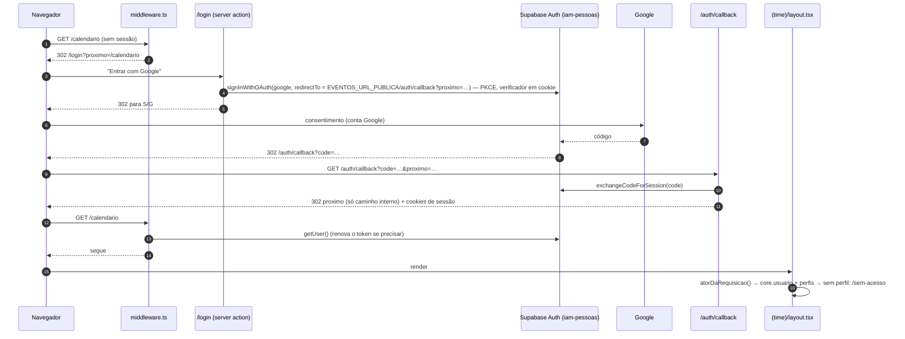
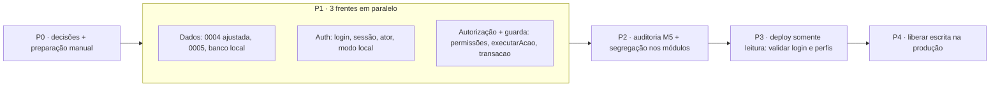

# Sistema Eventos — Login, autorização e pré-requisitos para publicar (v0.1, 29/10/2026)

Desenho técnico dos pré-requisitos do doc 07 §12 (revisão de segurança de 28/10: M4, M5, M6, M7, B2 e privacidade).
Não contém código de produção: os trechos de código são contratos e pseudocódigo.

- **Base:** doc 07 (fluxos, guarda de escrita, `registro_acao`, máquinas de estado) e ADR 0001 (um banco, `core` do GH,
  regras 6 e 7: um papel de banco por app e login único pelo mesmo Supabase Auth).
- **Referência de login:** GH-System (`src/middleware.ts`, `src/core/auth/*`, `src/core/authz/*`, `src/app/login`,
  `src/app/auth/callback`), que usa o mesmo projeto Supabase `iam-pessoas` e, portanto, os mesmos usuários.
- **Escopo:** só o time de eventos. Staff, SDC e financeiro continuam sem login nesta rodada.

**Sumário**

1. Resumo das decisões
2. Login do time (Supabase Auth com Google)
3. Ator, perfis e quem fica sem acesso
4. Autorização: permissões, matriz e segregação de funções
5. Guarda de escrita em produção
6. Papéis de banco com o mínimo de privilégio (M4)
7. Trilha de auditoria completa (M5)
8. `registro_acao` só de inclusão e as chaves estrangeiras (M6)
9. Privacidade
10. Plano em ondas, donos de arquivos e verificações
11. Ações manuais (Vitor e Lucas)
12. Riscos
13. Decisões pendentes

---

## 1. Resumo das decisões

| # | Decisão | Por quê |
|---|---|---|
| L1 | Login **só com Google** pelo Supabase Auth do `iam-pessoas` (fluxo OAuth com PKCE, `@supabase/ssr`). Sem senha no Eventos. | Decisão de produto (docs 01/04); mesmo login do IAM Control. |
| L2 | O **middleware só autentica** (renova a sessão e manda para `/login`). Quem decide acesso é o servidor: layout do `(time)`, `executarAcao` e o fluxo. | Middleware não é fronteira de segurança (falhas de bypass já existiram no Next); a checagem fica onde o dado é lido e gravado. |
| L3 | **Ator** = usuário do Supabase → `core.usuario` ativo (por e-mail verificado, como o GH) → perfis do Eventos em `core.usuario_perfil`. Lido do banco **a cada requisição** (cache só dentro da requisição). | Tirar um perfil vale na hora, sem esperar o token expirar. |
| L4 | Perfis novos em `core.perfil`: **`EVENTOS_TIME`** e **`EVENTOS_LIDER`** (líder = time + aprovar, reabrir, configurações). Escopo `GLOBAL` nesta rodada; escopo `POLO` é **recusado** até ser implementado. | O time é central e cuida de todos os polos. `core.usuario_perfil` tem PK `(usuario_id, perfil_id)`: um perfil só aceita um polo, o que não serve para quem cuida de vários. |
| L5 | Sem perfil do Eventos → `/sem-acesso` (logado, sem nenhum dado). Sem `core.usuario` ativo → sai da sessão e volta ao login com aviso. | Igual ao GH no segundo caso; no primeiro, a pessoa entende o que pedir. |
| L6 | **Modo local sem Supabase:** seletor "Entrar como" com 3 usuários semeados (time A, time B, líder), só com as três travas do banco local abertas. Mesmo `Ator`, mesma matriz, mesma segregação. | Testar segregação exige duas pessoas; login real no local misturaria identidades da produção com dados locais. O login real é testado no primeiro deploy, em modo somente leitura (§10, onda P3). |
| L7 | **Permissão obrigatória em toda server action** (`executarAcao(form, schema, PERMISSAO, trabalho)`; sem a permissão não compila). Regras de objeto e segregação ficam no `domain/` do módulo dono e rodam dentro da transação. | Uma checagem grossa que não dá para esquecer + a regra fina perto do dado travado. |
| L8 | **Guarda de escrita com dois modos:** `LOCAL` (as três travas de hoje, intactas) e `PRODUCAO` (quatro travas: `NODE_ENV=production` + `EVENTOS_ESCRITA=producao`; conexão de escrita no papel `app_eventos`; marcador `producao` no papel; ator de sessão com permissão). Fora disso, somente leitura. | A máquina de dev não tem a senha do `app_eventos` e roda `next dev`: não grava na produção nem com variáveis copiadas. |
| L9 | **Três papéis de banco:** `app_eventos` (escrita mínima), `app_eventos_leitura` (só `SELECT`, transação somente leitura por padrão), `app_eventos_copia` (só `SELECT` nas 8 tabelas copiadas). Nenhum acessa `sensivel`, `gh`, `auditoria`, `auth`. | M4. Ver §6. |
| L10 | **Toda ação de escrita grava `registro_acao`**, garantido por teste e por uma checagem na própria transação; dado pessoal nunca vai para `dados`/`comentario` gerado pelo sistema (só o nome do campo mudado). | M5 + privacidade: o registro é imutável. |
| L11 | `registro_acao`: **recomendação A — FKs `RESTRICT` e eliminação por pseudonimização** (nunca apagar pessoa/usuário/evento referenciados). Decisão do usuário (§8). | Mantém a autoria da trilha; o GH já não apaga pessoa nem usuário no código. |

Esta seção tem peso de ADR. Proposta: o gerente extrai L2, L6, L8, L9 e L11 para
`docs/adr/0003-login-autorizacao-e-papeis-de-banco.md` (Status: proposta) quando aprovar.

---

## 2. Login do time (Supabase Auth com Google)

### 2.1 Fluxo



### 2.2 Peças e onde ficam

| Peça | Arquivo | Regra |
|---|---|---|
| Cliente Supabase do servidor | `src/core/auth/supabase-servidor.ts` | `createServerClient` do `@supabase/ssr` com `cookies()` do Next (igual ao GH). Opções de cookie: `httpOnly: true`, `secure` fora do local, `sameSite: "lax"`, `path: "/"`. Não há cliente Supabase no navegador. |
| Middleware | `src/middleware.ts` | Renova a sessão (`auth.getUser()`) e redireciona para `/login` quem não tem sessão. `matcher` cobre tudo menos `/login`, `/auth/callback`, `/api/health`, `/_next/*`, `/images/*`, `favicon`. No modo local (`EVENTOS_MODO=local`) não fala com o Supabase e deixa passar (o layout aplica o seletor). Roda no runtime edge: não importa banco. |
| Página de login | `src/app/login/page.tsx` + `acoes.ts` | Um botão "Entrar com Google". `entrarComGoogle(form)` chama `signInWithOAuth({ provider: "google", options: { redirectTo, queryParams: { prompt: "select_account" } } })` e faz `redirect(data.url)`. Mensagens por código (`?erro=sem-cadastro`, `link-expirado`, `falhou`), nunca o texto do provedor. |
| Callback | `src/app/auth/callback/route.ts` | `exchangeCodeForSession(code)`; destino = `proximo` **validado** (só `^/(?![/\\])`, sem esquema; senão `/inicio`). `redirectTo` e o destino são montados com `EVENTOS_URL_PUBLICA`, nunca com o `Host` da requisição. |
| Sair | `src/app/(time)/_servidor/sessao.ts` → action `sair()` | `auth.signOut()` + `redirect("/login")`. Botão no cabeçalho do `painel.tsx`. |
| Sem acesso | `src/app/sem-acesso/page.tsx` | Fora do grupo `(time)` (sem menu e sem dados): "Sua conta (e-mail) não tem acesso ao Eventos. Peça à líder do time." + Sair. |
| Entrar como (só local) | `src/app/entrar-local/page.tsx` + `acoes.ts` | Lista os usuários semeados com perfil do Eventos; grava o cookie `eventos_ator_local` (id do usuário). `notFound()` quando `modoLocal()` é falso **ou** as três travas do banco local não estão abertas. |

O GH tem um defeito no callback: `next?.startsWith("/")` aceita `//site-externo` (redirecionamento aberto). O Eventos
não copia isso; handoff para o Lucas (§11).

### 2.3 Sessão

- Token de acesso do Supabase (JWT) com validade padrão de 1 hora e refresh token rotativo, guardados em cookies
  `httpOnly`. O middleware renova; páginas e actions só leem.
- **Validação:** `auth.getUser()` (consulta o Auth a cada requisição, como o GH). Se o projeto passar a usar chaves de
  assinatura assimétricas, trocar por `auth.getClaims()` (valida o JWT localmente) — decisão do Vitor, sem mudar o resto.
- **Revogação:** o ator é lido do banco a cada requisição (`cache()` do React só dentro dela). Tirar o perfil ou
  desativar o `core.usuario` corta o acesso no próximo clique, mesmo com token válido.
- **Server actions:** o Next confere `Origin` × `Host`. Atrás do proxy do Easypanel, configurar
  `experimental.serverActions.allowedOrigins` com o domínio público.
- Inatividade: o Supabase só oferece tempo máximo de sessão/inatividade em plano pago; sugestão de 12 h de sessão
  (decisão em §13).

### 2.4 Quem pode criar conta

O Supabase cria um `auth.users` novo quando alguém entra com Google pela primeira vez (cadastro aberto). Isso **não dá
acesso**: sem `core.usuario` ativo com o mesmo e-mail, o Eventos encerra a sessão (L5). Mesmo assim, recomendação: desligar
"Allow new users to sign up" no projeto (o GH cria usuários pela API admin, que continua funcionando com o cadastro
fechado) — decisão do Vitor com o Lucas, porque vale para os dois apps (§11). O cadastro do staff no primeiro acesso
(doc 04) fica para a rodada do portal do staff e reabre essa discussão.

---

## 3. Ator, perfis e quem fica sem acesso

### 3.1 Tabelas lidas (somente leitura, donas do GH)

Conferido no fixture `src/test/fixtures/gh-schema.sql`:

| Tabela | Colunas usadas |
|---|---|
| `core.usuario` | `id`, `email`, `nome_usuario`, `ativo`, `deleted_at` |
| `core.pessoa` | `id`, `usuario_id`, `nome_completo`, `nome_social` (para o nome no cabeçalho e para a segregação "não audita o próprio custo") |
| `core.usuario_perfil` | `usuario_id`, `perfil_id`, `escopo`, `escopo_ref` — PK `(usuario_id, perfil_id)` |
| `core.perfil` | `id`, `codigo` (unique), `nome` |

As definições Drizzle de `core.usuario_perfil` e `core.perfil` entram em `src/core/db/schema/core.ts` (somente
leitura, sem migration, ADR 0001 regra 3).

### 3.2 Resolução do ator

```ts
// src/core/auth/ator.ts (lê com o Executor de leitura)
type PerfilDoEventos = "EVENTOS_TIME" | "EVENTOS_LIDER";
type Ator = {
  usuarioId: string;            // core.usuario.id
  pessoaId: string | null;      // core.pessoa.id com usuario_id = usuarioId
  nome: string;                 // nome social ou completo; senão nome_usuario
  email: string;
  perfis: readonly PerfilDoEventos[];   // só os do Eventos, só escopo GLOBAL
  origem: "SESSAO" | "LOCAL";
};

resolverAtor(email, executor): Promise<{ situacao: "OK"; ator: Ator } | { situacao: "SEM_CADASTRO" } | { situacao: "SEM_PERFIL"; email: string }>
atorDaRequisicao(): Promise<Ator | null>    // cache() por requisição; sessão (produção) ou cookie local (modo local)
exigirAtor(): Promise<Ator>                 // usado pelo layout: redireciona para /login, /sem-acesso ou sai da sessão
```

Regras:
1. `email` vem do usuário do Supabase; só aceito se `email_confirmed_at` estiver preenchido (o Google confirma).
   Compara em minúsculas com `core.usuario.email`, `ativo = true` e `deleted_at IS NULL` (mesma regra do GH).
2. `SEM_CADASTRO` → `auth.signOut()` e `/login?erro=sem-cadastro` ("Sua conta Google não está cadastrada na IAM.").
3. Perfis: `usuario_perfil` × `perfil` com `codigo IN ('EVENTOS_TIME','EVENTOS_LIDER')`. Linha com `escopo <> 'GLOBAL'` é
   **ignorada** e registrada no log como aviso (fail-closed até existir escopo por polo). Perfis do GH (`CEO`,
   `COORD_EVENTOS`…) não dão acesso ao Eventos.
4. `SEM_PERFIL` → `/sem-acesso`. Nada de dado do Eventos é lido antes dessa decisão.
5. O GH ignora códigos de perfil que não conhece (`isPerfil`), então os perfis novos não mudam nada lá.

### 3.3 Modo local

- `banco:local` semeia três usuários em `core.usuario` + `core.pessoa` + `core.usuario_perfil` (e os dois perfis em
  `core.perfil`): **Time A (teste)** `EVENTOS_TIME` (é o `USUARIO_TESTE` de hoje, `7e570000-…-0001`), **Time B (teste)**
  `EVENTOS_TIME`, **Líder (teste)** `EVENTOS_LIDER`. Um deles é também staff (tem convocação e custo) para testar
  "não audita o próprio custo".
- `atorDaRequisicao()` no modo local lê o cookie `eventos_ator_local` e resolve o ator **no banco local** pelas mesmas
  regras (perfis inclusive). Cookie ausente ou inválido → `/entrar-local`.
- O cookie só é lido se `situacaoDaEscrita()` disser modo `LOCAL` com as três travas abertas. Em qualquer outro caso
  ele é ignorado (e apagado). `origem: "LOCAL"` nunca passa na guarda de produção (§5).
- O cabeçalho mostra "Versão local · Time A (teste) · trocar".

---

## 4. Autorização: permissões, matriz e segregação de funções

### 4.1 Três camadas

| Camada | Onde | O que decide |
|---|---|---|
| 1. Rota | `src/app/(time)/layout.tsx` → `exigirAtor()` | Logado e com perfil do Eventos. Itens do menu e botões usam `pode(ator, permissao)`. |
| 2. Ação | `src/app/(time)/_servidor/acao.ts` → `executarAcao(form, schema, permissao, trabalho)` | O ator tem a permissão. Roda **antes** de ler o formulário. Falha = "Você não tem permissão para esta ação." + log de aviso. |
| 3. Objeto | `src/modules/<dono>/domain/*` (puro), chamado pelo serviço dentro da transação, com a linha travada | Segregação de funções e estado do objeto. O fluxo passa `{ usuarioId, pessoaId }` (tipos simples: o `domain/` não importa `@/core`). |

Catálogo e matriz: `src/core/autorizacao/` (puro, sem banco), porque é usado pelo app (`_servidor`, layout, menu) e pelos
fluxos. Não conhece módulos; só nomes de permissão.

```ts
// src/core/autorizacao/permissoes.ts
type Permissao =
  | "evento.editar" | "escala.montar" | "escala.registrar_resposta" | "escala.aprovar" | "escala.reabrir"
  | "comunicacao.enviar" | "disponibilidade.gerir" | "disponibilidade.registrar_resposta" | "pessoas.editar"
  | "logistica.gerir" | "logistica.registrar_retorno_sdc" | "custos.registrar" | "custos.auditar"
  | "custos.reabrir_auditoria" | "config.locais" | "config.modelos_copy" | "config.link_custos"
  | "config.regras_vagas" | "config.regras_custo";
pode(ator: Pick<Ator, "perfis">, permissao: Permissao): boolean   // switch exaustivo por perfil
class AcessoNegadoError extends Error {}                            // traduzida por mensagemDoErro
```

A leitura de todas as telas vale para os dois perfis. Não há permissão só de leitura nesta rodada.

### 4.2 Matriz perfil × permissão

| Permissão | `EVENTOS_TIME` | `EVENTOS_LIDER` | Segregação / regra de objeto |
|---|:-:|:-:|---|
| `evento.editar` | ✓ | ✓ | escala fora de `AGUARDANDO_APROVACAO` (já existe) |
| `escala.montar` | ✓ | ✓ | — |
| `escala.registrar_resposta` | ✓ | ✓ | grava `registrado_por` (já existe) |
| `escala.aprovar` (aprovar e devolver) | — | ✓ | **SoD-1:** o aprovador não está entre os montadores do ciclo |
| `escala.reabrir` | — | ✓ | — |
| `comunicacao.enviar` | ✓ | ✓ | — |
| `disponibilidade.gerir` | ✓ | ✓ | — |
| `disponibilidade.registrar_resposta` | ✓ | ✓ | grava `registrado_por` (já existe) |
| `pessoas.editar` | ✓ | ✓ | — |
| `logistica.gerir` | ✓ | ✓ | — |
| `logistica.registrar_retorno_sdc` | ✓ | ✓ | grava `retorno_registrado_por` (já existe) |
| `custos.registrar` | ✓ | ✓ | grava `registrado_por` (já existe) |
| `custos.auditar` (aprovar e reprovar) | ✓ | ✓ | **SoD-2:** não registrou nem corrigiu a solicitação; **SoD-3:** não é a pessoa da solicitação |
| `custos.reabrir_auditoria` | — | ✓ | SoD-3 |
| `config.locais` | ✓ | ✓ | — |
| `config.modelos_copy` | ✓ | ✓ | — |
| `config.link_custos` | — | ✓ | muda todas as copys de escalação |
| `config.regras_vagas` | — | ✓ | — |
| `config.regras_custo` | — | ✓ | dinheiro |

### 4.3 Todas as server actions (13 arquivos, `rg -l "use server" src/app`)

| Arquivo | Action → permissão |
|---|---|
| `eventos/[eventoId]/acoes.ts` | `salvarDadosDoEvento` → `evento.editar` |
| `eventos/[eventoId]/escala/acoes.ts` | `confirmarVagas`, `alterarVagas`, `definirVagaDigitada`, `adicionarVagaManual`, `removerVagaManual`, `porNaVaga`, `tirarDaVaga`, `atualizarConvocacao`, `enviarParaAprovacao` → `escala.montar`; `registrarRespostaDoStaff` → `escala.registrar_resposta`; `aprovarEscala`, `devolverEscala` → `escala.aprovar`; `reabrirEscala` → `escala.reabrir` |
| `escalas/aprovacao/acoes.ts` | `aprovarEscala`, `devolverEscala` → `escala.aprovar` |
| `eventos/[eventoId]/comunicacao/acoes.ts` | `marcarCopyComoEnviada` → `comunicacao.enviar` |
| `disponibilidade/nova/acoes.ts` | `abrirEnqueteAcao` → `disponibilidade.gerir` |
| `disponibilidade/[enqueteId]/acoes.ts` | `encerrarEnqueteAcao`, `reabrirEnqueteAcao` → `disponibilidade.gerir`; `registrarRespostaAcao` → `disponibilidade.registrar_resposta` |
| `pessoas/[pessoaId]/acoes.ts` | `salvarPerfilAcao`, `definirFuncoesAcao`, `salvarVeiculoAcao`, `salvarCoordenadasAcao` → `pessoas.editar` |
| `logistica/acoes.ts` | `registrarPedidoDeVooAcao`, `alterarPedidoAcao`, `cancelarPedidoAcao`, `criarHospedagemAcao`, `alterarHospedagemAcao`, `registrarPedidoDeHospedagemAcao`, `adicionarQuartoAcao`, `removerQuartoAcao`, `porNoQuartoAcao`, `tirarDoQuartoAcao`, `aplicarRoomingSugeridoAcao`, `criarCaronaAcao`, `removerCaronaAcao`, `definirCaronaAcao`, `tirarDaCaronaAcao` → `logistica.gerir`; `registrarRetornoDeVooAcao`, `registrarRetornoDeHospedagemAcao` → `logistica.registrar_retorno_sdc` |
| `custos/acoes.ts` | `registrarSolicitacaoAcao`, `corrigirSolicitacaoAcao`, `calcularPreviaAcao` (não grava) → `custos.registrar`; `aprovarSolicitacaoAcao`, `reprovarSolicitacaoAcao` → `custos.auditar`; `reabrirAuditoriaAcao` → `custos.reabrir_auditoria` |
| `configuracoes/locais/acoes.ts` | `salvarLocalAcao`, `arquivarLocalAcao` → `config.locais` |
| `configuracoes/modelos-de-copy/acoes.ts` | `salvarModeloAcao`, `definirModeloAtivoAcao`, `previaDoModeloAcao` (não grava) → `config.modelos_copy`; `salvarLinkDeCustosAcao` → `config.link_custos` |
| `configuracoes/vagas/acoes.ts` | `salvarRegraDeVagas`, `recalcularVagasDoTipo` → `config.regras_vagas` |
| `configuracoes/regras-de-custo/acoes.ts` | `criarVigenciaDeRegraAcao`, `desativarRegraAcao` → `config.regras_custo` |

Actions que não gravam (`calcularPreviaAcao`, `previaDoModeloAcao`) continuam exigindo login e permissão (gastam CPU e
leem dados), mas não passam pela guarda de escrita. Action nova sem permissão não compila (parâmetro obrigatório) e um
teste lista os `acoes.ts` e confere que todo `export async function` chama `executarAcao`.

### 4.4 Segregação de funções (regras de objeto)

| Regra | Dono (domínio) | Como decide | Dados |
|---|---|---|---|
| **SoD-1** Quem montou ou enviou a escala não aprova nem devolve | `escala/domain/segregacao.ts` | `montadoresDoCiclo` = usuários com `registro_acao` de montagem no evento (`VAGA_*`, `VAGAS_*`, `CONVOCACAO` incluída/removida/atualizada, `ENVIADA_APROVACAO`, `DADOS_DO_EVENTO_ALTERADOS`) desde o início do ciclo (criação da escala ou última `REABERTA`) + `escala.confirmada_por` + `convocacao.criado_por` das convocações ativas. Aprovador ∈ montadores → `AcessoNegadoError("Quem montou esta escala não pode aprová-la. Peça a outra líder.")` | depende de M5 (§7) registrar toda mudança de vaga e convocação |
| **SoD-2** Quem registrou ou corrigiu a solicitação de custo não audita | `custos/domain/segregacao.ts` | auditor ≠ `solicitacao_custo.registrado_por` e ≠ autor de qualquer `registro_acao` `SOLICITACAO_REGISTRADA`/`SOLICITACAO_CORRIGIDA` da solicitação | já registrado |
| **SoD-3** Ninguém audita o próprio custo | `custos/domain/segregacao.ts` | `ator.pessoaId` ≠ `solicitacao_custo.pessoa_id` (aprovar, reprovar, reabrir) | `core.pessoa.usuario_id` |

- As regras rodam no serviço, depois de travar a linha (`FOR UPDATE`), na mesma transação que grava a decisão.
- Não adotado nesta rodada (registrado para avaliar): quem fez o pedido à SDC não registrar o retorno; quem está numa
  escala não montá-la.
- Consequência prática da SoD-1: **é preciso ter pelo menos duas pessoas com `EVENTOS_LIDER`, ou uma líder que não monta**
  (§13, pergunta do usuário). Sem exceção por configuração.

### 4.5 Escopo por polo

Não nesta rodada (L4). O `Ator` já carrega `perfis`; quando houver coordenação por polo: (1) decidir com o Lucas como
um usuário recebe vários polos (a PK de `usuario_perfil` não permite); (2) acrescentar `polos` ao `Ator`; (3) filtrar
listas e checar `evento.polo_id` na camada 3. Até lá, atribuição com `escopo <> 'GLOBAL'` não dá acesso.

---

## 5. Guarda de escrita em produção

### 5.1 Dois modos, decididos pela configuração

| | Modo `LOCAL` (igual a hoje) | Modo `PRODUCAO` (novo) | Nenhum dos dois |
|---|---|---|---|
| Quando | `EVENTOS_MODO=local` | `EVENTOS_MODO` ausente e `EVENTOS_ESCRITA=producao` | qualquer outro caso (inclui `npm run dev` com o `.env` de hoje) |
| Trava 1 | `NODE_ENV ≠ production` | `NODE_ENV = production` (o `next dev` nunca é) | — |
| Trava 2 | `DATABASE_URL` em loopback, sem `host`/`hostaddr`/`options` | escrita por uma conexão **própria** (`DATABASE_URL_ESCRITA`) e `current_user = 'app_eventos'` | — |
| Trava 3 | marcador `local` no **banco** (`pg_db_role_setting`, `setrole = 0`), servidor em loopback, porta conferida | marcador `producao` no **papel** `app_eventos` (`pg_db_role_setting`, `setrole` = oid do papel) e **nenhum** marcador `local` no banco | — |
| Trava 4 (ator) | ator `LOCAL` ou `SESSAO` com a permissão | ator `SESSAO` com a permissão; `LOCAL` recusado | — |
| Resultado | escrita liberada | escrita liberada | **somente leitura** |

Por que a máquina de dev continua protegida:
- `npm run dev` / `dev:local` rodam com `NODE_ENV=development` → trava 1 do modo `PRODUCAO` fecha.
- Mesmo com `next build && next start` e `EVENTOS_ESCRITA=producao` copiados, a escrita exige a senha do `app_eventos`,
  que só existe no Easypanel (o `.env` do Vitor tem a URL do `postgres`, usada para migrations e sincronização) → trava 2 fecha.
- O marcador `producao` só existe no papel do `iam-pessoas`; o banco local tem o marcador `local` no banco, e a guarda
  recusa quando acha os dois (trava 3).
- Toda escrita passa por `transacao(ator, trabalho)`: sem ator com permissão não há transação (trava 4).

### 5.2 Mudanças no código (contrato)

```ts
// src/core/ambiente
type ModoDeEscrita = "LOCAL" | "PRODUCAO";
type SituacaoDaEscrita = { liberada: true; modo: ModoDeEscrita } | { liberada: false; trava: TravaDeEscrita; motivo: string };
// TravaDeEscrita ganha: "MODO_PRODUCAO" | "PAPEL_DE_ESCRITA" | "MARCADOR_NO_PAPEL"

// src/fluxos/_base/banco.ts
bancoParaLeitura(): Promise<Db>                          // pool de DATABASE_URL (produção: app_eventos_leitura)
transacao<T>(ator: AtorDaEscrita, trabalho: (tx: Executor) => Promise<T>): Promise<T>
// AtorDaEscrita = Pick<Ator, "usuarioId" | "pessoaId" | "origem">; a permissão já foi conferida em executarAcao.
// No modo PRODUCAO: recusa origem LOCAL. Em qualquer modo: abre a transação no pool de escrita, confere as travas
// 2 e 3 na primeira vez (resultado guardado só quando passa) e faz `SET LOCAL statement_timeout = '15s'`.
```

- No modo `LOCAL` o pool de escrita é o mesmo da `DATABASE_URL` (como hoje); no `PRODUCAO`, um pool separado
  (`max` pequeno) da `DATABASE_URL_ESCRITA`.
- `situacaoDaEscrita()` (cabeçalho "somente leitura") passa a informar o modo.
- Testes sem banco: cada trava de cada modo fechando sozinha recusa; os dois marcadores juntos recusam; ator `LOCAL` no
  modo `PRODUCAO` recusa. Um teste de integração no banco local confere a trava 2 do modo `PRODUCAO` com o papel errado.

---

## 6. Papéis de banco com o mínimo de privilégio (M4)

### 6.1 Papéis

| Papel | Usado por | Pode |
|---|---|---|
| `app_eventos` | Next em produção, só pelo pool de escrita (`DATABASE_URL_ESCRITA`) | `USAGE` em `eventos` e `core`. Em `eventos`: `SELECT, INSERT, UPDATE` nas tabelas do app; `DELETE` **só** onde o código apaga (`convocacao`, `disponibilidade`, `deslocamento`, `custo_item`, `carona`, `quarto`, `quarto_ocupante`, `trecho_voo`, `pessoa_funcao`, `pessoa_veiculo`); `registro_acao`: só `SELECT, INSERT`; `USAGE` nas sequências; `EXECUTE` em `eventos.proximo_protocolo()` e `public.uuid_v7()`. Em `core`: `SELECT` **por coluna** só no que o app lê (`pessoa`: `id, usuario_id, nome_completo, nome_social, email, telefone, ativo, deleted_at`; `usuario`: `id, email, nome_usuario, ativo, deleted_at`; `polo`; `vinculo`: as colunas de polo/tipo/status; `perfil`; `usuario_perfil`). |
| `app_eventos_leitura` | Next (todas as páginas, `DATABASE_URL`) | Só `SELECT`, com as mesmas colunas de `core`. `ALTER ROLE … SET default_transaction_read_only = on` e `statement_timeout = '15s'`. |
| `app_eventos_copia` | `banco:local` (`ORIGEM_DATABASE_URL`) | Só `SELECT` nas 8 tabelas de `TABELAS_COPIADAS` (`core.polo` e 7 de `eventos`); `default_transaction_read_only = on`. |
| `postgres` (existente) | migrations (`db:migrate`) e, por enquanto, o worker | Dono das tabelas. Fica fora do app web. |

Nenhum dos três papéis novos: `sensivel`, `gh`, `auditoria`, `auth`, `storage`, `pgboss`, DDL (`CREATE`), `TRUNCATE`,
`REFERENCES`, `TRIGGER`. Todos `NOINHERIT`, `NOCREATEDB`, `NOCREATEROLE`.

O worker (sincronização de turmas, pg-boss) continua no papel atual nesta rodada; um `app_eventos_worker` (escrita em
`evento`, `local`, `escala`, dono do schema `pgboss`) fica registrado como próximo passo.

### 6.2 Como convive com o Supabase

- **RLS:** todas as tabelas de `eventos` e as de `core` usadas têm RLS ligada e nenhuma política. Papel que não é dono
  não vê linha nenhuma. Duas saídas: (a) `ALTER ROLE app_eventos[_leitura|_copia] BYPASSRLS` — só funciona se o papel
  `postgres` do Supabase puder conceder o atributo (conferir com `select rolbypassrls from pg_roles where rolname = 'postgres'`);
  (b) política explícita por papel (`CREATE POLICY … FOR ALL TO app_eventos USING (true) WITH CHECK (true)`; só `SELECT`
  para os outros dois). **Recomendação: (b)**, porque não depende de atributo especial e deixa a permissão visível no
  schema. Em `eventos` a migration do Eventos cria as políticas; em `core` as políticas de `SELECT` são do GH (PR do Lucas).
  `anon` e `authenticated` continuam sem acesso (0002).
- **Pooler:** o web usa o pooler em modo transação (porta 6543), usuário `app_eventos.<ref-do-projeto>` e
  `app_eventos_leitura.<ref-do-projeto>`; `max` de 3 a 5 por pool. O `node-postgres` não usa prepared statements com nome,
  então funciona no modo transação. As configurações do papel (`default_transaction_read_only`, `statement_timeout`) valem
  no Supavisor porque a conexão ao Postgres é feita com o próprio papel. O worker continua no modo sessão (5432).
- **Chaves do Supabase:** o Eventos usa só a URL e a chave pública (anon/publishable) para o Auth. **Sem `service_role`**
  (quem cria usuário é o GH).

### 6.3 O que é migration e o que é manual

| Item | Onde | Quem |
|---|---|---|
| `CREATE ROLE … NOLOGIN` se não existir (sem senha), `GRANT`s em `eventos`, políticas de RLS em `eventos`, configurações dos papéis (`default_transaction_read_only`, `statement_timeout`) | **migration `0005_papeis-do-app`** do Eventos (nova; depende só da 0004) | especialista de dados |
| `GRANT SELECT` por coluna em `core` e políticas de `SELECT` em `core` para os três papéis | migration do **GH-System** (dono de `core`) | Lucas |
| Perfis `EVENTOS_TIME` e `EVENTOS_LIDER` em `core.perfil` (e, se o Lucas quiser, a coluna `sistema` da ADR 0001 regra 7) | migration do GH-System | Lucas |
| `ALTER ROLE app_eventos LOGIN PASSWORD '…'` (e os outros dois); `ALTER ROLE app_eventos SET eventos.ambiente = 'producao'` | SQL manual no `iam-pessoas` | Vitor |
| Os mesmos papéis no banco local, com senha gerada em `.banco-local/`, e o app local conectando como `app_eventos` | `scripts/banco-local` | especialista de dados |

A 0005 vai separada da 0004 para dar para revisar e reverter os privilégios sem mexer nas tabelas. Mudanças de
`registro_acao` (§7 e §8) entram na **0004**, que ainda não foi aplicada na produção.

---

## 7. Trilha de auditoria completa (M5)

### 7.1 O que hoje não registra quem fez

Conferido nos repositórios (`registrarAcao` ausente em `eventos/repository/evento-repository.ts`,
`eventos/repository/local-repository.ts`, `pessoas/repository/perfil-repository.ts`, `escala/repository/vagas-repository.ts`)
e na lista da revisão:

| Action / fluxo | Entidade | Ação a registrar | `dados` (sem dado pessoal) |
|---|---|---|---|
| `salvarPerfilAcao` | `PESSOA` | `PERFIL_ALTERADO` | nomes dos campos mudados (`["sexo","camisetaTamanho"]`), nunca os valores |
| `salvarCoordenadasAcao` | `PESSOA` | `COORDENADAS_ALTERADAS` | `{}` (as coordenadas não entram) |
| `definirFuncoesAcao` | `PESSOA` | `FUNCOES_DEFINIDAS` | códigos e níveis das funções (de/para) |
| `salvarVeiculoAcao` / remover | `PESSOA` | `VEICULO_SALVO` / `VEICULO_REMOVIDO` | só os nomes dos campos mudados (decisão de 29/10: o registro é imutável, então valores não entram) |
| `salvarLocalAcao` | `LOCAL` | `LOCAL_CRIADO` / `LOCAL_ALTERADO` | campos mudados com valores (não é dado pessoal) |
| `arquivarLocalAcao` | `LOCAL` | `LOCAL_ARQUIVADO` | — |
| `encerrarEnqueteAcao` / `reabrirEnqueteAcao` / alterar | `ENQUETE` | `ENQUETE_ENCERRADA` / `ENQUETE_REABERTA` / `ENQUETE_ALTERADA` | `fecha_em` de/para |
| `abrirEnqueteAcao` (se ainda não registra) | `ENQUETE` | `ENQUETE_ABERTA` | ids dos eventos |
| `salvarDadosDoEvento` | `EVENTO` | `DADOS_DO_EVENTO_ALTERADOS` | expectativa, fila e local de/para |
| `alterarVagas`, `confirmarVagas`, `definirVagaDigitada` | `VAGA` | `VAGAS_ALTERADAS` / `VAGAS_CONFIRMADAS` / `VAGA_DIGITADA` | função, quantidade de/para |
| `adicionarVagaManual` / `removerVagaManual` | `VAGA` | `VAGA_MANUAL_ADICIONADA` / `VAGA_MANUAL_REMOVIDA` | função, quantidade |
| `atualizarConvocacao` | `CONVOCACAO` | `CONVOCACAO_ATUALIZADA` | nomes dos campos (`deslocamento`, `montagem`, `observacao`); valor só do `deslocamento` |
| `recalcularVagasDoTipo` e o recálculo dentro de `salvarDadosDoEvento` | `VAGA` | `VAGAS_RECALCULADAS` (uma linha por evento) | o plano (inserir/atualizar/remover) |
| Recálculo pela sincronização (worker) | `VAGA` | `VAGAS_RECALCULADAS` com `origem = 'SISTEMA'` | o plano |

Mudanças no `registro_acao` (na 0004):
- `registro_acao_entidade_check` ganha `PESSOA`, `LOCAL`, `ENQUETE`, `EVENTO`, `VAGA`.
- Coluna `origem text NOT NULL DEFAULT 'USUARIO' CHECK (origem IN ('USUARIO','SISTEMA'))` e
  `CHECK ((origem = 'USUARIO') = (usuario_id IS NOT NULL))`: só a sincronização grava sem usuário.

### 7.2 Como garantir que nada fica sem registro

- `registrarAcao` marca a transação (contador guardado por transação, num `WeakMap` do `tx`); `transacao(ator, …)` confere
  antes do commit que houve **pelo menos um** registro e, se não houve, desfaz e lança erro de programação. Assim uma action
  nova que esquece o registro falha no primeiro teste.
- Teste de integração por action (tabela de casos): executa e confere a linha em `registro_acao` com `usuario_id` do ator.
- Login e acesso negado **não** vão para `registro_acao` (é trilha de negócio): vão para o log (pino) com `usuarioId`, sem
  e-mail. Logins ficam também no log de auditoria do próprio Supabase Auth.

---

## 8. `registro_acao` só de inclusão e as chaves estrangeiras (M6)

**Problema:** `evento_id`, `em_nome_de_pessoa_id` e `usuario_id` têm FK `ON DELETE SET NULL`. Apagar o evento, a pessoa
ou o usuário referenciado faz o Postgres tentar um `UPDATE` em `registro_acao`, o trigger de só-inclusão recusa e o
`DELETE` original falha com um erro confuso — inclusive quando é o GH ou alguém no painel do Supabase apagando uma
`core.pessoa` ou um `core.usuario`.

Hoje o GH **não apaga** pessoa nem usuário no código (usa `deleted_at`), e o Eventos também só arquiva eventos. Mesmo
assim, `solicitacao_custo.pessoa_id` já é `RESTRICT`: pessoa com custo já não pode ser apagada.

| Opção | Como | Prós | Contras | Impacto no GH |
|---|---|---|---|---|
| **A. Pseudonimizar e nunca apagar** (recomendada) | FKs passam a `ON DELETE RESTRICT`; o trigger continua recusando tudo. Eliminação de pessoa = pseudonimização em `core.pessoa`/`core.usuario` (nome → "Pessoa removida", e-mail e telefone nulos, `deleted_at`) + apagar os dados só do Eventos (`pessoa_evento`, `pessoa_funcao`, `pessoa_veiculo`). | Trilha íntegra: autoria nunca se perde (não repúdio). Trigger simples. Erro claro (violação de FK) em vez de erro do trigger. A LGPD aceita anonimização como alternativa à eliminação. | Ninguém apaga de verdade uma pessoa/usuário que aparece na trilha. Exige um procedimento de pseudonimização no GH. | Apagar (hard delete) `core.pessoa`/`core.usuario` referenciado passa a falhar com FK; o GH precisa oferecer "anonimizar pessoa" como caminho de eliminação. Nenhum código atual do GH quebra. |
| B. Trigger aceita só anular as FKs | O trigger deixa passar `UPDATE` em que só `evento_id`/`em_nome_de_pessoa_id`/`usuario_id` mudam de valor para `NULL` e o resto é idêntico. O `app_eventos` não tem `UPDATE` (só a ação da FK, que roda como dono, consegue). | O GH continua apagando livremente. | A trilha perde quem fez (o registro diz "alguém aprovou"). Trigger mais complexo. Remove a prova justamente quando há conflito. | Nenhum. |
| C. Sem FK, referência lógica | `usuario_id`, `em_nome_de_pessoa_id`, `evento_id` viram `uuid` sem FK (opcional: guardar o nome no momento do registro). | Nada bloqueia; registro imutável. | Ids órfãos; sem integridade na inclusão. Guardar o nome mantém dado pessoal na trilha depois da eliminação (conflita com a LGPD). | Nenhum. |

**Recomendação: A**, com o compromisso: retenção definida para `registro_acao` (§9) e expurgo por procedimento controlado
(o dono desliga o trigger numa transação de manutenção, apaga o que passou da retenção e religa; registrado em ata).
**Decisão do usuário**, combinada com o Lucas (afeta o caminho de eliminação do GH). Com A, `usuario_id` também deixa de
precisar ser anulável para ações de usuário (ver `origem` em §7.1).

---

## 9. Privacidade

### 9.1 O que o código garante

| Dado | Regra no código |
|---|---|
| Coordenadas de casa (`pessoa_evento.lat/lng`) | Só aparecem no formulário de Pessoas; as outras telas mostram km. Nunca em URL, log, `registro_acao`, copy ou mapa externo (embutir mapa do Google com a coordenada só depois de decidir, §9.2). Cálculo de distância no servidor. |
| Sexo | Usado só para quarto e `{{genero:…}}`; pode ficar vazio. Não aparece em listas que não precisam dele. |
| Telefone e e-mail | Lidos com `GRANT` por coluna; só na ficha da pessoa. Já estão na lista de mascaramento do log. |
| Logs (pino) | Acrescentar `lat`, `lng`, `sexo`, `nomeCompleto`, `nomeSocial`, `observacao`, `comentario`, `motivo` à lista de `redact.ts`. Erro de banco sem parâmetros (já feito, M3). Log de acesso só com `usuarioId`. |
| `registro_acao` | `dados` com nome de campo, não valor, quando o valor é pessoal (§7.1). Comentário livre só onde o usuário digita (devolução, motivo). |
| Dado sensível do GH | O Eventos não lê `sensivel` (sem grant, §6). CPF/PIX/endereço continuam fora. |
| Sessão | Cookies `httpOnly`; nenhum cliente Supabase no navegador; páginas só mandam ao navegador o que a tela mostra. |
| Banco local (B2) | `initdb` com `--auth=scram-sha-256` e senha gerada em `.banco-local/` (fora do Git, já no `.gitignore`), `listen_addresses = '127.0.0.1'`. A cópia da produção traz só as 8 tabelas sem dado pessoal (`core.polo` + `eventos`); as pessoas são fictícias. Entra em `scripts/banco-local`. |
| Direitos do titular | Procedimento (runbook) de eliminação da opção A (§8) e de "o que o Eventos guarda sobre a pessoa" (consulta por `pessoa_id`), a ser escrito quando a decisão de §8 sair. |

### 9.2 O que é decisão ou documento do usuário

- **Base legal e finalidade** de cada dado do staff no Eventos: coordenadas de casa (distância e carona), sexo (quarto e
  copy), telefone, histórico de escalas, custos (proposta: execução do contrato de prestação de serviço e legítimo
  interesse para a logística; validar com o jurídico).
- **Retenção:** `registro_acao`, `mensagem` (texto da copy tem nome, hotel e voo), `pedido_sdc`/`trecho_voo` (localizador),
  `solicitacao_custo` (prazo fiscal), `disponibilidade`. Sugestão para discutir: custos e pedidos 5 anos; mensagens 1 ano
  depois do evento; registro 5 anos.
- **RIPD** (relatório de impacto): recomendado pela geolocalização da casa do staff.
- **Aviso de privacidade** para o staff (o que o Eventos guarda e por quê) e **contrato com a SDC** como operadora
  (nome e documento para emissão).
- Uso futuro do **Google Maps** (geocodificação e rotas enviam endereço ao Google): incluir no aviso e no RIPD.

---

## 10. Plano em ondas, donos de arquivos e verificações

### 10.1 Ondas



**P0 — decisões e preparação (antes de codar).** O usuário decide §8 (M6), SoD-1 (quem são as líderes) e as perguntas
de §13. O Vitor e o Lucas fazem os itens de §11 que não dependem de código (provedor Google, URLs, PR de perfis).

**P1 — três frentes em paralelo.**

| Frente | O quê | Pastas e arquivos (dono exclusivo) |
|---|---|---|
| Dados (especialista de dados) | 0004: entidades novas, `origem`, FKs conforme §8; 0005: papéis, grants, políticas; banco local com scram, 127.0.0.1, papéis e os 3 usuários com perfis; definições de leitura de `core.perfil`/`core.usuario_perfil` | `src/core/db/migrations/**`, `src/core/db/schema/**`, `scripts/banco-local/**`, `src/test/banco.ts`, `src/test/fixtures/**` |
| Auth (dev 1) | `@supabase/ssr`; cliente do servidor; `resolverAtor`/`atorDaRequisicao`/`exigirAtor`; middleware; `/login`, `/auth/callback`, `/sem-acesso`, `/entrar-local`; sair; layout do `(time)` e cabeçalho do painel com nome + sair; variáveis novas | `src/core/auth/**` (novo), `src/middleware.ts`, `src/app/login/**`, `src/app/auth/**`, `src/app/sem-acesso/**`, `src/app/entrar-local/**`, `src/app/(time)/layout.tsx`, `src/app/(time)/_componentes/painel.tsx`, `src/app/(time)/_servidor/usuario-atual.ts` e `sessao.ts`, `src/core/config/**`, `package.json`, `package-lock.json`, `next.config.ts` |
| Autorização + guarda (dev 2) | `src/core/autorizacao` (catálogo, matriz, `pode`, testes da matriz); `executarAcao` com permissão; os 13 `acoes.ts` com a permissão de §4.3; guarda de dois modos e `transacao(ator, …)` com a checagem de registro (§7.2); menu e botões das telas de aprovação, auditoria e configurações escondidos sem permissão | `src/core/autorizacao/**` (novo), `src/core/ambiente/**`, `src/fluxos/_base/**`, `src/app/(time)/_servidor/acao.ts`, todos os `src/app/(time)/**/acoes.ts`, `src/core/db/registro-acao.ts`, `src/core/db/database.ts` |

Contrato fixado para as frentes não se esperarem: `Ator` (§3.2), `Permissao`/`pode` (§4.1), `transacao(ator, trabalho)` e
`SituacaoDaEscrita` com `modo` (§5.2). A frente Autorização publica primeiro a assinatura de `transacao` com um
adaptador temporário (`usuarioId` string ainda aceito) para os fluxos continuarem compilando até a P2.

**P2 — auditoria e segregação (uma frente, dev 3; dev 1 e 2 revisam).** Registros de §7.1 nos repositórios;
`escala/domain/segregacao.ts` e `custos/domain/segregacao.ts` com testes; serviços de aprovar/devolver/auditar/reabrir
recebendo `{ usuarioId, pessoaId }`; todos os fluxos trocam para `transacao(ator, …)` e o adaptador temporário sai;
mascaramento de log (§9.1). Pastas: `src/modules/**`, `src/fluxos/<aba>/**` (menos `_base`), `src/core/logging/redact.ts`.

**P3 — primeiro deploy em modo somente leitura.** Easypanel com `DATABASE_URL` = `app_eventos_leitura`, **sem**
`EVENTOS_ESCRITA` e sem `DATABASE_URL_ESCRITA`. Verificar: login com Google, `/sem-acesso` para quem não tem perfil,
`/login?erro=sem-cadastro` para quem não tem `core.usuario`, telas abrindo, faixa "somente leitura".

**P4 — liberar escrita.** Vitor dá `LOGIN` ao `app_eventos`, grava o marcador `producao`, coloca
`DATABASE_URL_ESCRITA` e `EVENTOS_ESCRITA=producao`. Teste de fumaça num evento de teste (montar, enviar, aprovar com outra
líder, registrar e auditar um custo) e conferência do `registro_acao`. Revisão de segurança antes de abrir ao time.

### 10.2 Arquivos compartilhados e dono por onda

| Arquivo | P1 | P2 |
|---|---|---|
| `src/app/(time)/_componentes/painel.tsx`, `src/app/(time)/layout.tsx` | Auth | congelado |
| `src/app/(time)/_servidor/acao.ts` | Autorização | congelado |
| `src/app/(time)/_servidor/usuario-atual.ts`, `sessao.ts` | Auth | congelado |
| `src/app/(time)/**/acoes.ts` (13) | Autorização | congelado (P2 só muda o que os fluxos recebem, não as actions) |
| `src/fluxos/_base/**` | Autorização | congelado |
| `src/fluxos/<aba>/**` | congelado (o adaptador mantém compilando) | Auditoria |
| `src/modules/**` (inclusive `index.ts`) | congelado | Auditoria |
| `src/core/ambiente/**`, `src/core/db/registro-acao.ts`, `src/core/db/database.ts` | Autorização | congelado |
| `src/core/config/**`, `package.json`, `package-lock.json`, `next.config.ts`, `src/middleware.ts` | Auth | congelado |
| `src/core/logging/redact.ts` | congelado | Auditoria |
| `src/core/db/migrations/**`, `src/core/db/schema/**`, `scripts/banco-local/**`, `src/test/**` (base e fixtures) | Dados | Dados (a pedido) |
| `eslint.config.js` | Autorização (se precisar liberar `src/core/autorizacao` para o app) | congelado |

### 10.3 Verificações (pronto quando)

- `npm run lint`, `typecheck`, `test` verdes; testes de integração no banco local verdes **conectando como `app_eventos`**
  (prova que os grants bastam e que não há acesso a `sensivel`/`gh`: um teste tenta `select` em `sensivel` e espera erro de
  permissão).
- Matriz: teste de tabela perfil × permissão (§4.2) e teste que confere que toda action exportada chama `executarAcao`.
- Segregação: integração — Time A monta e envia, Time A tenta aprovar (recusa), Líder aprova (passa); Time A registra
  custo e tenta auditar (recusa); a pessoa-staff tenta auditar o próprio custo (recusa).
- Guarda: testes de §5.2; `npm run dev` com o `.env` de hoje mostra "somente leitura" e nenhuma action grava.
- Auditoria: toda action de escrita gera `registro_acao` com o `usuario_id` do ator (teste de §7.2).
- `registro_acao`: tentar apagar `core.pessoa` referenciada no banco local dá erro de FK (opção A) e `UPDATE`/`DELETE` em
  `registro_acao` pelo `app_eventos` dá erro de permissão.
- Login (manual, na P3): os três casos de §3.2 e o redirecionamento aberto recusado (`/auth/callback?proximo=//exemplo.com`).

---

## 11. Ações manuais

> **29/10: o Vitor assumiu de ponta a ponta**, inclusive o que estava com o Lucas (GH-System). A ordem a seguir
> substitui as duas listas abaixo, que ficam como referência. O Lucas só precisa ficar ciente (ver o passo 15).

### 11.0 Roteiro único (Vitor)

**A. Preparar o GH-System** (repositório `/Users/vitorguedes/IAM/GH-System`, migrations do schema `core`)
1. Migration no GH com os perfis `EVENTOS_TIME` e `EVENTOS_LIDER` em `core.perfil` (ver o formato real dos perfis
   existentes no GH) e, se quiser, listar esses perfis no admin de usuários do GH.
2. Migration no GH com o conteúdo de `docs/gh-proposta-papeis-do-eventos.sql` deste repositório (grants por coluna e
   políticas de `SELECT` em `core` para os papéis do Eventos). **Só depois** da 0004 e da 0005 do Eventos (passo 6),
   porque a política de `core.pessoa` lê `eventos.pessoa_evento` e `eventos.registro_acao`.
3. "Anonimizar pessoa" no GH no lugar de apagar (decisão M6, opção A): o histórico do Eventos recusa apagar pessoa,
   usuário ou evento citados nele.
4. Corrigir o redirecionamento aberto do callback de login do GH (`src/app/auth/callback/route.ts`): `//site-externo`
   passa no `startsWith("/")`. Usar o mesmo critério de `src/core/auth/destino.ts` do Eventos.

**B. Login no Supabase `iam-pessoas`**
5. Google Cloud: cliente OAuth "Aplicativo da Web" com a URI `https://<ref>.supabase.co/auth/v1/callback`; Supabase ›
   Authentication › Providers › Google: ligar e colar ID e segredo; URL Configuration: incluir
   `https://<dominio-do-eventos>/auth/callback` nas Redirect URLs (sem curinga). Decidir "Allow new users to sign up"
   (§2.4) — vale também para o GH.

**C. Banco de produção** (nesta ordem; fazer um backup antes)
6. Aplicar as migrations 0004 e 0005 do Eventos (`npm run db:migrate` exige `EVENTOS_CONFIRMO_MIGRAR_REMOTO=sim`).
   A 0004 troca CHECKs em `evento` e `convocacao` (o GH lê essas tabelas: conferir o GH depois).
7. Aplicar as migrations do GH dos passos 1 e 2.
8. Papéis: `ALTER ROLE app_eventos LOGIN PASSWORD '…'`, idem `app_eventos_leitura` e `app_eventos_copia`; e
   `ALTER ROLE app_eventos SET eventos.ambiente = 'producao'`. Senhas fortes, guardadas só no Easypanel (a da cópia no
   `.env` local como `ORIGEM_DATABASE_URL`).
9. Atribuir os perfis às pessoas reais (`core.usuario_perfil`, escopo `GLOBAL`): a Patricia com `EVENTOS_LIDER`; o
   restante do time com `EVENTOS_TIME`. Conferir que o e-mail do Google de cada uma é o mesmo de `core.usuario.email`.
10. Só depois que o código desta branch estiver no ar: incluir `{"funcao":"STAFF","digitado":true}` na regra de vagas
    do Confronto (pela tela Configurações › Vagas ou migration de dados).

**D. Deploy somente leitura (P3)**
11. Easypanel (web): `NEXT_PUBLIC_SUPABASE_URL`, `NEXT_PUBLIC_SUPABASE_ANON_KEY`, `EVENTOS_URL_PUBLICA` (também como
    argumento de build), `DATABASE_URL` (pooler 6543, `app_eventos_leitura`). Nunca `EVENTOS_MODO` nem a
    `service_role`. Worker: segue com a URL atual até existir o papel próprio (R7).
12. Conferir no ar: login com Google entrando; pessoa sem perfil indo para `/sem-acesso`; cabeçalhos com `curl -I`;
    `SHOW default_transaction_read_only` = `on` pelo pooler; refazer a prova RSC do C1 contra o domínio real.

**E. Liberar escrita (P4)**
13. Validar a privacidade com quem cuida de LGPD na IAM (rascunho na §9.2).
14. Easypanel: `DATABASE_URL_ESCRITA` (pooler 6543, `app_eventos`) e `EVENTOS_ESCRITA=producao`; teste de fumaça num
    evento de teste (montar, enviar, aprovar, comunicar, auditar um custo) e conferir o `registro_acao`.

**F. Avisar**
15. Avisar o Lucas do que mudou no banco compartilhado: os CHECKs novos de `status_escala` e `convocacao.status`, os
    perfis `EVENTOS_*`, as políticas em `core`, o RESTRICT do histórico (apagar pessoa vira anonimizar) e o callback
    corrigido.

### 11.1 Listas originais (referência)

**Vitor (Supabase `iam-pessoas` e Easypanel):**
1. Google Cloud: cliente OAuth "Aplicativo da Web" com a URI de redirecionamento
   `https://<ref>.supabase.co/auth/v1/callback` (se ainda não existir, ADR 0001 passo 3).
2. Supabase › Authentication › Providers › Google: ligar e colar ID/segredo do cliente.
3. Supabase › Authentication › URL Configuration: incluir `https://<dominio-do-eventos>/auth/callback` nas Redirect URLs
   (sem curinga).
4. Decidir com o Lucas "Allow new users to sign up" (§2.4).
5. Depois da 0005: `ALTER ROLE app_eventos LOGIN PASSWORD '…'`, idem `app_eventos_leitura` e `app_eventos_copia`; e
   `ALTER ROLE app_eventos SET eventos.ambiente = 'producao'`. Senhas fortes, guardadas só no Easypanel (e a da cópia no
   `.env` local como `ORIGEM_DATABASE_URL`).
6. Conferir se o `postgres` pode conceder `BYPASSRLS` (só para registro; a recomendação é a política, §6.2).
7. Easypanel (web): `NEXT_PUBLIC_SUPABASE_URL`, `NEXT_PUBLIC_SUPABASE_ANON_KEY` (chave pública), `EVENTOS_URL_PUBLICA`,
   `DATABASE_URL` (pooler 6543, `app_eventos_leitura`); na P4, `DATABASE_URL_ESCRITA` (pooler 6543, `app_eventos`) e
   `EVENTOS_ESCRITA=producao`. Nunca `EVENTOS_MODO` nem `SUPABASE_SERVICE_ROLE_KEY`.
8. Atribuir os perfis às pessoas reais do time (`core.usuario_perfil`, escopo `GLOBAL`) — pelo admin do GH ou SQL — depois
   do PR do Lucas.

**Lucas (GH-System):**
1. Migration com os perfis `EVENTOS_TIME` e `EVENTOS_LIDER` em `core.perfil` (e, se quiser, a coluna `sistema` da ADR 0001
   regra 7). Avaliar se o admin de usuários do GH passa a listar esses perfis.
2. Migration com `GRANT SELECT` por coluna e políticas de `SELECT` em `core.pessoa`, `core.usuario`, `core.polo`,
   `core.vinculo`, `core.perfil`, `core.usuario_perfil` para `app_eventos`, `app_eventos_leitura` (e `core.polo` para
   `app_eventos_copia`).
3. Combinar a decisão de §8: com a opção A, o GH oferece "anonimizar pessoa" em vez de apagar.
4. Corrigir o redirecionamento aberto em `src/app/auth/callback/route.ts` do GH (`//` passa no `startsWith("/")`).
5. Ciência do `convocacao_status_check` e dos valores novos de `status_escala` (já pendente no doc 07 §11.1).

---

## 12. Riscos

| # | Risco | Mitigação |
|---|---|---|
| R1 | Segregação travar a operação se só a Patricia for líder e ela também montar | Decisão do usuário (§13): duas líderes ou a líder não monta; sem exceção configurável |
| R2 | Supabase com cadastro aberto cria contas Google à toa | Não dão acesso (L5); fechar o cadastro (§2.4) |
| R3 | Políticas de RLS em `core` dependem de PR no GH | P3 não sobe sem elas; teste de integração no local com `app_eventos` antecipa a falta |
| R4 | Pooler em modo transação × configurações de sessão | O app não usa `SET` de sessão; `SET LOCAL` só dentro da transação; papéis configurados por `ALTER ROLE` |
| R5 | Opção A de §8 bloqueia hard delete de pessoa no banco compartilhado | Hoje ninguém apaga no código; procedimento de pseudonimização no GH antes do primeiro pedido de eliminação |
| R6 | Esquecer a permissão numa action nova | Parâmetro obrigatório + teste que varre os `acoes.ts` |
| R7 | O worker continua com o papel `postgres` | Registrado; `app_eventos_worker` na próxima rodada |
| R8 | E-mail do Google diferente do `core.usuario.email` (ex.: apelido, outro domínio) | Mensagem `sem-cadastro` clara; o RH/GH corrige o e-mail no cadastro |

---

## 13. Decisões pendentes

**Do usuário (Vitor/Patricia):**
1. **M6:** opção A (pseudonimizar e nunca apagar), B (anular a autoria) ou C (sem FK)? (Recomendação: A, combinada com o Lucas.)
2. **SoD-1:** quem terá `EVENTOS_LIDER`? É preciso duas líderes, ou uma líder que não monta escala. (Hipótese: Patricia + mais uma pessoa.)
3. **Auditoria de custos:** todo o time audita (com SoD-2 e SoD-3) ou só a líder? (Hipótese: todo o time.)
4. **Retenção** de `registro_acao`, `mensagem`, `pedido_sdc` e custos, e **base legal** das coordenadas e do sexo; fazer o **RIPD**? (Sugestão em §9.2.)
5. **Restringir o login a um domínio Google** (ex.: só contas da IAM)? (Hipótese: não; vale o cadastro em `core.usuario`.)
6. **Duração da sessão** (hipótese: padrão do Supabase, 1 h de token com renovação; sair manual).

**Do gerente:**
7. Aceitar a P3 (deploy somente leitura) como etapa obrigatória antes de liberar escrita.
8. Confirmar que `calcularPreviaAcao` e `previaDoModeloAcao` (não gravam) continuam como server actions com permissão, em vez de virar leitura de página.
9. Extrair L2, L6, L8, L9 e L11 para a ADR 0003.


### 13.1 Decisões tomadas em 29/10

| Tema | Decisão |
|---|---|
| M6 — histórico × apagar | **Opção A**: chaves do `registro_acao` em `RESTRICT`; pedido de exclusão de pessoa vira pseudonimização. Combinar o procedimento com o Lucas (GH). |
| Líder | Só a Patricia terá `EVENTOS_LIDER` e **pode aprovar o que ela mesma montou**: a SoD-1 (escala) sai. O registro de quem montou e quem aprovou continua no histórico. |
| Auditoria de custos | Qualquer pessoa do time audita; SoD-2 (quem registrou não audita) e SoD-3 (ninguém audita o próprio custo) continuam. |
| Domínio do Google | Qualquer conta Google; só entra quem tiver `core.usuario` ativo e perfil do Eventos. |
| Privacidade | Usar a sugestão da §9.2 como rascunho; validar com quem cuida de LGPD na IAM antes de abrir ao time. |
| P3 (deploy somente leitura) | Obrigatória antes de liberar escrita. |
| Ações de prévia (`calcularPreviaAcao`, `previaDoModeloAcao`) | Continuam server actions, exigindo sessão e permissão de leitura do time. |
| ADR | Extrair L2, L6, L8, L9 e L11 para `docs/adr/0003-login-autorizacao-e-papeis-de-banco.md`. |
| Textos livres no histórico | Só textos escritos pelo time ficam no `registro_acao` (comentário de devolução, motivo de reabrir a escala, motivo de reprovação e parecer de custo). Textos do staff ou da SDC (motivo de recusa, localizador, reserva, motivo de alterar/cancelar pedido) ficam só na tabela de origem, com um indicador no registro. |
| Proteção das páginas (C1) | `exigirAtor()` em toda página, layout e `generateMetadata` sob `(time)`, com teste de varredura. Leitura que exige ator dentro dos fluxos fica como dívida. |
